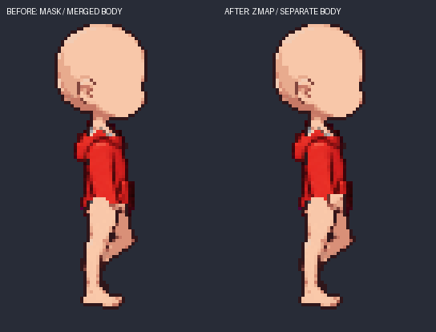

# 몸 레이어와 원본 편집을 기준으로 하는 제작

> Owns: authored body 분리, zmap 기본 빌드, 원본 수정 후보, 레이어 생성 가이드 · Index: [docs/README.md](../README.md)

## 실제 빌드의 기본값

production 설정의 `visibility` 기본값은 `zmap`이다. `parts-part-build`는 선택 후보의 원본 `part.png`를 가져와 조각을 분리하고 공통 모션의 zmap 순서로 렌더한다. `occluded`에서 만든 `render_part.png`는 기본 빌드에서 사용하지 않는다. 검수 화면의 **실제 빌드**, 공통 런타임, 독립 레이어 export가 같은 pack을 사용한다.

Mina 데모의 body는 head / torso / waist / arm_back / hand_back / arm_front / hand_front / leg_back / leg_front / 빈 root로 분리했다. 상의는 sleeve_back / torso / sleeve_front다. 소매는 해당 팔·손 영역을 함께 소유하고, body 손이 나중에 그려져 겹친 소매를 덮는다. 앞 팔·앞 소매·앞 손이 몸통보다 앞에 온다. 머리는 몸통 위, 눈·헤어보다 아래에 온다. 이것은 런타임 순서이며 비교용 임시 합성만을 위한 변경이 아니다.

특정 디자인에 알파 절단이 필요한 경우만 `visibility: "mask"`로 지정한다. 화면의 **겹침 처리 → 지정 마스크 + zmap → 처리 방식 적용**은 설정·검사·실제 빌드를 함께 갱신하고 이전 시각 판정을 초기화한다. required/protected/allowed 검사 지도와 body 픽셀 소유권 라벨은 렌더 마스크와 다른 입력이다.

zmap 검사는 생성 원본의 소유권과 실제 resolver 순서를 사용한다. 나중에 그리는 body 픽셀이 덮는 부분은 접합 검사에서 제외하되, 파츠가 누락됐다는 이유로 required 영역을 제외하지 않는다. 잔조각·작은 구멍은 원본에서도 검사한다. 디자인·손목 경계의 적합성을 자동 승인하지 않는다.

## 몸을 다시 그리지 않는 분리

```bash
sprite-gen parts-body-refine --assembly library/assembly.json \
  --topology topology.proposed.json --labels authored-labels \
  --colors body-colors.json --body-id sd.mina.body --out library/inputs/body-refined
```

라벨은 `<pose>.png`, 원본 캔버스 크기의 명시적 픽셀 소유권이다. 각 원본의 불투명 픽셀을 정확히 한 색으로 덮고 라벨 알파는 255여야 한다. 색은 topology node와 일치해야 한다. 몸 레이어를 다시 합쳤을 때 RGBA 변경이나 중복 픽셀이 있으면 거부한다. 원본 PNG·시간·포즈·socket은 유지하지만, head node 추가에 따른 topology → rig → motion → pack → catalog **메타데이터 digest는 바뀐다**. 이전 문서·생성 입력·후보는 불변 경로에 보존한다. 현재 후보는 원본 ancestry를 기록해 새 motion metadata에 연결한다.

기존 topology ID와 활성 body ID를 대상으로 실행한다. topology 변경 시 appearance·검수·build lock 등 기존 revision의 소비자를 무효화한다. topology가 같아도 body 소유권이 바뀌면 이전 검사·시각 승인·생산 빌드를 초기화한다. 이후 파츠 검사·빌드·appearance/export를 다시 만든다. 다른 체형은 그 체형의 authored 라벨과 경계를 작성해야 한다.

Mina fixture의 목 높이와 손 끝 5px 정책은 이 그림에 맞춘 초안이다. 범용 해부학 감지기로 취급하지 않는다. 전체 몸에서 다리/발도 개별 교체하려면 해당 소유권을 추가로 작성해야 한다.

## 원본을 편집하는 재작업

화면의 **프로그램으로 원본 수정**은 위치 이동, 명시한 영역 지우기, 생성 원본 복원, 정확한 색 교체를 제공한다. 좌표는 전체 native 캔버스 기준이며 사각형의 오른쪽·아래는 제외한다. 새 후보만 만들고 현재 선택은 유지한다. **이 후보 적용 · 검사 · 빌드**를 눌러 적용한 뒤 실제 빌드를 검수한다.

```json
[
  {"type": "erase", "bounds": [59, 55, 60, 56]}
]
```

```bash
sprite-gen parts-part-edit --assembly library/assembly.json \
  --part demo.upper.red --pose walk.04 --recipe edit.json
# 반환된 preview_candidate를 parts-part-select로 선택한 뒤 check/build/review.
```

각 편집은 원본 후보 digest, 사용한 원본 경로, 연산·영역, 변경 픽셀 수, `provider_calls: 0`을 남긴다. 원본 페이지·drawn·under·고정 검사지도는 보존한다. 캔버스 밖으로 잘리는 이동, 소수 좌표, 영역 없는 지우기·복원, 실제 변경 없는 연산은 거부한다. `restore-source`는 유지된 part-only 생성 원본에만 허용한다. 이 도구가 소매나 주머니를 새로 그리는 것은 아니다.

형태를 새로 그려야 할 때는 기존 생성 재작업 경로를 사용한다. 새 생성 기준에는 body 소유권 라벨, 색/node 대응, zmap 순서, 목·손 경계, 같은 grid의 body-layer page를 고정한다. 공급자는 포즈·디자인에 더해 이 레이어 가이드를 참조한다. 지시문에는 연속된 파츠 표면을 그리되 body 손·머리가 zmap으로 겹침을 처리한다는 조건을 전달한다. 프롬프트만으로 품질을 보장하지 않으며 생성 결과를 같은 기준으로 검사·검수한다.

## 결과와 재현

2026-10-10 로컬 결과: `assets/parts-zmap-20261010/`. 원본 결과는 `assets/parts-first-result-20261009/`에 보존했다. 원본 body 42샘플 RGBA 재구성, walk 14프레임, 동일 시간 상의 교체 28회, 조합별 생성 클립 0개를 확인했다. UI에서 `walk.04` 원본의 허용 영역 밖 한 픽셀을 수정·적용했고 나머지 픽셀은 유지했다. 후드 검사 오류 10포즈, 청록 7포즈, 시각 승인 0이다. 원본 아트의 소매 길이·형태·프레임 일관성은 추가 작업 대상이다.



[실제 import한 머리·몸통·팔·손 PNG 조각](assets/parts-body-zmap-pieces-20261010.png)도 별도로 보존했다. 색으로 칠한 소유권 모형이 아닌 원래 body 픽셀의 분리 결과다. export의 모든 placement에서 렌더 마스크가 0개인 것을 확인했다. 관련 회귀 테스트 177개가 통과했다.

```bash
# 기존 결과를 복사해 새 작업물을 만든다. 생성 공급자 호출 없음.
.venv/bin/python scripts/dev/parts_zmap_demo.py \
  --source assets/parts-first-result-20261009 --out assets/parts-zmap-new
.venv/bin/python scripts/dev/parts_first_result.py finish --out assets/parts-zmap-new
sprite-gen parts-review-serve --assembly assets/parts-zmap-new/library/assembly.json --port 8776
sprite-gen parts-play --assembly assets/parts-zmap-new/library/assembly.json --port 8780 --interpolation frame
```

`body-refine-result.json`, `body-ownership-policy.json`, `source-lock-original.json`, `source-lock.json`, `result.json`에 분리 정책·revision·보존 증거를 남긴다. native 라벨과 import source snapshot, 생성 가이드, 원본/수정 후보, 실제 독립 레이어 export도 결과 폴더에 남는다. 초기 결과 자산이 필요한 fixture 재현이며 새 설치에서 이미지를 자동 다운로드하지 않는다.
