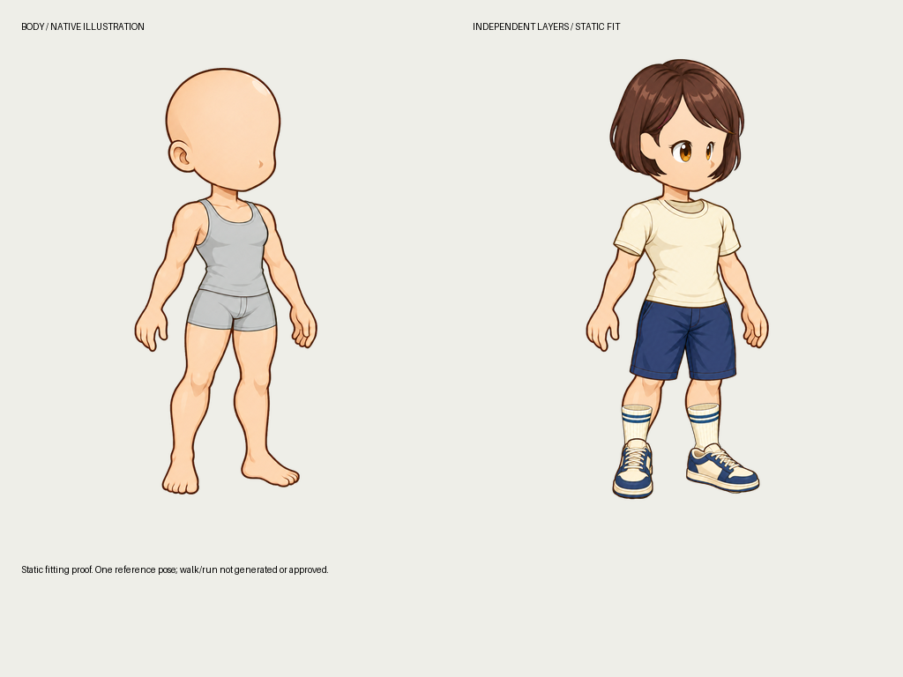
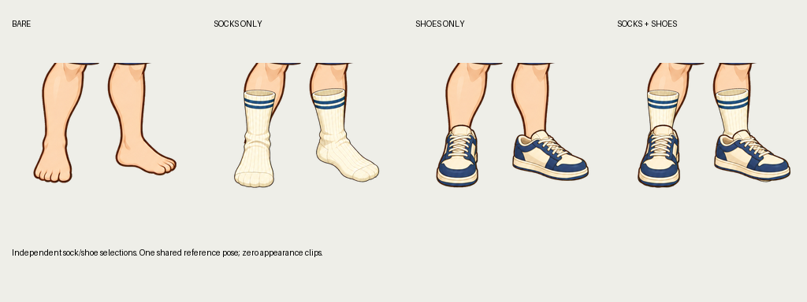

# 고해상도 일러스트 바디와 독립 파츠 실험

> Owns: native illustration sampling, source registration, independent socks/shoes, portable body-node replacement · Index: [docs/README.md](../README.md)



1254×1254의 새 SD 일러스트 바디와 헤어·눈·상의·하의·신발·양말을 Codex 내장 `image_gen`으로 생성했다. 기존 픽셀 이미지를 확대하지 않았다. **정적 기준 포즈 1개**를 사용하는 피팅 실험이며 idle/walk/run 동작을 생성하거나 검증한 결과는 아니다. 시각 승인과 release 승인은 모두 없다.

작업 디렉터리는 `assets/parts-illustration-20261010/`, 실행 도구는 `scripts/dev/parts_illustration_demo.py`다. 기존 픽셀 데모와 원본은 유지한다. 생성 프롬프트는 작업 디렉터리의 `prompts.json`과 아래 원본 묶음에 보존한다. 다른 공급자로 바꿀 때도 같은 source/pose/interface 입력을 사용해야 한다.

## 실제로 확인한 것

| 항목 | 결과 |
| --- | --- |
| 생성 바디 해상도 | 1254×1254, 연속 색·부드러운 알파 |
| 독립 슬롯 | hair / eyes / upper / lower / footwear / socks |
| 기준 모션 | `fit.front_threequarter`, 1 sample, 재생 정지 기본 |
| 바디 분리 | head / torso / waist / 앞뒤 팔·손·다리·발 / 빈 root |
| 바디 재구성 | 원본과 RGBA 바이트 동일 |
| 조합 검사 | 각 파츠 켜기/끄기 64조합 실제 렌더, 서로 다른 RGBA hash 64개 |
| 런타임 알파 가림 마스크 | 0개 |
| 조합별 생성·베이크 클립 | 0개 |
| 독립 레이어 export | PNG 텍스처 24개, 공통 기준 포즈 1개 |
| 시각 승인 | 0개 |

`verification.json`은 각 조합의 hash와 공통 sample을 기록한다. 각 조합을 위해 다른 영상을 만들거나 아틀라스를 생성하지 않는다. 비교 PNG는 검수용 결과다.

## 픽셀 격자를 강제하지 않는 경로

rig의 선택 필드 `sampling: "smooth"`가 일러스트 경로를 지정한다. 필드를 생략한 기존 rig는 계속 `nearest`를 사용하고 기존 선언 digest도 유지한다.

일러스트 pose sheet는 `scale: 1`이며 native page 크기와 생성 이미지 크기가 같아야 한다. `art_mode: "illustration"`에서는 픽셀 격자 축소와 이진 알파 변환을 건너뛰고 약한 알파·연속 색을 보존한다. 불투명 chroma 입력은 기존 추출 엔진을 사용한다. 임의의 캔버스 리사이즈로 잘못된 좌표를 맞추지 않는다.

뷰어와 큐레이션은 부드러운 축소를 사용한다. 큰 native 캔버스가 작은 창에서도 들어가도록 소수 배율을 지원한다. **고해상도가 좌표·가림·프레임 일관성을 자동으로 해결하지는 않는다.** 이번 실험에서도 생성 좌표가 프롬프트와 달라 파츠별 등록 작업이 필요했다.

## 원본을 보존하는 등록과 보수

`fit-alpha-box`는 파츠 알파 bbox를 명시한 native 영역 안에 비율을 유지해 맞추는 편집이다. `source_bounds`는 좌우 신발/양말처럼 독립된 원본 영역을 각각 지정한다. 전체 캔버스는 유지하고 결과는 새 후보로 저장한다. 재피팅은 최초 원본으로 돌아가며 이전 피팅 결과를 반복 리샘플링하지 않는다.

`fill-small-holes`는 지정 사각형 안의 작은 닫힌 알파 구멍만 기존 엔진으로 보수한다. 최대 크기는 1~64 native pixels다. 열린 가장자리·큰 구멍·기존 불투명 픽셀은 바꾸지 않는다. 이 실험의 양말은 12px 이하의 작은 내부 구멍을 보수했다. 모든 파츠에 자동 적용하는 규칙은 아니다.

```json
[
  {"type":"fit-alpha-box","source_bounds":[620,0,1254,1254],"bounds":[640,963,851,1215]},
  {"type":"fill-small-holes","bounds":[428,950,858,1240],"max_pixels":12}
]
```

편집에는 원본 후보, recipe, 변경 픽셀 수, `provider_calls: 0`을 기록한다. 원본 `drawn`과 `under`도 남긴다. 위치/크기를 등록한 뒤에는 이동 전 원본과 이동 후 파츠를 같은 좌표로 비교해 “추출 누락”으로 판정하지 않는다. 피팅 후 검사에는 고정된 required/protected/allowed 지도를 사용한다.

## 양말은 신발과 별도 자산



양말은 별도 `socks` 슬롯과 `sock_back/sock_front` 조각을 갖는다. 이 바디의 순서는 **다리 → 기본 발 → 양말 → 신발**이다. 신발은 `shoe_back/shoe_front`에 붙는다. 양말 영역은 발목·종아리의 명시적 required 지도와 별도 allowed 범위로 생성·검수한다. 신발 검사는 기본 발의 내부 피복 영역을 사용한다. 이 지도들은 렌더 알파 가림 마스크가 아니다.

이번 **발까지 덮는 crew 디자인**은 각 조각에 `replaces: ["foot_back"]` / `["foot_front"]`를 명시한다. 기본 발 PNG만 숨기고 새 양말의 발 모양을 같은 좌표에 그려 맨발 윤곽이 비치는 문제를 없앤다. 양말을 끄면 기본 발이 돌아온다. 발목만 감싸는 디자인은 `replaces`를 생략할 수 있다. 기본 빌드는 계속 `visibility: "zmap"`이고 일반 파츠에 가림 마스크를 강제하지 않는다.

replacement는 production의 조각 설정 → 실제 pack → Python resolver → 독립 export → 브라우저 sampler까지 전달된다. 교체 조각은 해당 노드를 제공해야 한다. 분리되지 않은 body raster의 일부만 숨기는 교체와 flat body 교체는 거부한다. **몸만 보기**는 선택 파츠로 일부가 숨겨진 scene을 단순 필터링하지 않고 기본 body를 다시 resolve한다.

추후 양말 색/길이 변형은 별도 pack으로 추가한다. 긴 바지와 조합할 때는 바짓단·양말의 가림 규칙을 작성해야 한다. 필요하면 양말의 종아리/발 조각을 더 나눠 foot replacement와 바짓단 순서를 따로 관리한다.

## 검수 기준과 출처의 한계

원본 바디의 anatomy 소유권은 이 그림을 위한 수작업 polygon이다. 원본 재구성의 바이트 동일성만으로 해부학 분리가 맞다고 결론 내리지 않는다. 실제로 초기 hand_front 범위가 다리/발을 포함하는 오류를 찾아 y<830으로 제한했다. 재구성·손 영역 경계 테스트를 함께 둔다.

스크립트의 소유권/피팅 profile은 **이 바디의 RGBA hash**에 묶는다. 같은 크기의 다른 바디를 넣어도 거부하고 workspace를 초기화하지 않는다. 다른 체형에는 별도 rig/binding과 해당 바디의 소유권·검사 영역을 작성해야 한다.

초기 5파츠는 `raw/body-magenta.png`를 참조해 생성했다. 이후 작성한 frozen guide를 초기 생성 때 사용했다고 기록하지 않는다. 양말은 생성 전에 고정한 native body/coverage guide를 실제 참조했고 그 묶음을 보존한다. 이후 레이어 구조를 확장하며 metadata revision은 변경했지만 바디 RGBA와 기준 프레임 시간은 유지했다.

현재 양말의 명시적 피복 검사에는 오류·경고가 없다. 헤어의 얼굴 보호 영역 침범은 오류로 남겨둔다. 눈·상의·하의·신발에는 잔조각/작은 내부 구멍 등 경고가 남아 있다. 검사 통과는 시각 승인이 아니며 모든 파츠는 미승인이다. 이 실험은 정적 피팅과 파츠 교체의 증거이고 동작 품질의 증거는 아니다.

검수 화면은 파츠를 바꿀 때 이전 후보를 즉시 비우고 새 요청의 revision을 확인한다. 이전 후보를 보며 다른 파츠에 판정/편집을 보낼 수 없도록 했다.

## 결과와 처리 재현

- [원본·PNG·프롬프트·native 피팅 입력·독립 HTML 미리보기](assets/illustration-fit-20261010.sources.zip)
- [출처·원본 SHA·현재 검사 상태](assets/illustration-fit-20261010.provenance.json)

원본 묶음의 `preview.html`은 오프라인에서 파츠를 교체할 수 있다. 원본 이미지를 새로 생성하는 과정과 저장된 이미지의 처리 재현을 구분한다. 저장된 RGBA 입력을 재처리할 때는 생성 공급자를 호출하지 않는다. 실제로 원본 묶음을 새 폴더에 풀어 6파츠를 다시 처리했으며 최초 착용 결과와 native RGBA가 같았다.

```bash
# 압축을 새 작업 폴더에 풀고 실행한다. 기존 library는 덮어쓰지 않는다.
python scripts/dev/parts_illustration_demo.py prepare --out assets/illustration-replay
for part in hair.bob eyes.open upper.cream lower.navy footwear.sneakers socks.crew; do
  python scripts/dev/parts_illustration_demo.py import --out assets/illustration-replay --part "$part"
done
python scripts/dev/parts_illustration_demo.py finish --out assets/illustration-replay
python scripts/dev/parts_illustration_demo.py verify --out assets/illustration-replay
sprite-gen parts-play --assembly assets/illustration-replay/library/assembly.json --port 8782 --interpolation frame
sprite-gen parts-review-serve --assembly assets/illustration-replay/library/assembly.json --port 8783
```

다음 동작 단계는 이 스타일의 **walk body 원본 프레임을 먼저 고정**하고 상의/하의/신발/양말을 그 포즈별 native guide에 생성하는 것이다. 헤어/눈도 시점 변화가 있으면 해당 포즈 자산이 필요하다. 조합별 클립을 추가하는 방향으로 확장하지 않는다. 고해상도 모션을 확장할 때는 투명 여백 trimming, texture 캐시와 메모리 사용도 별도로 검증해야 한다.
