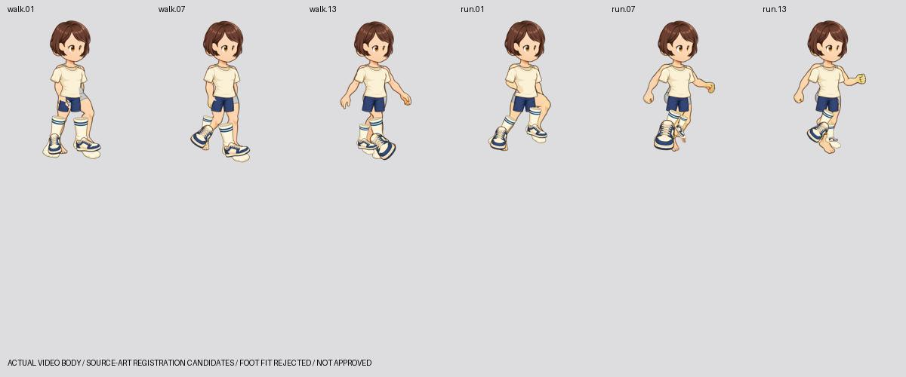
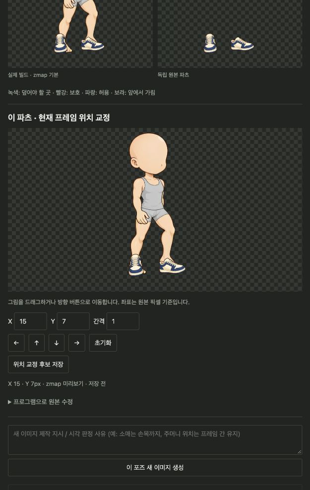

# 고해상도 SD 실제 모션과 파츠 위치 큐레이션 (2026-10-10)

현재 결과는 **실제 walk/run 바디 영상 위에서 기존 아트를 등록한 검증 후보**다.
동작별 독립 파츠를 이미지 모델로 새로 생성하거나 시각 승인한 결과가 아니다.
정적 피팅 실험과 별도 작업 공간이며 원래 픽셀 실험도 보존한다.

- 기존 정적 결과: `http://127.0.0.1:8782/`
- 실제 모션 조합: `http://127.0.0.1:8784/`
- 모션 검수·위치 교정: `http://127.0.0.1:8783/`
- 작업 공간: `assets/parts-illustration-motion-20261010/library/assembly.json`

## 실제로 만든 것과 아직 안 된 것

Grok 로그인으로 기준 바디의 walk/run 영상만 생성했다. 각각 6초, 720p이고
`video-frames` → `video-loop --anchor motion-auto`로 23/20프레임을 추출했다.
1080p first/last 요청은 서비스가 거부하여 720p로 진행했다.
RIFE는 설치되지 않아 엔진의 자동 보간 복구는 적용되지 않았다. 루프는 촬영된
프레임 그대로이며, 보간 복구를 추가하려면 공식 `sprite-gen rife install` 뒤
재검수한다. 원본 영상과 엔진 보고서를 보존했다.

새 768×768 작업 캔버스에 원본 사이클을 배치하고, 바디 분리 후 재조립한 43개
프레임이 입력 RGBA와 동일함을 검사했다. 이는 **바디 픽셀 보존** 검증이다.
몸의 부위 소유권·가림 순서는 해당 영상에 수동 작성한 기준점에 기반하므로
아직 시각 승인이 필요하다. 런타임은 원점 소켓 하나와 프레임별 PNG 레이어를
사용하며, 바디를 뼈대 변형으로 움직이지 않는다.

헤어·눈·상의·하의·신발·양말은 기존 독립 아트를 프레임별로 등록한 후보다.
모든 외형은 바디의 같은 두 모션과 시계를 공유한다. 코디별 클립 생성은 0회다.
**상의의 접힘·소매, 하의의 다리 가림, 발 각도와 양말 형태는 이 등록만으로
완성되지 않는다.** 특히 양말은 정적 소스를 회전·늘리면 모양과 발 덮임이
틀어진다. 검수용 참조와 완성 파츠를 혼동하면 안 된다.

## 큐레이션 사용

1. 파츠와 walk/run을 선택하고 재생한다. 슬라이더로 프레임을 고를 수 있다.
2. `이 프레임 교정`으로 해당 포즈를 검사한다.
3. 바디 위 그림을 드래그하거나 X/Y·방향 버튼으로 원본 픽셀 좌표를 교정한다.
4. `위치 교정 후보 저장`은 원본을 보존하며 새 미적용 후보를 만든다.
5. `이 후보 적용 · 검사 · 빌드`로 실제 레이어에 반영한다. 시각 승인은 별도다.

미리보기는 실제 빌드와 같은 zmap 및 지정된 마스크 정책으로 계산한다.
화면 배율을 원본 픽셀로 환산하며, 캔버스 밖으로 원본 픽셀이 잘리는 이동은
거부한다. 숫자 수정과 미리보기가 같은 이동 함수를 사용한다. 미저장 이동이
남아 있으면 기존 후보를 잘못 승인하거나 적용하지 못하게 막는다.
부위 한쪽만 움직일 때는 고급 수정의 영역 좌표를 사용할 수 있다.

현재 실험의 렌더링 마스크는 0개다. 검사 지도의 `required`는 덮임을 측정하는
기준이며, 바디를 지우는 렌더링 마스크가 아니다.

## 검사 결과와 승인 정책

닫힌 디자인인 `footwear.sneakers`와 발 전체를 덮는 `socks.crew`에만 바디의
발 소유 영역을 필수 덮임 기준으로 등록했다. 이는 샌들·발 없는 양말까지
강제하는 범용 규칙이 아니다. 소유권 지도 자체는 시각 검수가 필요한 초안이다.

두 후보 모두 43포즈에서 덮임 오류가 검출됐다. 예를 들어 최초 후보의
`walk.01` 신발은 1,226px, 양말은 2,854px이 누락됐다. 승인은 막혀 있다.
기준을 느슨하게 바꾸거나 바디 발을 감춰 통과시키지 않았다. 승인 수는 0이다.
원본 디자인 PNG와 실제 모션 포즈·필수 영역을 포함한 생성 참조 ZIP을 준비해
프레임별 독립 아트 제작의 입력으로 사용할 수 있다. 이 제작 호출은 아직 없다.

배치 기준이 없는 다른 후보는 `기본 검사 · 배치 기준 미등록`으로 표시한다.
새 기준이 선언된 후 이전 후보를 고르는 것으로 검사를 우회하지 못하도록,
필수 기준 스냅샷이 없는 후보는 검사 및 승인에서 차단한다. 이전 스냅샷의
픽셀을 나중에 바뀐 입력 파일로 조용히 바꾸지는 않는다.

## 구현·검증

- smooth 자산의 빈 테두리를 제거하고 pivot을 보정해 같은 좌표를 유지한다.
  원본과 출처는 보존한다. 좌표 공간이 있는 마스크·팔레트 입력은 제외한다.
  이 처리가 없으면 프레임×부위의 빈 캔버스까지 누적하여 픽셀 한도를 넘었다.
- 기존 파츠를 후보로 가져올 때 해당 바디 참조도 고정한다. 가져온 후보의
  원본 덮기·검사 영역 보기가 없는 참조 때문에 실패하던 경우를 수정했다.
- UI 빌드 후 기존 코디를 새 파츠 참조에 다시 연결한다. 기존 승인은 승계하지
  않는다. 조합 뷰어는 새로 열거나 새로고침할 때 최신 코디를 읽는다.
- 위치 미리보기=저장 후 빌드의 픽셀 일치, 다른 포즈 보존, 원본 클리핑 거부,
  이전 후보의 기준 누락 우회 차단을 테스트한다.
- 43샘플 × 전체/각 슬롯 제거/바디만 = 344사례의 Python/JS 레이어 위치가
  동일하다. 각 샘플의 시계·바디와 모션은 파츠 교체로 바뀌지 않는다.
- 코드 테스트와 아트 통과는 별개다. 닫힌 신발·양말 오류 86개는 남아 있다.





## 재현·다음 작업

먼저 15번 문서의 정적 원본 묶음을 복구해 정적 library를 만든다. 이번 원본
묶음에는 두 영상, 사이클 PNG, 프롬프트, 엔진 보고서와 검증 기록이 있다.
실패한 초기 작업 공간 및 인증 파일은 포함하지 않는다. 복구한 사이클을
사용하면 영상 생성 호출 없이 다음 단계들을 실행할 수 있다.

```bash
.venv/bin/python -m scripts.dev.parts_illustration_motion \
  --source assets/parts-illustration-20261010 --out assets/parts-illustration-motion-20261010
.venv/bin/python -m scripts.dev.parts_illustration_foot_qc \
  --source assets/parts-illustration-20261010 --out assets/parts-illustration-motion-20261010
.venv/bin/python -m scripts.dev.parts_illustration_motion_verify \
  --out assets/parts-illustration-motion-20261010
```

모션 import·부위 분리를 마친 뒤 중단됐다면 `--register-only`로 등록 단계를
이어갈 수 있다. 영상·사이클·원래 바디의 해시가 달라지면 기준점을 새로
작성해야 한다. 등록을 다시 실행하면 실험 초기 기준으로 돌아가므로, 이후
닫힌 발 검사를 다시 실행해야 한다. UI 교정 후보는 불변 이력으로 남는다.

다음 작업은 문제 포즈의 **독립 신발·양말 이미지를 직접 제작/편집**하여
후보 비교·덮임 검사·동작 재생으로 확인하는 것이다. 단순 이동으로 풀리는
문제와 발/옷 형태를 새로 그려야 하는 문제를 구분한다. 상의·하의·헤어·눈에도
몸 침범·가림·디자인 일관성을 판단할 명시적 기준과 시각 검수가 필요하다.
