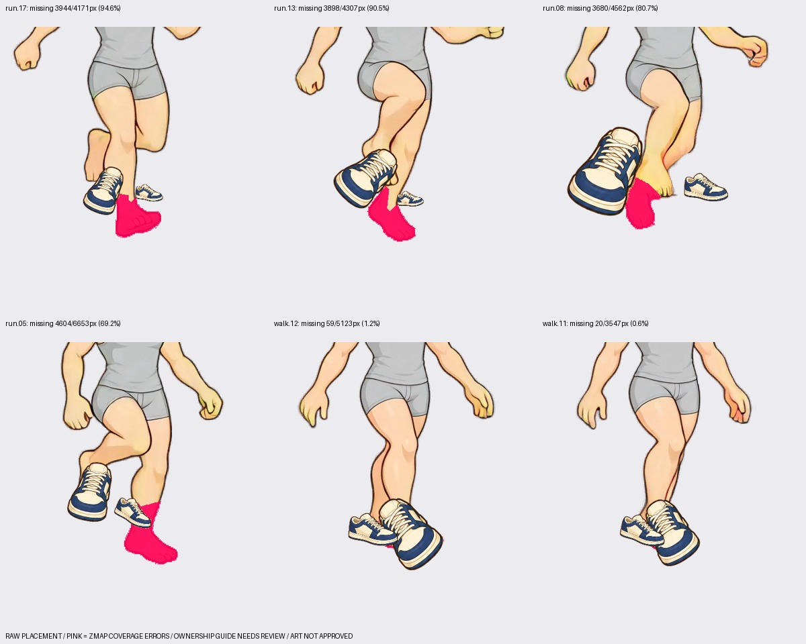
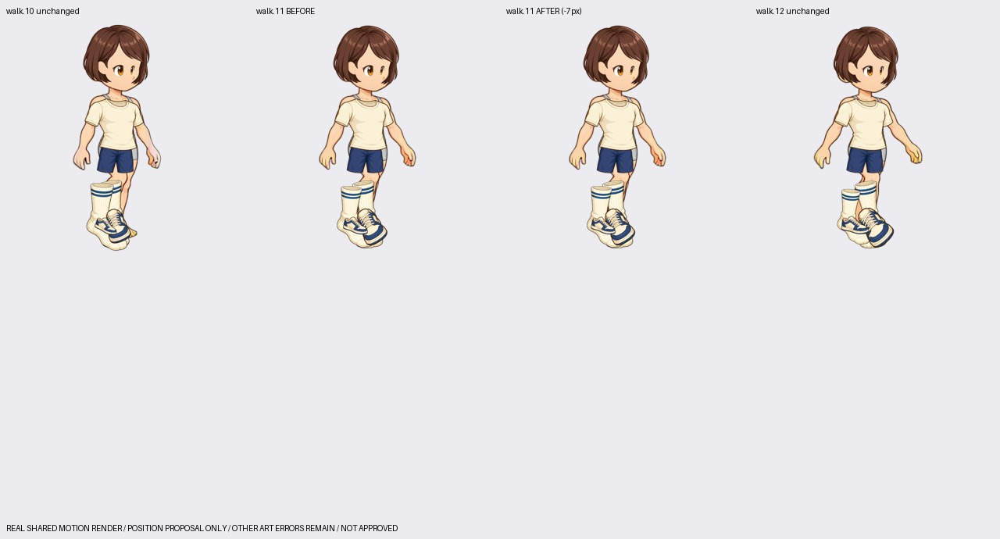
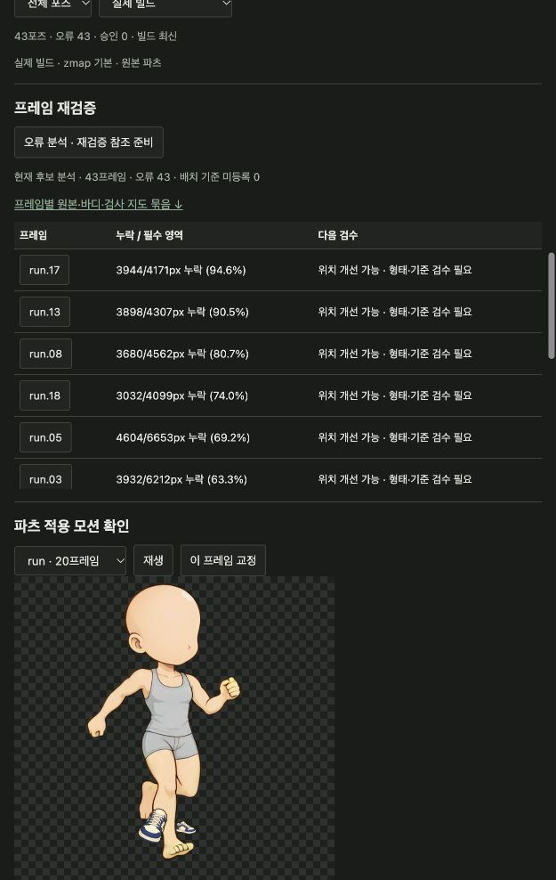

# 고해상도 SD 오류 프레임과 재검증 준비 (2026-10-10)

현재 작업은 동작별 독립 파츠의 **오류 분석·제작 기준 준비**다. 완성 아트 승인이
아니다. 바디 walk/run은 그대로 공유하며 코디별 영상이나 클립을 생성하지 않았다.

검수 화면: <http://127.0.0.1:8783/?part=illustration.motion.footwear.sneakers&pose=run.17>

## 확인한 오류

6종 파츠 × walk 23/run 20 = 258개 파츠 프레임을 분석했다. 닫힌 신발과 발 전체를
덮는 양말은 각각 43개 덮임 오류가 남는다. 헤어·눈·상의·하의 172개는 배치 기준이
미등록이다. 이들을 `오류 없음`으로 해석하지 않는다. 검사 영역 자체도 시각 검수가
필요한 초안이다.

| 대상 | 프레임 | 필수 발 영역 누락 | 다음 검수 |
|---|---|---:|---|
| 신발 | run.17 | 3,944 / 4,171px (94.6%) | 발끝 기준점·뒤쪽 신발 크기·각도 |
| 신발 | run.13 | 3,898 / 4,307px (90.5%) | 뒤쪽 발 기준점과 축소 문제 |
| 신발 | run.08 | 3,680 / 4,562px (80.7%) | 앞뒤 발 정체성과 가림 |
| 신발 | run.05 | 4,604 / 6,653px (69.2%) | 각 발의 위치·형태 |
| 양말 | run.08 | 4,562 / 4,562px (100%) | 종아리/발 전체 회전 등록을 재검토 |
| 신발 | walk.12 | 59 / 5,123px (1.2%) | 작은 경계 누락·기준 검수 |
| 신발 | walk.11 | 20 / 3,547px (0.6%) | -7px 이동 후보 전후 검수 |



이 그림은 가림 없는 원본 배치에 **실제 zmap 기준으로 측정한** 누락을 분홍색으로
표시한 진단 자료다. 실제 빌드와 가림 없는 비교를 구분한다.

## 파츠 재제작 전에 등록 기준부터 확인

기존 등록은 8개 기준 프레임의 추정 좌표를 보간하여 정적 그림을 회전·확대한다.
생성된 독립 파츠가 동작을 정확하게 따라가는 방식은 아직 아니다.

발 기준점과 바디 발 소유 영역의 일관성 검사에서 다음 11개 프레임을 우선 확인한다:
`run.02, run.03, run.05, run.08, run.10, run.11, run.12, run.13, run.16, run.17, run.18`.
12px 거리 기준은 분류용 휴리스틱이며 통과·승인 기준이 아니다.

- run.13 뒤쪽 발끝 기준점은 발 영역과 약 36.85px 떨어져 있다. 등록 확대율은
  앞쪽 0.6893 / 뒤쪽 0.2220으로, 추정한 투영 길이가 신발 전체 크기에 영향을 준다.
- run.17 뒤쪽 발끝 기준점은 약 27.34px 떨어져 있다.
- run.08 뒤쪽 발 소유 영역은 0px인데 별도의 신발은 그려진다. 실제 가림인지,
  잘못된 부위 소유권인지 먼저 확인한다. 신발이 맨발보다 돌출할 수 있으므로
  빈 영역만 보고 신발을 자동으로 삭제하지 않는다.

소유권 지도도 같은 추정 기준에서 파생되므로 이 검사는 독립적인 해부학 정답이
아니다. 바디 원본 위에서 발목·뒤꿈치·발끝, 앞뒤 정체성과 가림을 재검수한다.
투영된 발끝 벡터만으로 신발 전체를 균일하게 축소하거나, 양말 전체를 종아리
축으로 돌리는 등록을 완성 파츠로 승인하지 않는다.

상의는 `run.02/05/08/17`의 어깨·소매 연결과 바디 기본 의상 노출, 하의는
`run.02/05/13/17`, `walk.22`의 올린 허벅지와 바지통 형태를 우선 재검수한다.
허용 의상 영역, 덮임 인터페이스, 보호할 손·얼굴 기준을 작성한 뒤 각 동작의
독립 파츠를 제작한다. 총 19개 **파츠×프레임 재작업 요청**을 저장했다.
요청 저장은 생성 실행이 아니다. 이번 작업의 이미지 생성 호출은 0회다.

## 실제 수정 후보 검증

`walk.11` 신발에 X=-7/Y=0 이동 후보를 만들었다. 필수 발 영역 누락이 20px → 0px로
줄었으나 작은 구멍 등 경고가 남는다. 원본과 수정 이력을 보존했다.

이를 실제 레이어 빌드에 잠시 적용하여 공유 walk의 23샘플을 렌더링했다.
수정 프레임의 미리보기와 빌드 픽셀이 일치하고, 나머지 22샘플은 동일하며
샘플 ID도 변하지 않는다. 검증 후 원래 파츠 선택과 코디를 복원했다.
수정 후보는 미적용 상태로 검수 화면에서 비교할 수 있다. 시각 승인은 0이다.



## 검수 화면에서 확인하는 방법

1. 파츠를 선택하고 `프레임 재검증`의 누락 비율 순 목록에서 포즈를 연다.
2. `오류 분석 · 재검증 참조 준비`로 현재 후보와 기준을 다시 측정한다.
3. 묶음 ZIP은 후보 원본, 당시/현재 바디, 검사 지도, 부위 라벨 PNG, 오류 지도,
   디자인 참조, 설정, 모션 순서와 앞뒤 프레임 정보를 보존한다.
4. `분석한 위치 이동 미리보기`는 현재 후보와 분석이 일치할 때만 제공한다.
   양쪽 신발/양말을 함께 이동하는 제한된 제안이다. 각 발을 독립적으로 고치는
   자동 리깅이나 형태 판정이 아니다. 앞뒤 가림과 다른 발의 악화를 함께 확인한다.
5. 위치 교정 후보를 저장한 뒤 적용·검사·빌드와 시각 검수를 구분한다.

원본 파츠/바디/모션/설정/검사 이미지/부위 라벨이 바뀌면 이전 분석임을 표시한다.
이전 묶음은 불변 이력으로 남으며 다운로드 때 이미지 해시를 검증한다. 후보의
고정 검사 지도와 현재 지도가 달라지면 기준 갱신을 우선하도록 표시한다.
재검증 보고서는 raster 파츠용이다. held 파츠의 follow 배치 검사는 별도 대상이다.



## 재현 및 다음 단계

작업 공간: `assets/parts-illustration-motion-20261010/library/assembly.json`.
16번 문서의 원본 묶음과 재현 절차로 이 작업 공간을 먼저 만든다.

```bash
.venv/bin/python -m scripts.dev.parts_illustration_revalidation \
  --out assets/parts-illustration-motion-20261010 --reuse-current
```

`--queue`를 명시하면 위의 구체적인 재작업 요청도 저장한다. 생성 호출, 후보 선택,
빌드 및 승인을 자동 실행하지 않는다. `revalidation-plan.json`,
`registration-anchor-audit.json`, `revalidation-position-motion.json`에 결과가 남는다.
프로그램으로 변경한 후보의 계보와 실제 파일 해시는 작업 공간에 보존된다.

다음 순서는 **기준점·소유권 검수 → 위치 교정 가능한 후보 비교 → 형태/각도가
필요한 동작별 독립 파츠 제작 → 같은 고정 기준의 재검사 → 앞뒤 및 전체 동작
검수 → 시각 승인**이다. body를 지우거나 필수 덮임 기준을 느슨하게 해서 통과시키지
않았다. 기본 렌더링은 여전히 마스크 없는 zmap이다.
