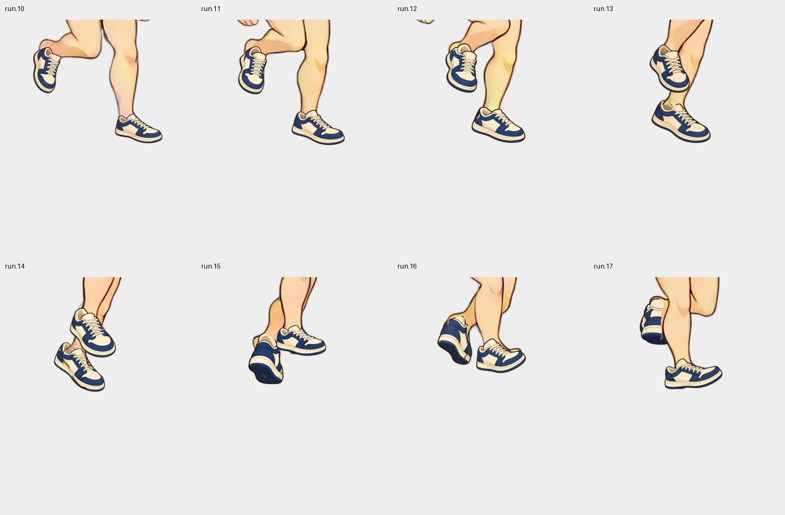
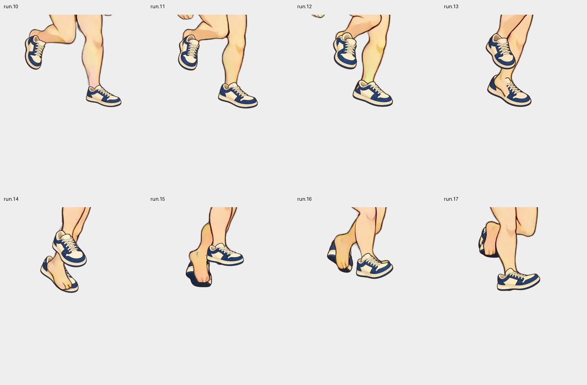

# AI independent footwear pilot — 2026-10-10

This experiment now contains actual AI-drawn **pose-specific independent shoes**, rather than a standing shoe rotated/scaled along interpolated ankle vectors. It demonstrates eight shared run samples (`run.10–17`), not a completed run cycle or an approved production library.

## Open the result

- Player: <http://127.0.0.1:8786/?state=run&from=10&to=17&speed=0.25>
- Curation: <http://127.0.0.1:8785/?part=illustration.motion.footwear.ai-pilot&pose=run.17>
- Workspace: `assets/parts-ai-shoes-pilot-20261010/library/assembly.json`.
- The player swaps “정지 그림 변형 후보”, “AI 신발 · 8프레임” and no shoes at the same original sample/time. The window loops only a section of the original motion; its endpoints are not a new seamless cycle.



## What was actually generated

The native Codex image generation tool made 12 images: eight pose-specific shoe pairs, plus targeted redraws for `run.12`, `run.13`, `run.15`, and `run.17`. No image-generation API key or alternative provider was used. No new video was filmed. The existing Grok-derived walk/run body clips remain the shared motion.

Each request used the exact body pose ROI plus the navy/cream sneaker design. The ROI was `[128,384,640,768]` on the immutable 768px body canvas, padded to 512px square and enlarged to a 1024px reference. The model did not consistently honor output framing or resolution; raw outputs therefore remain evidence rather than directly usable coordinates.

`parts_ai_shoes_pilot.py` separates the two actual drawings and registers each with authored uniform scale/translation (and an explicit rotation if supplied). It preserves aspect and the newly drawn perspective. It never uses projected ankle-toe length to scale standing art, repaints a shoe, or extracts clothing from a generated full character. All original provider outputs and prompts are retained. The later small translation proposals were bounded to ±8 body pixels and remained unapproved; proposals based on ambiguous crossing rectangles were discarded in favor of body contour review or an AI redraw.

The source and transforms live in `generation-latest.json`, `registration.json`, `registration-report.json`, and the immutable `inputs/ai-shoes-pilot/revisions/…` directories. Curation candidates retain frozen QA images; `final-curation-lineage-body-corrected.json` identifies the selected candidates after ownership/QC updates.

[Native outputs, prompts, guides, annotations and evidence](assets/ai-independent-shoes-20261010.sources.zip) are archived as 146 hash-verified files (12.0MB). The body/motion source dependency remains the archive in experiment 16.

## The actual zmap failure and correction

Raw overlays looked much better, but the **real build** still drew bare rear feet above their shoes in `run.14–17`. The old video-body segmentation had assigned those rear-foot pixels to foreground nodes. Repositioning or redrawing a shoe alone could not fix that ordering error.

`parts_ai_shoes_body_ownership.py` applies body-reference contours to the visible rear feet in `run.13–17` and regenerates the segmented body pack. The body pack revision changes, while its reconstructed RGBA stays exactly equal to all 43 original body frames. There is no runtime occlusion mask and no body-node replacement. The existing zmap now draws the correctly owned rear foot below `shoe_back`; actual foreground limbs can still occlude that shoe naturally. This is a provisional semantic annotation for this exact body/motion, not a general detector or an approved anatomical rig.



The review server also now keys its built render cache on body, rig, motion, part and state context. A body ownership revision with unchanged full-body pixels/part digest must not reuse an old composite. The cache keeps one context and captures the rendered image under its lock.

## QC and approval remain separate

The new guides check authored **foot-core** regions containing toes/heels against original body alpha, protected upper-body space, and allowed footwear volumes. Crossing contours exclude the other limb. These are explicitly limited criteria; full ankle closure and temporal design consistency are not certified. QA guides are never used to erase runtime body pixels.

| Pose | Required pixels missing | Allowed/protected violation | Status |
|---|---:|---:|---|
| run.10 | 36 | 0 | error |
| run.11 | 5 | 0 | error |
| run.12 | 0 | 0 | warning |
| run.13 | 10 | 0 | error |
| run.14 | 0 | 0 | warning |
| run.15 | 15 | 0 | error |
| run.16 | 6 | 0 | error |
| run.17 | 0 | 0 | warning |

Total: 72 missing pixels across five poses, **zero approved art**. Internal alpha holes/small fragments still need inspection. The generic area-jump warning at the window endpoints compares against empty unproduced neighbors; it is not proof of temporal instability or stability. Review the eight produced images in sequence as well as the original body reference.

The other 35 poses have explicit transparent preview placeholders and are **rejected as unproduced**, not accepted parts. Their ownership guides are empty. A new generation for one of these poses requires new ownership annotations. `parts_segments.split_piece` now fails before writing a split import if drawn pixels have no owner; it no longer silently discards such artwork. The review UI displays rejected decisions separately from unverified art.

## Verification

- 43 body frames reconstruct byte-identically after the ownership correction.
- Motion reference/sample IDs/timing are unchanged; shoe swaps preserve every sample.
- Python and browser layer samplers match for 86 actual off/on cases.
- Eight produced samples each have `shoe_back` and `shoe_front` layers; runtime masks and appearance-specific baked clips are both zero.
- 59 focused tests cover production/revalidation, split pixel preservation, body-context render cache invalidation, export/player behavior, and variable/fractional-duration review windows. JS syntax, Ruff F checks and Git whitespace checks pass.
- Live player and curation pages were checked, including original sample IDs and actual zmap rendering. Asset QA errors remain errors; code tests do not approve the art.

## Reproduce / continue

Use the managed worktree `.venv` and the exact body library from experiment 16:

```sh
.venv/bin/python -m scripts.dev.parts_ai_shoes_pilot --out assets/parts-ai-shoes-pilot-20261010 --publish-from assets/parts-illustration-motion-20261010/library
.venv/bin/python -m scripts.dev.parts_ai_shoes_check --out assets/parts-ai-shoes-pilot-20261010
.venv/bin/python -m scripts.dev.parts_ai_shoes_body_ownership --out assets/parts-ai-shoes-pilot-20261010
.venv/bin/python -m scripts.dev.parts_ai_shoes_check --out assets/parts-ai-shoes-pilot-20261010
.venv/bin/sprite-gen parts-play --assembly assets/parts-ai-shoes-pilot-20261010/library/assembly.json --interpolation frame --port 8786
.venv/bin/sprite-gen parts-review-serve --assembly assets/parts-ai-shoes-pilot-20261010/library/assembly.json --port 8785
```

The provider calls are intentionally not replayed by those commands. Restore the archived raw art/prompts/guides and resolve frozen body source paths first. The source archive preserves native outputs, placement history, foot contours, selected-candidate lineage and verification evidence. The generated runtime export remains an independent layer library; the development workspace is separate from the previous experiment and the primary checkout.

Next required work: resolve the five residual coverage errors, distinguish alpha defects from intended openings, stabilize the shoe design across the sequence, and validate body ownership beyond this window before extending to the remaining poses or another garment/body type. The Codex Goal remains active for those quality steps.
