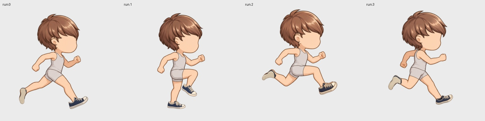

# 동작에 대응하는 독립 파츠 제작

기준 바디와 모션을 고정하고, **각 포즈의 각 레이어를 독립 이미지로 생성**한다. 기존 `gen`, `parts-part-*`, 큐레이션, zmap 합성, 레이어 export를 그대로 사용한다. `parts_ai_shoes_pilot.py`는 과거 실험을 재현하는 도구이며, 새 파츠 제작에는 필요하지 않다.

## 제작 계약

- 파츠 하나는 슬롯, 포즈 목록, 레이어별 render node와 바디 좌표의 target bounds를 가진다. 상의라면 몸통/앞 소매/뒤 소매를 별도 레이어로 지정할 수 있다.
- `body_nodes`는 생성 시 참고할 실제 바디 분리 이미지다. 발바닥/발등 방향처럼 전체 몸 축소본에서 모호한 부분을 명확히 한다. `landmarks`에는 포즈별 heel/toe/ankle 또는 crown/ear 같은 바디 좌표를 작성할 수 있다. 엔진이 실제 참조 이미지에 점·이름·방향 선을 붙인다. 런타임 소켓을 추가하거나 파츠를 변형하는 기능은 아니다.
- 각 생성 입력은 바디, 포즈, 바디 분리 이미지, 디자인 참조, QA 지도와 프롬프트를 해시로 고정한다. 생성 출력은 투명한 **파츠만**이어야 한다. 기본은 바디에서 새로 생성한다. `independent.reference_previous: true`를 명시하면 이전 원본도 AI 편집 참조로 붙인다. 잘못된 이전 원근을 다시 복사하는 문제 때문에 기본값은 false다. 이전 원본 파일은 두 방식 모두 보존한다.
- 원본은 그대로 보존한다. 좌표 등록은 양수 보간을 사용하는 premultiplied bilinear 리사이즈 한 번과 균일 scale/translation으로 수행한다. `source_bounds`는 외부에서 가져온 원본의 명시적 crop이며, 새로 생성한 독립 이미지에는 적용하지 않는다.
- 뒤 레이어가 앞 레이어에 가려져도 그 독립 원본 픽셀을 남긴다. 겹침은 실제 body/part node의 zmap으로 처리한다. 새 direct production의 기본은 `visibility: zmap`이다. 예외적인 렌더 마스크가 필요한 자산은 별도 기존 mask production으로 작성한다. QA 지도는 검사용이며 렌더링 마스크가 아니다.
- 완성 캐릭터에서 옷을 빼내거나 바디를 지워 파츠를 만들지 않는다. 모션을 외형 조합별로 생성하지 않는다. 바디와 파츠 모두 동일한 sample clock을 따른다.

## 새 파츠 시작

발의 면 방향처럼 해부학 참조만으로 생성 결과가 반복해서 틀리면 레이어의 `guides`에 포즈별 파츠 형태 초안을 연결한다. 예를 들어 `"guides": {"run.3": ["inputs/run.3.sole-template.png"]}`로 아웃솔의 보이는 면과 칼라 입구를 명시한다. 이 파일은 생성 참조로만 고정되며 결과 파츠를 자르는 마스크나 최종 그림으로 쓰지 않는다. 같은 경로의 가이드 내용이 바뀌어도 이전 비전 판정은 무효화한다. `parts_qualified_templates.py`는 현재 바디의 명시적 발 영역으로 이런 초안을 만드는 예제이며, 초안 자체를 승인하지 않는다.

바디가 올바르게 분리되어 있는 workspace에서 초안을 만든다. 아래 body node 이름은 그 workspace의 실제 이름으로 바꾼다.

```bash
sprite-gen parts-part-scaffold --assembly library/assembly.json \
  --part demo.sneakers --slot footwear \
  --layer shoe_back:shoe_back:foot_back \
  --layer shoe_front:shoe_front:foot_front \
  --prompt-file sneakers.txt --out sneakers.json
```

이 명령은 실제 node 소유 픽셀의 bounds와 참조 보드를 만들 뿐, 정답 위치나 승인된 파츠를 만들지 않는다. bounds, node 연결, 필수 덮임/보호/허용 QA 지도를 작성자가 확인한다. 양말은 별도 sock node와 별도 파츠로 작성한다. 신발 영역을 무조건 종아리까지 넓히지 않는다.

설정의 핵심은 다음과 같다. `targets`는 정수 바디 좌표이며 필요한 모든 포즈를 명시한다. 아래 한 포즈 예시는 다른 포즈도 추가한 뒤 사용한다.

```json
"independent": {
  "require_vision": true,
  "layers": [
    {"id": "shoe_back", "node": "shoe_back", "body_nodes": ["foot_back"],
     "targets": {"run.17": [286, 478, 354, 607]}, "fit": "contain", "margin": "1.04"},
    {"id": "shoe_front", "node": "shoe_front", "body_nodes": ["foot_front"],
     "targets": {"run.17": [328, 624, 462, 686]}, "fit": "contain", "margin": "1.04"}
  ]
}
```

`independent`는 raster part 전용이다. held/segment/variant 추론과 섞으면 명시적으로 거부한다. 다른 체형은 새로운 rig/body revision과 해당 포즈 bounds를 작성한다. 이전 체형 후보를 자동 승인하거나 억지로 늘리지 않는다.

## 같은 엔진에서 생성 → 검수 → 빌드

```bash
sprite-gen parts-part-init --assembly library/assembly.json --config sneakers.json
sprite-gen parts-part-sheet --assembly library/assembly.json --part demo.sneakers
sprite-gen parts-part-draw --assembly library/assembly.json --part demo.sneakers --provider codex
sprite-gen parts-part-slice --assembly library/assembly.json --part demo.sneakers
sprite-gen parts-part-check --assembly library/assembly.json --part demo.sneakers
sprite-gen parts-part-build --assembly library/assembly.json --part demo.sneakers
sprite-gen parts-part-vision --assembly library/assembly.json --part demo.sneakers \
  --pose run.17 --provider codex
sprite-gen parts-part-review --assembly library/assembly.json --part demo.sneakers \
  --approve run.17 --reviewer curator
sprite-gen parts-review-serve --assembly library/assembly.json --port 8789
```

`draw --dry-run`으로 실제 실행 명령과 참조를 먼저 확인할 수 있다. provider는 명시하고 기존 로그인/접근 규칙을 따른다. Codex 생성은 기존 native image generation adapter, 비전 검수는 기존 Codex 이미지 입력 transport다. API 크레딧이나 다른 공급자로 자동 전환하지 않는다. 외부 도구가 만든 독립 PNG도 frozen batch의 해당 page에 `parts-part-slice --page INDEX=PATH`로 가져올 수 있다.

독립 파츠의 기계 검사는 투명도 16 미만의 보이지 않는 잔여 픽셀을 침범·잔조각으로 세지 않는다. 필수 지도 흰색은 파츠 투명도 230 이상으로 덮여야 한다. 회색 지도는 강도를 비례해 낮춘다. 희미한 alpha 1 픽셀을 덮임 통과로 인정하지 않는다. 발목과 발끝·뒤꿈치를 구분한 바디 기준 지도를 작성해야 한다.

비전은 원본, 확대 바디 접합부, **실제 zmap 합성**, 디자인 정본, 인접 포즈를 보고 attachment/shape/occlusion/design/alpha/temporal을 판정한다. 실제 입력 보드와 모델 응답을 함께 저장한다. JSON 불일치/호출 실패는 `failed`, 근거 부족은 `uncertain`, 결함은 `rework`로 남는다. 모두 승인 차단 대상이다. 수치 검사 통과가 비전 통과로 대체되지 않는다. 현재 후보·인접 후보·바디·모션·설정·QA/디자인 파일 바이트와 연결된 pass만 별도 큐레이터가 승인할 수 있다.

## 교정과 재작업

생성 전과 후보 검사에서 필수 덮임의 바디 픽셀이 선언한 `body_nodes`에 속하는지도 확인한다. 뒤꿈치가 `torso`에 남아 있으면 신발에 덮임 픽셀이 있어도 몸통 zmap이 그 위로 그려진다. 이를 파츠 오류로 다시 생성하지 않고 바디 소유를 먼저 수정한다. 실제 예제의 `parts_qualified_body_fix.py`는 이런 433픽셀을 `foot_back`으로 옮겼고, 바디 원본 4장의 렌더 픽셀은 그대로 유지했다. 이 검사도 아트 승인과 별도다.

큐레이션에서 현재 후보의 독립 원본과 실제 빌드를 비교하고 모션 프레임을 넘겨 본다. **위치 교정 레이어**로 `shoe_back`을 선택하면 그 레이어만 이동한다. 저장은 새 후보 생성이며 적용 전까지 현재 빌드는 유지된다. 적용하면 검사/빌드를 갱신하고 이전 비전/승인은 무효화한다. `프로그램으로 원본 수정`은 레이어별 비율 유지 크기 맞춤, 최대 30° 기울기 교정, 제한 영역 잔조각 제거를 지원한다. 기울기는 해당 포즈의 생성 원본에만 적용하며 공통 모션을 리깅하거나 서 있는 그림을 모든 포즈에 재사용하지 않는다. 원본 복구용 픽셀과 변경 내역은 보존된다. 크기·위치 교정 후 검수 bounds도 실제 그림 범위로 확장한다. QA 지도를 바꾸면 이전 후보가 옛 기준으로 통과할 수 없고 새 후보에서 현재 지도를 다시 고정해야 한다. 이때 픽셀을 그대로 보존하는 zero-translation 편집도 허용하며 `qa_revalidated`로 기록한다.

형태/원근이 틀리면 같은 드롭다운에서 레이어를 선택하고 재작업 지시를 적어 **이 포즈 새 이미지 생성**을 누른다. 웹 작업은 실제 sheet → native draw → slice → check → build → vision을 수행하며 단계/완료 레이어 수/실패 이유를 표시한다. 그 포즈의 다른 레이어는 동일 픽셀로 보존한다. 여러 포즈 표시 재작업은 전체 레이어 대상으로 처리한다. 검사 통과·승인된 그림도 재작업할 수 있다. 재생성은 자동 승인하지 않는다.

CLI에서도 같은 작업이 가능하다.

```bash
sprite-gen parts-part-rework --assembly library/assembly.json --part demo.sneakers \
  --poses run.17 --note '뒤 신발의 발바닥 방향 수정'
sprite-gen parts-part-sheet --assembly library/assembly.json --part demo.sneakers \
  --pose run.17 --layer shoe_back
# 같은 draw/slice/check/build/vision/review 단계로 이어간다.
```

## 실제 검증 자산



**2026-10-11 정정:** 이전에 두 파츠 × 4포즈의 비전 pass 8건과 큐레이터 승인 8건을 근거로 품질을 확인했다고 보고했지만, 신발 승인은 잘못이었다. 신발 4포즈의 승인을 철회했다. 회귀 테스트 80개, 바디 픽셀 동일성, Python/JavaScript 16경우 일치, 마스크 0·외형별 baked clip 0은 런타임 동작의 증거이며 신발의 원근·부착·제품 일관성을 보증하지 않는다. [오승인 조사와 재검증](20-shoe-acceptance-audit.md)을 먼저 확인한다. 아래 기존 archive는 **철회 전 이력 보존용**이며, 복원한다고 현재 승인 자산이 되는 것이 아니다.

현재 제작 예제는 `assets/parts-independent-qualified-20261011/library/assembly.json`의 `qualified.hair` 1레이어와 `qualified.sneakers` 2레이어다. Native Codex image generation으로 만든 고해상도 SD 바디 시트의 **4개 달리기 참고 포즈**를 공통 모션으로 고정했다. 제작 경로를 검증하는 non-looping 구간이다. 전체 idle/walk/run 사이클과 추가 체형의 최종 아트 승인은 별도 작업이다.

원본 `body-native-sheet.png`와 실제 provider 보고서를 보존했다. 각 cell은 같은 해상도에서 정수 이동만 했고, 주요 alpha 연결 성분과 2px AA 경계를 남겼으며 alpha 240 이상은 opaque로 정규화했다. 그 정규화된 바디 4장은 분리/재분리/파츠 제작 이후에도 bare-body 렌더와 픽셀 단위로 동일하다. 바디 분리는 명시적으로 작성한 영역이며 자동 해부학 추론 결과가 아니다. 팔·의상 접합부 등 현재 헤어/신발 밖의 영역에는 별도 검수가 필요하다.

몸 위 비교에서 발견한 실제 오류를 다음처럼 처리했다.

- 이전 8프레임 영상 구간의 신발은 확대 비전에서 원근/가림 오류 또는 판단 보류가 나와 **전부 반려**했다. `assets/parts-independent-production-20261011`에 실패 원본과 응답이 남아 있다. 실패 그림을 검증 완료 예제로 쓰지 않는다.
- 새 바디의 발 분리에서 잘린 상단 윤곽을 수정했다. 분리 소유만 바꾸고 몸 그림 자체는 유지했다.
- 뒤꿈치 일부가 몸통에 배정되어 신발 위로 렌더링되는 오류를 수정했다. `parts_qualified_body_fix.py`와 `parts_qualified_body_finalize.py`의 소유 변경 내역과 원본 픽셀 동일성 증거가 archive에 있다. 요구한 해부학 node와 필수 바디 픽셀이 다르면 생성 전·후 검사에서 차단한다.
- 후두부가 비던 forelock 후보는 반려하고 full-cap을 실제 AI로 재생성했다. 두상 크기와 귀 위치에 맞춰 균일 scale/translation 후보를 만들었다. 선택한 스타일은 뒷귀 테두리에 짧은 층진 머리끝이 겹칠 수 있으며 귀 안쪽과 아래 얼굴은 보인다. 옛 기준의 반려를 통과로 바꾸지 않았다.
- 신발의 잘못된 방향은 heel/toe/ankle 참조를 표시해 해당 레이어만 다시 생성했다. 다른 레이어는 동일한 pixels/원본으로 보존했다. 잘못된 원본 조건을 반복 복사하던 재작업은 body-first 생성으로 바꿨다.
- 뒤로 든 발을 밑창 시점으로 단정한 형태 초안을 사용했다. 이 해석을 독립적으로 검증하지 않았고, 생성된 밑창을 다시 디자인 참조로 삼았다. 이 초안과 당시 pass는 올바른 원근의 증거로 사용할 수 없다.
- 필수 덮임 QA를 안쪽 영역으로 줄이면서 뒤꿈치·발끝 경계가 빠졌다. 확대 재검사에서 `run.2`의 누락이 확인됐다. 원본 바디 경계를 포함한 기준으로 강화했으며, 새 후보도 검사 오류나 비전 rework이면 승인하지 않는다.

웹 재작업은 실제 native draw·등록·검사·빌드·비전까지 실행한다. job이 완료되어도 비전이 rework/uncertain이면 승인할 수 없다. provider 성공과 아트 통과는 별도 상태다.

```bash
PYTHONPATH=. .venv/bin/python scripts/dev/parts_independent_verify.py \
  --out assets/parts-independent-qualified-20261011 --require-approval
sprite-gen parts-play --assembly assets/parts-independent-qualified-20261011/library/assembly.json \
  --port 63839 --interpolation frame --title '독립 파츠 제작 · 신발 미승인 검수'
```

검증기는 원본 바디 4장과 bare-body 렌더, 헤어/신발 on/off 네 조합의 **16개 sample**에서 Python과 portable JavaScript 런타임의 clock/레이어를 비교한다. 렌더 마스크와 외형 조합별 baked clip은 0이어야 한다. 기본 실행은 미승인·검사 오류 아트도 런타임 일관성만 측정하고 `art_checks`에 별도 기록한다. `--require-approval`은 검사 범위 내 통과, 현재 실제 Codex 비전 pass와 큐레이터 승인을 요구한다. 그 조건을 만족해도 사람이 실제 부착과 형태를 잘못 판정하면 오승인이 발생할 수 있다.

현재 후보·실제 비전 입력/응답·원본·교정 이력은 workspace의 immutable production records에 있다. 소스 전달용 archive는 원본 바이트의 중복만 제거한 저장 형식이며 `parts_workspace_snapshot.py restore`가 모든 파일의 SHA-256을 검증해 새 디렉터리로 복원한다.

```bash
PYTHONPATH=. .venv/bin/python scripts/dev/parts_workspace_snapshot.py restore \
  --archive docs/parts/assets/independent-parts-20261011.workspace.zip \
  --root /absolute/new/library
```

복원한 `library/assembly.json`에 같은 core commands를 실행한다. 아트 재생성에는 기존 provider 로그인이 필요하며 저장 원본의 복원·재생·검사에는 새 생성 호출이 필요 없다.

Archive는 약 94 MiB이며 실패 후보·비전 판정·교정 이력까지 포함한다. 2,751개 파일의 바이트를 1,188개 고유 blob으로 저장했다. 파일 크기와 SHA-256은 [archive metadata](assets/independent-parts-20261011.archive.json)에 기록했다.
