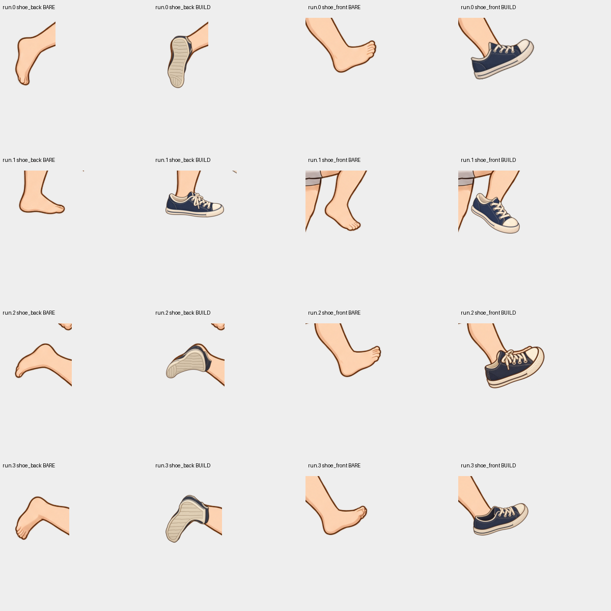
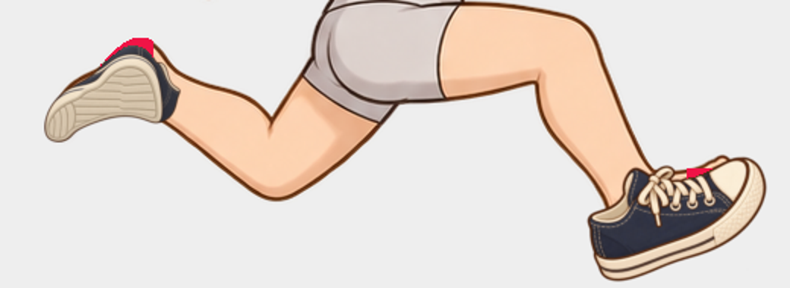
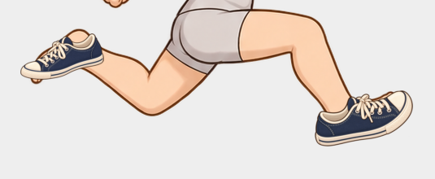

# 신발 오승인 조사 — 2026-10-11

이전의 `qualified.sneakers` 4포즈 승인은 잘못이었다. 사용자의 지적 후 전부 철회했다. **전체 모션 제작을 확대하지 않는다.** 이 문서는 승인 철회 당시의 원본과 실패 후보를 기록한 조사 자료다. 이후 수정안과 현재 상태는 [신발 수정 후속 검증](21-shoe-repair-followup.md)에 별도로 기록한다. 아래 철회 당시 화면과 archive를 현재 승인본으로 사용하지 않는다.

## 실제로 무엇을 확인했는가

실제 Codex 이미지 입력 비전 호출은 있었다. 당시 v4 보고서는 attachment/shape/occlusion/design/alpha/temporal 여섯 항목을 모두 pass로 판정했다. 생성 원본과 실제 zmap 렌더도 입력했다. 호출 자체를 생략하거나 기계 수치를 비전 응답으로 대신한 것은 아니다.

그러나 **큐레이터 역할을 수행한 Codex가 그 응답과 작은 전체 캐릭터 contact sheet를 충분한 품질 증거로 받아들였다.** 발별 원본 해상도에서 입구·뒤꿈치·발끝을 대조하고, 같은 제품의 형태가 포즈마다 유지되는지 따로 확인해야 했지만 그렇게 하지 못했다. 그 책임은 모델 응답을 최종 승인한 큐레이터에게 있다.

80개 회귀 테스트, 원본 바디 4장의 픽셀 동일성, Python/JavaScript 16개 조합의 clock/레이어 일치, 런타임 마스크와 코디별 baked clip이 0이라는 결과는 실제였다. **양쪽 구현이 같은 잘못된 신발을 렌더해도 이 검사는 통과한다.** 바디 픽셀 동일성도 해부학이나 신발 부착을 검증하지 않는다.

## 확인한 결함과 오승인 원인

- 생성 지시에 뒤쪽 발은 밑창을 보여야 한다고 단정했다. 실제 바디의 투영에서 그 시점을 독립적으로 확정하지 않았다. 생성된 밑창을 다시 `sole-canonical.png` 기준 디자인으로 삼아 잘못된 가정이 반복될 수 있었다.
- v4 비전 보드는 양쪽 발과 이웃 포즈 전체 범위를 묶어 축소했다. 실제 착용 신발은 작고, 생성된 기준 밑창은 크게 보였다. 가림 순서가 맞아도 뒤꿈치 피부 경계가 밖에 남는 문제를 놓쳤다.
- 필수 덮임 지도는 `MinFilter(9)`로 줄인 발 안쪽과 일부 사각 영역을 중심으로 작성했다. 뒤꿈치 상단과 발끝 경계가 빠져 있었다. `required_pixels: 0`은 이 불완전한 지도에 대한 값이었다. 일반적인 발목 피부 노출을 반려 사유로 삼는 것과 별개의 문제다.
- 등록은 alpha bounds에 대한 균일 scale/translation이었다. 실제 ankle/heel/toe 대응을 계산하는 의미적 정렬은 아니었다. 위치·크기를 조정해도 원근과 칼라 방향이 틀린 그림을 고칠 수 없다.
- QA 파일은 batch에 보존했지만, 생성 공급자에게 전달하는 이미지 `refs`에서는 빠져 있었다. 모델은 이 덮임 경계 지도를 실제 이미지 참조로 받지 않았다.

`run.2`의 뒤꿈치 `[161,438,196,470]`, 앞쪽 발끝 `[547,526,590,570]`을 원본 바디 alpha로 추가한 지도에서, **동일한 이전 신발의 필수 덮임 부족은 221px**이다. 기존 요구 영역과 추가 경계를 함께 측정한 값이며 투명도 기준은 바꾸지 않았다. 네 포즈 전체의 해부학 검증 완료를 의미하지 않는다.

## 재검사의 결과

동일한 기존 그림을 발별 확대와 중립적인 시점 질문으로 v5에서 검사하자 `rework`가 나왔다. attachment는 뒤꿈치/발끝 경계 노출로 fail, shape/temporal은 밑창 시점 근거 부족으로 unknown이었다. 이 최초 비교 보고서는 검사 중 설정이 바뀌어 현재 판정으로 적용되지 않았지만, 그 입력과 응답은 그대로 보존했다.

실제 원본 편집/재생성도 시도했다. 첫 body-first 뒤 신발 생성 후 두 레이어의 균일 크기 교정에서는 덮임 부족 77px·허용 영역 침범 108px이 남았고, 비전은 칼라가 다리를 제대로 받지 않고 신발 길이/축이 맞지 않는다고 반려했다. 강화한 덮임 참조를 보낸 두 레이어 재생성도 부족 482px으로 실패했다. **새 파일을 만들었다는 이유로 통과시키지 않았다.** 실패 후보는 immutable production records에 남아 있다.

철회 당시 기본 선택은 원래 지적된 그림으로 되돌리고, 강화한 QA를 새 후보 기록에 고정했다. 해당 이미지는 실패 이력 대조용이다. 그 시점에는 신발 승인 0이며 `run.2`는 검사 오류 221px로 표시했다.

철회 당시 기본 선택을 당시 설정으로 다시 호출한 v5도 `rework`였다. attachment/shape/occlusion은 fail, temporal은 unknown이었다. [철회 시점 응답](assets/shoe-audit-20261011/current-vision.json)과 [실제 입력 보드](assets/shoe-audit-20261011/current-vision-board.png)를 보존했다. 이 자료의 `current` 파일명은 그 조사 시점의 선택을 뜻한다.

## 구현에 반영한 조치

- 비전 v5에 레이어별 바디/독립 그림/실제 부착 확대를 추가했다. 다른 발이나 이웃 포즈 때문에 해당 접합부가 축소되지 않는다. 생성 참조를 정답으로 취급하거나 구부린 다리만으로 밑창 시점을 정당화하지 않도록 질문을 바꿨다. 기존 v4 응답은 현재 v5 승인 근거로 사용할 수 없다.
- 큐레이션 화면의 **레이어별 부착 확대**에서 세 그림을 같은 원본 좌표로 비교한다. `shoe_back`과 `shoe_front`를 선택할 수 있다.
- 생성에 실제 녹색 required / 빨간 protected 참조 이미지를 전달한다. 참조가 5개를 넘으면 바디·해부학·landmark·QA를 같은 포즈의 labelled geometry board로 묶는다. 모델이 임의로 참조를 빼는 방식을 쓰지 않는다. 별도 design/template 참조까지 너무 많으면 생성 전에 오류로 알린다.
- 비전 실패가 사람이 내린 반려와 사유를 지우는 문제를 수정했다. 실패 판정은 기존 승인을 철회할 수 있지만 명시적 반려는 보존한다.
- 런타임 검증과 아트 판정을 분리했다. 현재 16가지 런타임 조합은 여전히 일치하지만 `approved: false`, `release_ready: false`이며 아트 검사/반려 상태를 별도로 기록한다.
- 예제 문서의 ‘최종 품질 검증’ 주장을 정정했다. 기존 약 94MiB archive는 철회 전 자료로 보존하며 현재 승인본으로 소개하지 않는다.

## 철회 조사 당시 남은 일

철회 조사 시점에는 신발 아트의 원근·발목 입구·제품 비례를 고치는 작업이 끝나지 않았다. 생성 프롬프트나 bbox 맞춤만으로 해결됐다고 보고할 수 없었다. **한 발·한 포즈의 정확한 윤곽과 칼라 방향을 작성하고 검수한 참조**부터 고정한 뒤 같은 바디 위의 실제 결과를 다시 비교하는 작업으로 이어갔다. 그 결과는 후속 검증 문서에 별도로 기록한다.

당시 Goal은 이 수정 작업이 남아 있어 활성 상태를 유지했다. 이 조사만으로 신발 품질 개선 완료로 표시하지 않았다. 이후 4개 참고 포즈 수정안의 검증 결과를 과거 조사 결과와 구분한다.

검증: 관련 회귀 83개 통과 후, 반려 보존과 참조 수 제한을 추가한 독립 파츠 테스트 23개를 별도로 통과했다. 이는 엔진 동작 검증이며 그림 승인 근거가 아니다.

자료: [철회 기록](assets/shoe-audit-20261011/withdrawal.json), [경계 기준](assets/shoe-audit-20261011/coverage-policy.json), [런타임 검사와 아트 상태](assets/shoe-audit-20261011/runtime-verification.json). 실제 제작 workspace는 `assets/parts-independent-qualified-20261011/library/assembly.json`이다.
