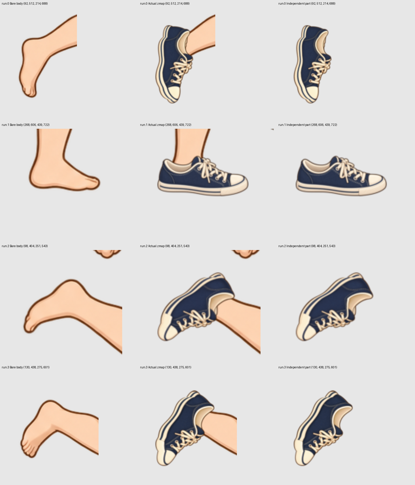
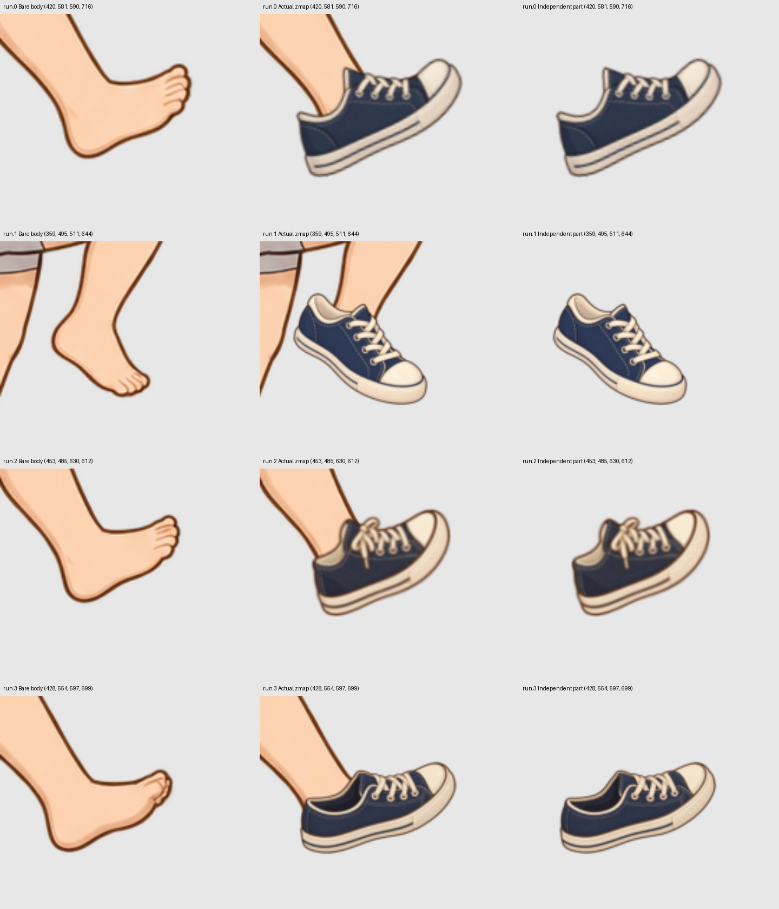
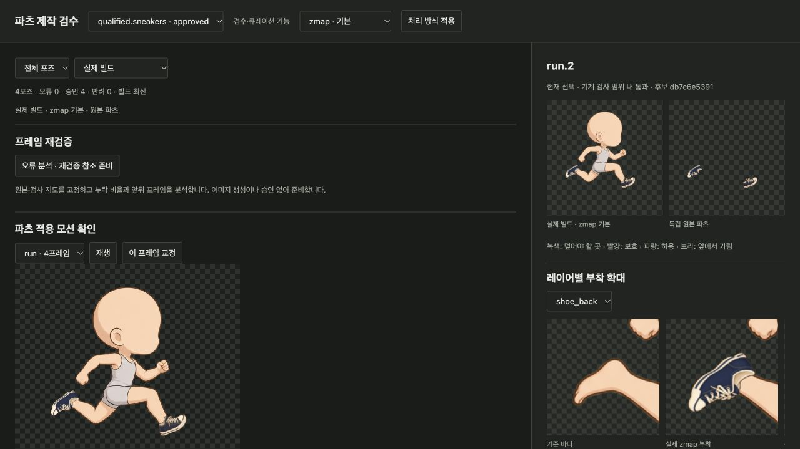

# 신발 수정 후속 검증 — 2026-10-11

**현재 상태: 이 문서의 재승인 결론도 철회했다.** 아래 이미지·수치·표결은 당시 기록이다. 최신 구현과 미승인 수정안은 [신발 레이어 교체와 재검증](22-shoe-replacement-revalidation.md)을 따른다.

이전 신발 4포즈 승인은 잘못이었다. [오승인 조사](20-shoe-acceptance-audit.md)의 원본과 당시 비전 응답은 그대로 보존한다. 실제 비전 호출이 있었어도, 불완전한 덮임 지도와 작은 전체 그림을 보고 승인한 것은 충분한 검수가 아니었다. 생성 지시의 밑창 시점 가정도 독립적으로 확인하지 않았다.

이번 작업은 **기존 4개 참고 포즈의 신발**에 한정한다. 전체 idle/walk/run 사이클이나 추가 코디 영상을 생성하지 않았다. 최종 수정안 4포즈의 실제 Codex 비전 v5가 모두 현재 입력에서 여섯 항목을 통과했고, 큐레이터가 8개 부착을 동일 좌표 확대 그림에서 대조한 뒤 이 바디·참고 포즈 범위로 승인했다. 아래 그림과 `current-state.json`은 그 최종 수정안이다. 이전 오승인을 다시 유효하게 만든 것이 아니다.

## 원본 바디와 실제 부착





각 행의 세 그림은 동일한 원본 좌표다. 뒤 신발을 밑창 아이콘으로 그리는 지시를 제거하고, 발끝·뒤꿈치·칼라 진입 방향을 맞춘 측면 파츠를 만들었다. `run.0` 앞 신발의 뒤축 길이와 `run.2` 앞 신발의 크기·위치도 교정했다. 전체 캐릭터에서 옷이나 신발을 차분으로 떼어내지 않았다.

## 제작 경로와 한계

1. 고정된 바디에서 발 윤곽과 칼라 진입 방향을 확인한다. `parts_shoe_pose_reference.py`는 기존 독립 신발의 heel/toe를 목표 좌표에 대응시킨 **제작 참고 그림만** 만든다. 세 번째 collar witness의 잔차도 기록한다. 이 잔차나 두 점 대응은 해부학·시점·최종 부착 승인 기준이 아니다.
2. 원본 바디의 발 경계를 포함하는 덮임 지도를 작성하고 강화한다. 줄어든 발 안쪽만 덮도록 기준을 낮추지 않는다. `run.0`, `run.2`, `run.3`의 뒤쪽 발 전체 경계와 실제 칼라 단면을 기존 요구 영역에 추가했다. white 영역의 alpha 230 기준은 유지한다.
3. Native image generation으로 포즈별 독립 신발을 만든다. 다른 신발 레이어는 보존한다. 공급자에게는 바디·landmark·QA·디자인·형태 참조의 실제 보이는 RGB 이미지를 전달하고 원본 RGBA도 별도로 고정한다.
4. 새 그림도 실패하면 후보로 남긴다. 이중 밑창 수정에서는 native 편집이 외곽을 줄여 발이 다시 노출됐다. 채색 결과를 앞서 맞춘 **독립 신발의 alpha 윤곽**에 행별로 등록했다. 원본 몸의 색상을 복사하거나 런타임에서 신발을 변형하지 않았다. 이 단계는 명시적인 제작 후처리이며, native 생성만으로 정확한 실루엣을 얻었다는 주장이 아니다. seam·재질·비례는 다시 시각 검수한다.
5. 선택된 독립 파츠를 실제 zmap 빌드에서 검사한다. 기술 검사, 실제 이미지 비전, 확대 큐레이터 판단과 프레임 간 비교를 모두 수행한다. 파츠의 승인과 전체 모션·전체 코디의 최종 승인은 별개다.

## 추가로 고친 도구 오류

- 투명 PNG의 숨겨진 RGB 때문에 형태 참조가 남색 사각형처럼 보일 수 있었다. 공급자 참조는 중립 회색에 실제 alpha를 합성한 RGB로 만들고 원본은 수정하지 않는다. 숨겨진 RGB만 다른 두 PNG의 공급자 참조가 동일하다는 회귀 테스트를 추가했다.
- 외부 이미지를 `INDEX=PATH`로 가져올 때 **보존 레이어 번호**에 주면 이미지가 사용되지 않은 채 미완료로 넘어갈 수 있었다. 직접 수행한 앞 신발 가져오기에서도 `0`과 실제 수정 대상인 `1`을 잘못 지정했다. 이제 공급한 이미지가 보존 번호를 가리키면 어떤 이미지도 가져오기 전에 오류와 올바른 수정 번호를 안내한다. 올바른 번호는 다른 레이어의 원본 픽셀을 유지하면서 수정 대상만 바꾼다.

웹 native 재작업은 job의 수정 대상 이미지를 직접 생성하므로 위 외부 INDEX 지정과 경로가 다르다. 이 수정은 모든 웹 재작업 오류를 해결했다는 뜻이 아니다.

## 검증 범위



- 관련 회귀 **87개 통과**. 원본 참조 보존, 잘못된 외부 가져오기 차단, 수정 레이어만 교체하는 동작을 검증했다.
- 기존 바디 4장과 bare-body 렌더의 픽셀 동일성 유지. 헤어/신발 on/off의 16가지 sample에서 Python/JavaScript 프레임과 레이어 일치.
- 실제 렌더 마스크 0, 외형 조합별 baked clip 0. 바디와 파츠는 공통 motion sample을 사용한다.
- 선택된 신발 4포즈의 덮임 누락·보호 영역·허용 범위·바디 소유 불일치 0. 이 수치는 신발 품질 승인 자체가 아니다. `run.0` 뒤축 과장, `run.2` 앞 신발의 과한 길이와 부피는 수치 0이어도 비전에서 반려됐고, 별도 수정 후에 다시 통과했다.
- 최종 선택의 실제 비전 입력 보드·응답을 모두 보존하고 보드 SHA-256을 확인했다. 현재 판정은 `run.0`~`run.3` 비전 pass 4건·범위를 명시한 큐레이터 승인 4건이다. 이웃 후보가 바뀌어 stale이 된 보고서는 승인 근거로 사용하지 않았다.
- 현재 모션은 4프레임 **non-looping 참고 구간**이다. 전체 달리기 사이클의 움직임이나 다른 체형의 신발 부착을 검증한 것이 아니다. 헤어의 과거 승인도 이번 신발 비전 결과로 갱신하지 않는다.

자료: [후보·비전·판정 상태](assets/shoe-repair-20261011/current-state.json), [큐레이터 기록](assets/shoe-repair-20261011/curator-review.json), [런타임 검사](assets/shoe-repair-20261011/runtime-verification.json), [run.0 앞 신발 교정](assets/shoe-repair-20261011/run.0.front-length-correction.json), [run.2 앞 신발 교정](assets/shoe-repair-20261011/run.2.front-length-correction.json), [run.0 채색 등록](assets/shoe-repair-20261011/run.0.paint-registration.json), [run.2 채색 등록](assets/shoe-repair-20261011/run.2.paint-registration.json), [run.3 채색 등록](assets/shoe-repair-20261011/run.3.paint-registration.json).

실제 제작 workspace는 `assets/parts-independent-qualified-20261011/library/assembly.json`이다. 기존 archive는 철회 전 snapshot이며 최신 수정 후보를 포함하지 않는다. 새 후보의 원본·등록 이력·검사 참조는 현재 workspace의 immutable production records에 보존한다.

```bash
.venv/bin/python scripts/dev/parts_shoe_pose_reference.py \
  --assembly assets/parts-independent-qualified-20261011/library/assembly.json \
  --part qualified.sneakers --source-pose run.1 --target-pose run.2 --layer shoe_back \
  --source-heel 305,689 --source-toe 402,680 --source-collar 324,648 \
  --target-heel 184,435 --target-toe 126,508 --target-collar 200,475 \
  --out /absolute/new/reference-directory
```

이 명령은 참고 그림만 저장하며 파츠 선택·바디 수정·승인을 수행하지 않는다.
