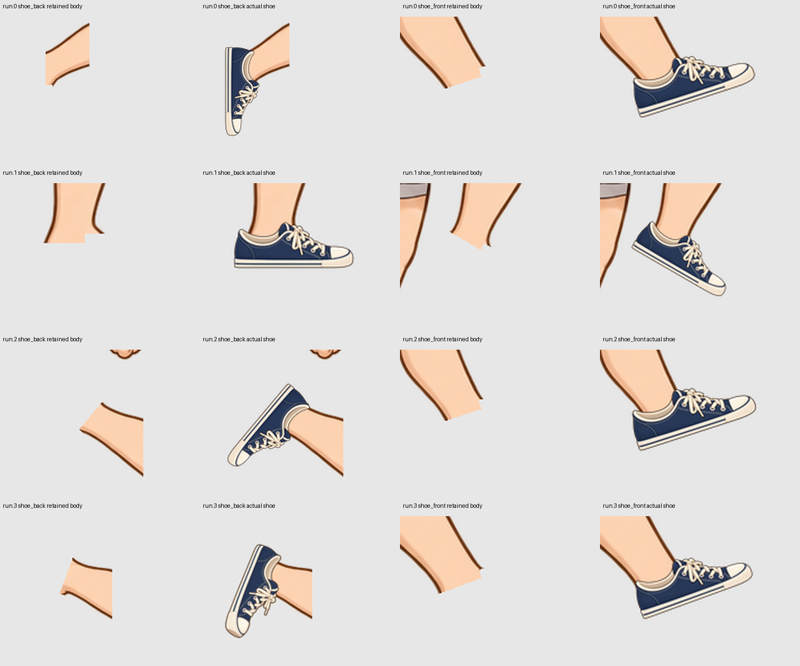
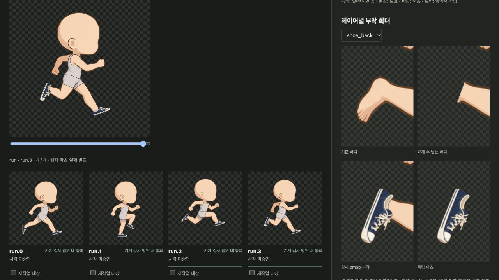

# 신발 레이어 교체와 재검증 — 2026-10-11

[이전 후속 검증](21-shoe-repair-followup.md)의 재승인도 철회한다. 검사 수치와 비전 pass를 실제 신발 형상에 대한 충분한 근거로 받아들인 판단이 잘못이었다. 이전 이미지·응답·표결은 당시 기록으로 보존하며 현재 승인으로 사용하지 않는다.

## 문제가 생긴 이유

독립 파츠 제작 경로에는 기존 합성기의 `provides/replaces`가 연결되지 않았다. 맨발을 그대로 그린 채 신발로 그 윤곽 전부를 덮도록 검사했고, 휘어진 맨발 모양을 따라 신발 밑창까지 굽혔다. 이후 채색을 같은 alpha 윤곽에 등록해도 잘못된 형상은 남았다. 원본의 발/다리 분리도 일부 발목에 맞지 않았다.

이번 구현은 기존 resolver의 부위 교체를 사용한다. `shoe_back`은 `foot_back`, `shoe_front`는 `foot_front`를 제공·교체한다. 신발을 벗으면 원래 발이 돌아온다. 다리 전체를 숨기거나 런타임 alpha 마스크로 자르지 않는다. 바디 분리 경계는 다시 작성했지만 **원본 바디 RGBA 4장은 그대로 복원된다**.

## 현재 결과와 범위



- 기준 바디 하나와 **4개 non-looping 참고 포즈**에 대한 신발 수정안이다. 전체 달리기 사이클이나 다른 체형 검증 결과가 아니다.
- 기계 검사 4포즈 통과, 최신 실제 이미지 비전 검사 4포즈 pass. **큐레이터 승인 0, release_ready=false**로 남긴다. 전체 도구/아트 완성이나 최종 채택을 주장하지 않는다.
- 기존의 휘어진 뒤 신발 `run.0/2/3`은 같은 직선 윤곽 기준에서 각각 **2.529 / 2.377 / 2.222px**로 반려된다. 제한은 2px이고 기존 `run.1`은 이 한 항목을 통과한다. 직선 검사는 만능 신발 QC가 아니라 명시한 단단한 가장자리의 검사다.
- Python/JavaScript 16개 렌더 경우가 일치한다. 착용한 8경우에서 원본 발 레이어가 제외되고, 벗은 8경우에서 돌아온다. 원본 바디 4장 픽셀 동일, 렌더 마스크 0, 외형별 baked clip 0.
- 관련 회귀 검사 **93개 통과**. 숫자 검사와 이미지 비전은 최종 아트 승인을 대신하지 않는다.

자료: [현재 판정](assets/shoe-replacement-20261011/current-state.json), [런타임 검증](assets/shoe-replacement-20261011/runtime-verification.json), [기존 후보 재측정](assets/shoe-replacement-20261011/old-candidate-edge-audit.json), [검사 설정](assets/shoe-replacement-20261011/production-config.json).



## 그림을 만든 방법

Codex 내장 image generation으로 곧은 밑창을 가진 [기준 신발](assets/shoe-replacement-20261011/native-master.png)을 다시 만들었다. 프로그램은 이 원본을 단일 배율·회전·이동으로 포즈별 제작 참고 자산에 배치한다. 이는 **자산 제작 단계**이며 플레이어에서 신발을 리깅하거나 변형하지 않는다. 미세 무늬는 입력 전처리와 4배 해상도 투영 후 축소로 정리한다.

`run.1` 뒤 신발은 위로 1px, `run.3`의 첫 수정안은 오른쪽 2px·위로 4px의 등록 교정이 필요했다. 요구/보호/허용 지도 안에서 위치만 보정했고 원본과 부모 후보를 보존했다.

`run.3`의 측면 초안은 비전에서 **shape unknown**이었다. 이를 pass로 바꾸지 않고, 맨발의 발가락 패드와 바디 전체 카메라를 참조해 [독립된 포즈용 신발](assets/shoe-replacement-20261011/native-run.3-view.png)을 새로 생성했다. 첫 각도 후보는 진입 방향과 밑창 면이 달라 가져오기 전에 제외했다. 채택한 후보는 발목이 우하단에서 들어오고, 앞코 밑면이 일부 보이는 형태다. 이 원본도 별도로 보존한다.

[생성 지시·원본 해시·후처리 기록](assets/shoe-replacement-20261011/native-generation.json)과 제외한 각도 원본도 함께 보존한다. 생성 지시 기록은 호출 이후 정리한 요약이며 provider payload의 원문이라고 주장하지 않는다. 이번 수정의 이미지 생성에는 Codex 내장 도구를 사용했고 Grok은 호출하지 않았다.

### 검사 지도 수정의 의미

필수 영역은 **삭제한 맨발 전체**가 아니라 남는 발목의 연결 경계다. 보호 영역은 신발 혀가 합법적으로 덮는 낮은 발목보다 위의 종아리다. `run.3`의 새 각도는 이전 측면 alpha를 4px 확장한 허용 지도에서 224px가 벗어났다. 이전 기준을 통과했다고 보고하지 않는다.

해당 포즈의 허용 영역은 기준 제품의 불투명 치수와 명시한 **7 native px**의 원근/등록 여유로 작성한 공간으로 바꿨다. 새 후보 alpha에 맞춰 지도를 복제하지 않았다. 필수 연결·보호 영역과 2px 직선 제한은 유지했다. [치수와 꼭짓점](assets/shoe-replacement-20261011/allowed-volume.json)을 보존하고 바뀐 기준에서 4포즈 비전을 다시 실행했다. 다른 제품/체형의 허용 범위는 따로 작성·검토해야 한다.

## 제작·검수 도구 변경

| 항목 | 동작 |
| --- | --- |
| 독립 레이어의 `replaces` | 생성 참조, 후보 검수, 실제 pack 빌드가 같은 부위 교체를 사용한다. Flat body/없는 부위/중복·부분 교체를 거부한다. |
| `straight_edges` | 포즈별 축·면·검사 구간·최대 편차를 고정하고 실제 외곽을 측정한다. 미검출은 통과시키지 않는다. |
| 교정된 생성 참조 | 선택·검사된 위치 보정은 다음 job의 위치·배율·참고 이미지로 전달된다. 바디/리그가 달라지면 재사용하지 않는다. |
| 형태 보류 | 현재 비전이 형태를 fail/unknown으로 판정하면 이전 파츠를 형태 템플릿으로 강제하지 않는다. 해당 응답도 참조 묶음에 고정한다. |
| `--registered-canvas` | 명시한 독립 PNG가 native rig 좌표를 사용하면 위치와 픽셀을 그대로 가져온다. 크기·투명도·대상 영역을 검사한다. 생성기의 자유로운 프레이밍은 기존 fit 경로를 사용한다. |
| 부착 비교 | 원본 바디 / 부위 교체 후 남는 바디 / 실제 부착 / 독립 파츠를 같은 좌표에서 본다. |
| 과거 후보 | 바디·교체 규칙이 바뀐 후보는 이전 기준으로 표시하며 현재 후보 패널 전체를 막지 않는다. |
| 승인 유효성 | 과거 표결은 보존하지만 현재 검사/비전이 유효하지 않으면 현재 승인과 release로 집계하지 않는다. 검사 지도 변경은 재검수를 요구한다. |
| 재작업 지시 | 완료된 요청은 다음 생성에 다시 발행하지 않는다. 현재 검사 오류는 과거 승인으로 재작업에서 제외하지 않는다. |

## 다시 확인하기

작업 workspace는 `assets/parts-independent-qualified-20261011/library/assembly.json`이고 관리 worktree의 브랜치는 `codex/parts-production-v243`이다. 이전 archive는 과거 snapshot으로 최신 수정안을 담지 않는다.

```bash
.venv/bin/sprite-gen parts-review-serve \
  --assembly assets/parts-independent-qualified-20261011/library/assembly.json --port 8789
.venv/bin/python scripts/dev/parts_independent_verify.py \
  --out assets/parts-independent-qualified-20261011
.venv/bin/python scripts/dev/parts_shoe_replacement_evidence.py \
  --out assets/parts-independent-qualified-20261011 \
  --evidence docs/parts/assets/shoe-replacement-20261011
```

`parts_shoe_replacement_author.py`는 저장된 native 원본과 명시한 geometry JSON으로 제작 참고 자산과 분리 경계를 만든다. `body-pieces-r12`와 `shoe-replacement-r12`가 현재 채택한 바디/기초 제작 이력이다. 이후의 등록 교정·native 각도 후보·검사 지도 갱신은 현재 후보와 부모 이력에 따로 보존한다. 전체 모션 확장 전에 이 결과의 최종 아트 채택과 나머지 파츠를 검수해야 한다.

해당 스크립트를 별도 workspace 복사본에서 재실행해 [바디 조각 48장·신발 참고 이미지 8장·검사 지도 12장의 픽셀 동일성](assets/shoe-replacement-20261011/author-reproduction.json)을 확인했다. 재현 작업은 현재 선택과 바디를 수정하지 않았다. 다음 생성용 [참조 묶음 8개 job](assets/shoe-replacement-20261011/next-generation-reference.json)도 최신 상태에서 준비하고 실행 명령만 dry-run으로 확인했다. 교정된 뒤 신발의 위치와 native 시점을 전달하며 현재 후보·비전은 그대로 유지한다. 실제 추가 생성은 시작하지 않았다.
