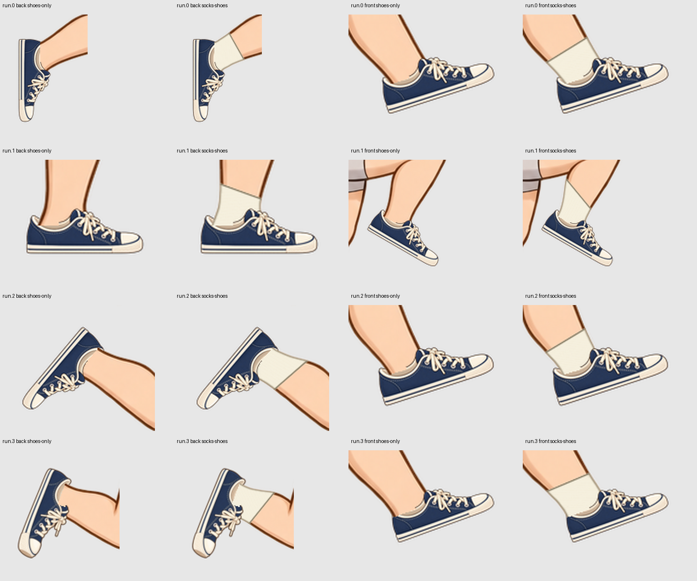
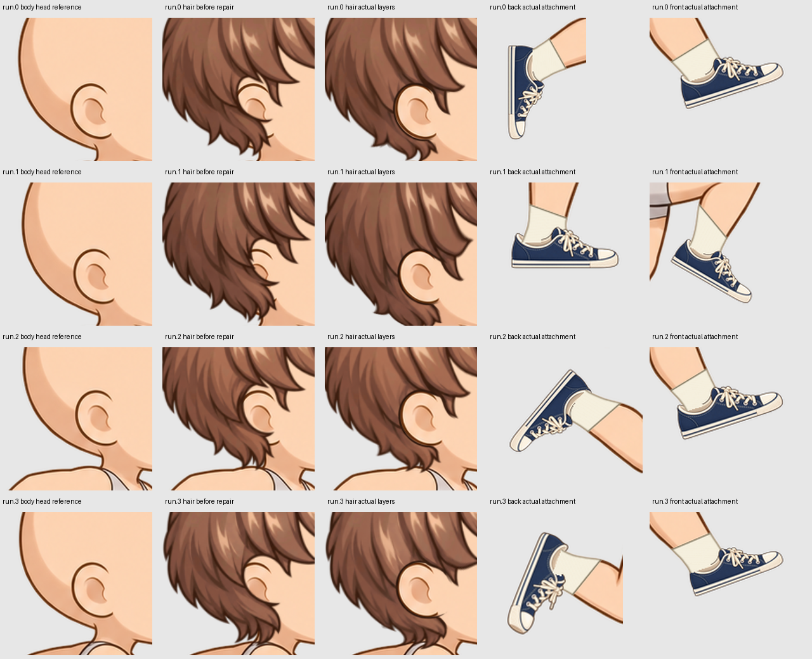
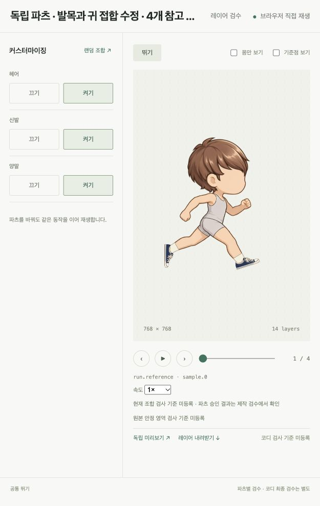

# 양말과 발목·귀 접합 교정 — 2026-10-11

현재 결과는 **공통 바디의 4개 non-looping 참고 포즈**에 독립 헤어·양말·신발을 붙인 미승인 제작안이다. 전체 달리기 사이클이나 다른 체형의 검증 결과가 아니다. [이전 신발 수정](22-shoe-replacement-revalidation.md) 이후 사용자가 지적한 양말 윗단과 귀 파임을 수정했다. 기존 이미지와 판정은 당시 기록으로 보존한다.



## 자산과 제작 방법

양말은 앞/뒤 발목과 발의 **4개 독립 레이어 × 4포즈 = 16 PNG**다. 발목은 남는 종아리 alpha 안에서 몸에 붙고 윗단은 발의 회전 대신 종아리 방향을 따른다. 사각 작업 영역으로 자르지 않고 발에 연결된 종아리 성분만 남겨 접힌 다리의 각진 절단과 허벅지 잔조각을 막는다. 신발이 있으면 `covers/cover_rule`로 양말의 발 부분만 숨기고 발목은 남긴다. 신발을 벗으면 양말 발 부분이 나오고 양말까지 벗으면 원래 맨발이 돌아온다.

신발 자신에게 적용하는 **칼라 입구 KEEP 마스크**는 실제 발목과 겹치는 뒤쪽 립만 연다. 앞쪽 림과 아래 접합은 보존한다. 양말 전체나 다리를 신발 윤곽으로 자르지 않는다. 신발 원본 8장과 바디 원본 4장의 RGBA는 그대로다.

헤어의 파임은 실제 귀보다 위에 있었다. 색 채움·국소 등록·원형/윤곽 마스크·외곽선 보강 초안은 결 손상이나 귀 둘레의 이중 테두리가 남아 제외했다. 최종 수정안은 **독립 헤어만 들어 있는 시트를 AI 편집**한 뒤 귀 주변에 한정해 원본에 등록한 자산이다. [실제 native 원본·입력·지시·SHA](assets/socks-20261011/native-hair-generation.json)를 보존한다. 바디 귀 윤곽의 접선을 위치 참조로 사용하며 바디 RGB를 파츠에 복사하지 않는다. 이 등록은 고정한 바디에 대한 제작 교정이고 범용 해부학 검출기가 아니다. 헤어의 귀 파임은 독립 PNG의 alpha 자체이며 **헤어 런타임 마스크는 없다**. 런타임에서 헤어를 변형하지 않는다.



[Codex 내장 도구로 생성한 니트 소재](assets/socks-20261011/native-material.png)와 [실제 소재 생성 지시](assets/socks-20261011/material-prompt.txt)를 보존했다. 양말 RGB는 새 소재이고 바디 RGB를 복사하지 않는다. 양말 16장은 프로그램으로 구성한 포즈별 제작 초안이며 AI가 각 포즈를 직접 그렸다고 주장하지 않는다. 헤어는 native 독립 파츠 편집이고 신발은 이전 native 생성 원본을 유지한다. 이번 수정에 Grok을 호출하지 않았다.

## 제작·검수 계약

- 기본은 zmap이고 필요한 레이어·포즈에만 `masks`를 선언한다. `provides`는 실제 제공 부위를, `replaces`는 바디 부위 교체를 지정한다.
- 대상·좌표계·채널·원본 SHA를 job/후보/빌드/export에 고정한다. 마스크나 착용 조건이 바뀌면 과거 후보/판정을 현재 승인으로 쓰지 않는다.
- **실제 빌드**는 지정 마스크 여부를 표시한다. **몸 위 원본 · zmap만**은 지정 마스크를 모두 제외한다. **가림 적용 파츠**는 몸 없이 실제 지정 마스크가 적용된 파츠를 보여준다. 이전 구현에서 이 보기들이 독립 레이어 마스크를 구분하지 못했던 문제를 수정했다.
- 기계 검사와 비전 관찰은 최종 채택을 대신하지 않는다. 현재 3파츠 × 4포즈의 **큐레이터 승인 0**, `release_ready=false`다.

## 실제 판정과 한계

원형 귀 마스크를 쓴 `attachments-r3`는 실제 Codex 이미지 비전에서 **헤어 4포즈 모두 rework**였다. 밝은 귀 둘레와 아래쪽 검은 돌출이 이유다. [입력과 실제 응답](assets/socks-20261011/vision-history/attachments-r3/joint-vision-report.json)을 보존한다. 윤곽으로 바꾼 중간 `attachments-r5`의 [재작업 판정](assets/socks-20261011/vision-history/attachments-r5/joint-vision-report.json)도 그대로 남긴다. 최신 공동 접합 관찰은 [현재 비전 기록](assets/socks-20261011/joint-vision-report.json)을 따른다. 이 관찰은 개별 파츠의 엄격한 비전/승인 상태를 갱신하지 않는다.

외곽선 보강 `attachments-r7`도 재작업 판정이었다. 이후 native 독립 헤어 수정 `attachments-r9`와 양말 `socks-r3`의 [실제 공동 이미지 관찰](assets/socks-20261011/vision-history/attachments-r9/joint-vision-report.json)은 4포즈 모두 pass였다. 발목과 연결되지 않은 양말 조각을 제거한 **현재 `socks-r4`도 4포즈의 헤어·발목 접합 관찰 모두 pass**다. [최신 입력과 응답](assets/socks-20261011/joint-vision-report.json)에 정확한 현재 appearance/part digest를 기록했다. 작은 가장자리 결함, 전체 동작, 디자인/시간 일관성의 승인을 뜻하지 않는다. `attachments-r6`의 최초 호출은 180초 timeout이었고 성공으로 처리하지 않았다. 모든 실제 입력과 응답을 이력에 보존한다.

현재 기계 검사에서 신발/양말 각각 4포즈 통과, 헤어 4포즈 작은 pinhole 경고가 남는다. 면적 변화의 45% 제한과 검사 기준을 완화하지 않았다. 개별 파츠의 변경 전 비전 판정은 현재 판정이 아니다. 전체 동작의 연속성, 나머지 파츠와 다른 체형 검수는 아직 필요하다.

- 관련 회귀 테스트 **103개 통과**. 실제 마스크 적용, 마스크 없는 zmap 비교, 파츠만 표시하는 보기의 픽셀 차이 검사도 포함한다.
- 헤어/양말/신발 on/off **8조합 × 4포즈 = 32경우**의 Python/portable JavaScript clock·레이어·마스크 descriptor/texture SHA가 같다. 두 렌더러의 전체 픽셀 동일성이나 아트 품질 보증을 의미하지 않는다.
- 바디 원본 4장 픽셀 동일, 신발 원본 8장 픽셀 동일, 양말 발목은 바디 alpha 밖으로 뜨지 않고 양말 발 alpha는 바디 발 alpha와 같다.
- 현재 런타임 마스크 이미지 **8장**은 신발 입구 전용이다. 32경우에서 활성 마스크 descriptor가 총 32개다. 헤어와 양말은 독립 alpha 파츠와 zmap을 사용한다. 외형 조합별 baked clip은 **0**이다.

자료: [현재 판정/선택](assets/socks-20261011/current-state.json), [런타임 검증](assets/socks-20261011/runtime-verification.json), [양말 제작 기준](assets/socks-20261011/authoring.json), [접합 교정 기준](assets/socks-20261011/attachment-authoring.json). `*.current-config.json`과 원본/후보/마스크 PNG를 함께 보존한다. `footwear-config.json`은 양말 제작 당시 covers를 추가한 기록이고 현재 신발 설정은 `qualified.sneakers.current-config.json`이다.



## 이어서 실행하기

관리 worktree `codex/parts-production-v243`의 workspace는 `assets/parts-independent-qualified-20261011/library/assembly.json`이다. 양말은 `inputs/socks-r4`, 접합 수정은 `inputs/attachments-r9`다. 이전 archive에는 현재 수정안이 없으므로 이 worktree를 보존해야 후보·재작업 이력과 빌드를 그대로 이어갈 수 있다.

```bash
.venv/bin/sprite-gen parts-play \
  --assembly assets/parts-independent-qualified-20261011/library/assembly.json --port 63839 --interpolation frame
.venv/bin/sprite-gen parts-review-serve \
  --assembly assets/parts-independent-qualified-20261011/library/assembly.json --port 8789
PYTHONPATH=. .venv/bin/python scripts/dev/parts_independent_verify.py \
  --out assets/parts-independent-qualified-20261011
PYTHONPATH=. .venv/bin/python scripts/dev/parts_sock_evidence.py \
  --out assets/parts-independent-qualified-20261011 --evidence docs/parts/assets/socks-20261011
PYTHONPATH=. .venv/bin/python scripts/dev/parts_attachment_vision.py \
  --out assets/parts-independent-qualified-20261011 --evidence docs/parts/assets/socks-20261011 \
  --revision NEW-AUDIT-ID
```

`parts_sock_author.py`와 `parts_attachment_author.py`는 configure → sheet → registered-canvas slice → check → build 경로를 사용한다. 기존 revision 디렉터리를 덮어쓰지 않는다. 생성 참조에서 제작 위치, 마스크와 착용 조건을 고정하므로 후속 독립 이미지 생성의 입력으로 사용할 수 있다. 전체 모션 확장은 접합부의 최종 아트 채택 이후에 진행한다.
