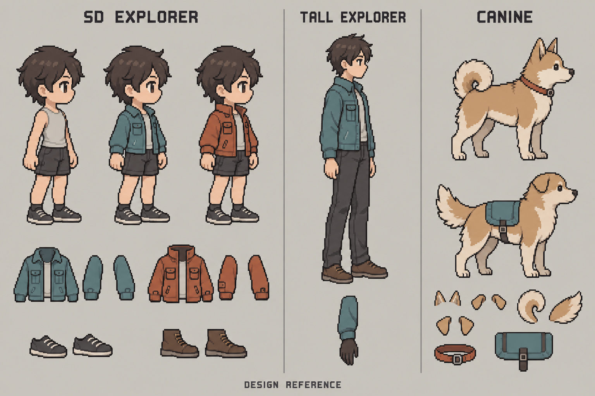

# 파츠 시스템 초기 구현과 데모 계획

> Owns: Fork planning and status for PR00–06 and the first parts demo · Index: [docs/README.md](../README.md)

이 문서는 첨부된 `sprite-gen-parts-system-pr-roadmap-20261004.md`의 초기 작업을 구현 단위와 데모 제작 규격으로 구체화한 제안이다. 기존 Python 엔진을 유지하고, 파츠 기능은 별도 assembly를 사용하는 opt-in 경로로 추가한다. 첫 착수 범위는 PR00–03이며, 첫 합성 데모는 PR04까지 완료한 뒤 검증한다.

사용자 정정(2026-10-04): 데모의 기본 경로는 **공통 idle/walk/run + 현재 sample에 대한 파츠 레이어 합성**이다. 아래의 96 clip 수량은 32외형 × 3상태의 검증 공간으로 읽는다. 조합별 완성 clip을 만들거나 저장하지 않는다. Baked export는 명시적으로 요청할 때만 사용한다. 팔이 중복된 장신 artwork 후보는 사용자가 반려했으므로 demo/reference로 재사용하지 않는다. Tall rig의 기술 검증은 별도이며 이 후보를 승인한 증거가 아니다.

2026-10-04 요구를 반영해 SD explorer의 기본 사용자 데모를 헤어·표정·상의·하의·신발의 5slot으로 확장했다. 추가 장비, 독립 subslot, palette와 다른 체형의 variation도 PR01부터 데이터 계약에 포함한다. 상세 범위와 조합 규칙은 [커스터마이징과 베리에이션 계획](customization-and-variation.md)을 따른다. 두 slot의 12 clip은 내부 smoke이며 사용자 데모의 완료 기준은 기본 32외형·96 clip이다.

작성일은 2026-10-04이다. PR00–06의 M1 엔진을 구현했다. 현재 사용할 수 있는 범위는 [선언 계약](01-contract.md), [모션 snapshot](02-motion-snapshots.md), [파츠 import](03-part-import.md), [공통 합성](04-composition.md), [검수·QA](05-review-and-qa.md), [baked export](06-baked-export.md)와 [기준선](00-baseline.md)을 따른다. 실제 아트의 96 clip 제작·검수는 진행 전이며, 엔진의 synthetic 증거와 구분한다.

## 구현 현황

| 범위 | 현재 상태 |
|---|---|
| PR00 | 기준 커밋에서 직접 실행한 layer/non-layer golden, 회귀 테스트와 fork 자동 게시 차단 구현 |
| PR01 | content digest·정확한 reference·sample binding·20개 humanoid slot·palette·preset·cardinality 검증, 다섯 체형의 선언 fixture 및 CLI 구현 |
| PR02 | 공통 source adapter, exact timing, immutable candidate/freeze, 최종 raster annotation, stale binding 분리와 CLI 구현 |
| PR03 | Body/part 분리, 실제 RGBA import, crop/pivot 보존, mask/region, coverage, immutable 등록 구현 |
| PR04 | 공통 timeline, body 교체, subslot 우선순위, draw order, mask/palette/mirror, appearance/preview CLI 구현. 다섯 체형과 synthetic 32외형·96 clip 검증 |
| PR05 | 입력·render·QA evidence snapshot, contact/world travel 측정, 명시적 검수 결정, scope와 오래된 승인 차단 구현 |
| PR06 | 결정론적 다중 state atlas·manifest·Aseprite mapping, 순서/ticks 유지 dedup, build lock와 승인 release gate 구현 |
| 실제 SD 데모 | 디자인 참고 시트와 새 투명 RGBA body 후보가 있음. pixel grid·alpha·view 보정, 분리와 5slot 각 2종·96 clip 검수는 미완료 |

## 확인한 기준선

| 항목 | 2026-10-04 확인 결과 |
|---|---|
| 저장소 | fork `imjlk/sprite-gen`, upstream `aldegad/sprite-gen` |
| 기준 SHA | `d993e5300b4255111e8ee0e29779caea1b3b97bd`, v2.20.0 |
| 구현 검토 당시 상태 | 로컬·origin·upstream main이 같은 SHA, 로컬 변경사항과 fork PR 없음 |
| 로컬 전체 테스트 | `python -m pytest -q -ra`: 3163 passed, 2 skipped, 74 warnings, 326.38초 |
| 로컬 테스트 환경 | macOS arm64, Python 3.14.0rc2, Pillow 12.3.0, NumPy 2.5.3, pytest 9.1.1 |
| 제외된 테스트 | `SPRITE_GEN_CHROMA_REAL_STILLS` 미설정, 실제 RIFE 바이너리 미설치 |
| upstream CI | [같은 SHA의 CI 통과](https://github.com/aldegad/sprite-gen/actions/runs/37122262255) |

로컬 결과는 CI의 Linux/Python 3.14 환경을 그대로 재현한 결과가 아니다. 74개 경고는 Pillow `getdata()`의 deprecation 경고다. 구현용 프로젝트 `.venv`는 로컬에 설치된 안정 버전 Python 3.13.2를 사용하며, 기존 Linux/Python 3.14 CI는 유지한다. 자세한 환경과 golden 생성 방법은 [기준선](00-baseline.md)에 기록한다.

임시 layer fixture에서 `curation.dx = 6`을 적용해 성공적으로 finalize했을 때, body bbox는 `[28,28,68,88]`에서 `[34,28,74,88]`로 이동했지만 manifest의 `hand_r`는 `[60,50]`으로 유지됐다. 현재 [이미지 변형](../../sprite_gen/compose/compose_atlas.py)과 landmark 출력은 별도 경로다. 따라서 finalize 성공만으로 최종 이미지의 socket이 정확하다고 판단할 수 없다.

## 초기 PR의 산출물과 완료 기준

각 PR은 바로 앞 PR에 의존한다. 첫 계약이 안정되기 전에는 생성 작업이나 검수 UI를 병행 구현하지 않는다.

| PR | 구현 단위 | 반드시 남길 산출물 | 완료 판정 |
|---|---|---|---|
| PR00 | 기준선과 fork 운영 | 기준선 문서, 현재 실패·skip 목록, legacy 결과 고정, fork release 설정 | 기존 layer/non-layer의 CLI·JSON·픽셀 결과 유지, 의도하지 않은 fork 게시 차단 |
| PR01 | 순수 선언 계약 | `spec/parts_contract.py`, SlotDefinition/CustomizationCatalog, digest 규칙, 다섯 topology/rig fixture | 기본·세부 slot과 variation/palette/preset 계약, SD/tall/사족/무다리/비대칭6limb 수용, 참조·cycle 오류 거절 |
| PR02 | 모션 import와 freeze | `spec/parts_assets.py`, `curate/parts_motion.py`, 최종 geometry annotations, 불변 snapshot | 이미지·순서·시간·socket을 같은 입력 해시에 고정, 잘못된 좌표나 불안정한 source는 freeze 실패 |
| PR03 | 파츠 import와 binding | `frames/parts_import.py`, multi-piece variants, cropped/full-canvas 예제, body piece 분리·join 정보 | crop 복원 픽셀 일치, 작은 파츠 크기 유지, 모든 target sample과 체형별 binding 검증 |
| PR04 | resolver와 raster 합성 | `compose/parts_resolve.py`, `compose/compose_parts.py`, catalog 선택·preset 해석, 공통 draw-list | 다섯 synthetic 형태가 같은 코드로 합성, 기본 5slot 각각 2종의 SD 32외형×3상태 preview 검수 |

PR03의 이미지 동등성 테스트는 full-canvas와 crop+offset을 같은 rig-canvas로 복원해 비교한다. `before`/`after`, body replacement, sample별 draw-list를 포함한 전체 합성 판정은 PR04가 담당한다.

프로젝트 가상환경에서 검증한다. CI는 Python 3.14를 사용하며 이번 로컬 구현 검증은 Python 3.13.2를 사용한다.

```bash
python3.13 -m venv .venv
.venv/bin/pip install -e ".[dev]"
.venv/bin/python -m pytest -q -ra
```

ffmpeg, `-exact`을 지원하는 img2webp, 실제 RIFE 검증은 현재 [CI 설정](../../.github/workflows/ci.yml)과 같은 방식으로 준비하거나 skip 이유를 기록한다. 유료 생성 API는 기준선과 synthetic 테스트에 사용하지 않는다.

PR00의 release 설정은 fork 자동 게시를 기본적으로 차단한다. fork 게시를 명시적으로 켜는 경로는 repository와 distribution 이름을 확인해야 한다. 현재 [release script](../../scripts/release_publish.py)의 기본 repository는 [release_notes.DEFAULT_REPO](../../scripts/release_notes.py)의 `aldegad/sprite-gen`이므로, fork workflow에서 이 기본값을 그대로 사용하지 않는다.

## PR01에서 확정할 계약

### 선언과 파일 검증의 경계

공통 필드는 `kind`, `schema_version`, `id`, `digest`다. schema version 1에서는 unknown field, bool을 정수로 취급한 좌표, duplicate ID, 존재하지 않는 node/socket, parent cycle을 거절한다. parser는 파일을 열지 않는다. 경로·파일·이미지 제한은 PR02/03의 import 단계가 검사한다.

| 계약 | v1에서 반드시 결정할 내용 |
|---|---|
| TopologyProfile | node와 parent, sockets, 대칭 관계, 접지 node, 허용 slot과 교체 interface |
| RigVariant | topology digest, view, canvas, style/pixel policy, 비율, 기본 body의 논리 ID |
| MotionSet/MotionClip | rig digest, state/view, sample 배열, 이미지 해시, timebase/ticks, loop, 최종 socket·visibility, body piece 자료 |
| PartPack | 디자인 ID, pieces와 assets, rig/motion/view binding, sample map, provides/replaces, mask·palette region |
| CustomizationCatalog | profile의 group/slot/subslot, variant snapshot, palette channel, cardinality, join·충돌 조건, preset의 변경 범위 |
| AppearanceSpec | 정확한 catalog/body/part snapshot 선택, preset과 override 해석, 색상, 상태 목록, 제외·충돌 정책 |
| Review/BuildLock | review subject의 입력 해시, 승인 scope, render/QA policy, toolchain, 실제 출력 해시 |

의존 해시는 topology → rig → motion → part binding → catalog → appearance 순으로 참조한다. RigVariant에는 기본 body의 논리 ID를 두고, 실제 PartPack revision은 AppearanceSpec과 lock에 고정한다. rig가 자신을 binding하는 PartPack 또는 catalog digest를 다시 참조하는 순환을 만들지 않는다.

### Content digest와 승인 대상

canonical JSON은 UTF-8, key 정렬, 고정 separators, `ensure_ascii=False`, `allow_nan=False`로 직렬화한다. 자기 `digest` 필드만 제외하며 의미 있는 배열 순서는 유지한다. defaults는 parser가 명시적으로 확정한 뒤 해시를 계산한다. 절대 경로, 작성 시각, 사용자 환경 로그는 별도 진단 기록에 둔다.

이 규칙에는 버전을 붙인다. 이미지·mask·palette region 등 참조 asset의 해시, sample 순서, duration, socket, visibility와 draw-order 조건은 해시 대상이다. bitmap이 같아도 timeline이 다르면 다른 motion digest를 갖는다.

`review_subject_digest`는 rig/motion/catalog/선택 part/preset·조합 정책/appearance/render policy/QA policy/toolchain 입력을 해시한다. review record의 digest나 미래 출력 해시를 자기 승인 대상에 넣지 않는다. build는 승인된 subject를 확인한 뒤 output hash를 BuildLock에 기록한다. 이렇게 review와 lock의 상호 참조를 피한다. 정식 release gate는 PR05/06에서 구현한다.

### 시간과 export 변환

`timebase`는 ticks/second인 양의 정수, `duration_ticks`는 양의 정수다. renderer는 특정 fps나 timebase를 하드코딩하지 않는다. fixture 기본값은 120000 ticks/second로 제안한다. 이는 정수 milliseconds와 24/30/60fps를 정확하게 표현할 수 있다.

external decimal/fps 입력은 source 값과 변환 규칙, 오차를 기록한다. 선언한 timebase에서 정확히 표현되지 않으면 명시적인 변환 정책을 적용하거나 거절한다. `FrameSequence`의 float seconds만 보고 원본 시간 표현을 추측하지 않는다.

native finalized manifest는 `durations_ms`를 그대로 읽는다. 현재 출력에서 24fps의 24프레임이 각 42ms로 이미 굳었다면 총 1008ms를 보존한다. 원래 fps를 이용해 1000ms로 다시 계산하지 않는다.

새 tick 기반 clip을 Aseprite의 정수 ms로 바꿀 때는 누적 sample 경계를 반올림하고 인접 경계의 차이를 duration으로 삼는다. 예를 들어 정확한 24fps 24프레임은 41/42ms를 배분해 총 1000ms가 되도록 하고, 변환 정책을 export metadata에 기록한다. 0ms 프레임이 생기는 입력은 target capability 오류로 처리한다. 기존 legacy exporter의 결과는 유지한다.

## PR02의 모션 snapshot과 annotation

import는 draft candidate를 만들고, freeze는 검증된 candidate를 불변 객체로 게시하는 별도 단계로 둔다. PR09 UI 이전에도 사용할 수 있게 최종 raster에 대응하는 annotation JSON을 입력받는다.

annotation은 각 `sample_id`에 대해 다음을 갖는다.

- 기준 이미지의 정확한 해시와 rig-canvas 좌표 공간.
- topology가 요구한 socket의 정수 좌표, visibility, `verified` 또는 `unverified` 상태.
- 해부학적 node ID. 화면의 앞/뒤 구분과 좌/우 정체성을 구분한다.
- 명시적으로 관측한 contact/root trajectory. 자료가 없으면 unknown.
- 작성·검수 근거와 annotation revision.

sample ID는 bitmap hash나 atlas rect에서 만들지 않는다. `[0,2,0,1]`과 같이 그림이 재사용되는 재생 순서도 네 sample로 저장한다. per-sample provenance에는 원래 frame/instance와 최종 변형을 연결할 수 있는 자료를 남긴다.

이미지를 6px 이동했는데 socket annotation은 원본 이미지 해시를 가리키는 케이스를 freeze 거절 테스트로 고정한다. 단순히 JSON에 `verified`라고 적힌 사실만으로 다른 raster의 좌표를 재사용하지 않는다. 유효한 해시 연결은 좌표의 시각적 정확성까지 보장하지 않으므로 사람의 피팅 검수도 필요하다.

native source는 기존 `read_guard`와 finalized 결과를 사용하고 `heal_run`을 호출하지 않는다. source tree의 내용은 import 전후 해시가 같아야 한다. 호흡·clone·transform이 적용된 좌표의 정확성을 입증할 수 없으면 최종 raster에서 다시 annotation한다.

이미지와 descriptor가 여러 파일이면 파일별로 한 번 읽는 것만으로 같은 세대가 보장되지 않는다. native 입력은 기존 publish lock에 맞춰 읽고, external 입력은 descriptor가 선언한 이미지 해시 등으로 세대를 검증한다. 안정된 입력을 입증하지 못한 candidate는 freeze를 차단한다. 허용 root, traversal/symlink 이탈, 읽기 전 byte 크기와 decode 전 픽셀 수 제한도 import gate에 둔다.

snapshot은 staging에 완성·검증한 뒤 digest 경로로 게시한다. 실패 시 부분 객체를 공개하지 않고, 같은 digest 객체가 이미 있으면 동일성 확인 후 재사용한다.

초기 CLI와 후속 명령은 다음과 같다. init/validate/motion-import/motion-freeze/import는 현재 실행 가능하다.

```text
parts-init             [구현] assembly와 profile/rig/catalog 초안 초기화
parts-validate         [구현] 선언·digest·선택/coverage 검증, release 승인은 하지 않음
parts-motion-import    [구현] finalized/external source를 draft candidate로 가져오기
parts-motion-freeze    [구현] raster와 annotation을 검사하고 motion snapshot 게시
parts-import           [구현] body/overlay/replacement piece와 sample binding 가져오기
parts-appearance       [구현] 현재 rig/motion/body/catalog에 선택과 palette 고정
parts-preview          [구현] 동일 resolver의 draw-list로 sample PNG와 검수용 preview 생성
```

`parts-inspect`, `parts-review`, `parts-approve`, `parts-build`도 PR05/06에서 구현했다. 각 명령은 처음 등장하는 PR부터 `_modules.py`, CLI/help, wrapper 정책, 문서와 packaging test를 함께 갱신한다. `parts-preview`는 release 승인 기능을 갖지 않는다.

## 첫 데모의 이미지 선택

첫 아트는 새로 만든 SD 탐험가다. 손과 발을 잘 볼 수 있는 복장과 오른쪽을 보는 한 view로 시작한다. 헤어는 앞/뒤 piece와 headwear 가림, 표정은 face feature 조합, 상의는 sleeve/hand 순서, 하의는 waist/leg 피팅, 신발은 foot 교체와 접지를 검증한다. 기본 다섯 slot과 palette를 독립적으로 바꾸면서 동일 모션이 유지되는지 확인한다.



시트는 built-in imagegen으로 생성한 디자인 참고 자료다. 기존 시트에는 단일 헤어·표정·하의와 두 재킷·신발만 그려져 있어 확장된 제작 목록 전체를 표현하지 않는다. 제작 목록은 catalog 계획을 기준으로 한다. 분리된 RGBA, 128px pixel grid, 같은 pose와 canvas 정렬, 정확한 등신 비율, motion binding은 검증하지 않았다. 시트의 조각을 crop한 것만으로 PartPack 등록을 완료한 것으로 취급하지 않는다. [생성 prompt와 provenance](assets/demo-design-reference-20261004.provenance.json)를 별도로 보관한다.

| 항목 | 첫 SD 데모의 제안 규격 |
|---|---|
| 디자인 | 성인 SD 체형, 약 3등신, 같은 identity와 anatomy 위에 기본 다섯 slot 선택 |
| view | 오른쪽을 보는 side view 1개, 자동 mirror 없음 |
| canvas | 128×128 RGBA, 발을 놓을 공통 기준선과 source offset 명시 |
| 스타일 | 정리된 pixel art, 간단한 명암, 24–32색 목표 palette, 배경·cast shadow 제외 |
| body | head surface, hair front/back/side, eyes/brows/mouth, 몸통, 팔·손, waist/leg/clothing, 발의 분리 자료 |
| hair A/B | 짧은 textured hair / 단발, 앞·뒤·옆 그림과 join interface |
| expression A/B | 무표정 / 미소, eyes/brows/mouth preset와 독립 override |
| upper A | 청록색 짧은 재킷: torso, sleeve_l, sleeve_r |
| upper B | 주황색 짧은 재킷: A와 다른 collar/pocket/cuff 디자인, 같은 rig의 소매 피팅 |
| lower A/B | 반바지 / 긴바지: waist/pelvis, leg_l/r |
| footwear A | 어두운 낮은 운동화: foot_l, foot_r replacement |
| footwear B | 갈색 ankle boots: 같은 발 길이·밑창 두께·contact interface의 replacement |
| palette | 피부·헤어·천 주색/보조색·가죽의 선언된 region, shape variant 수량과 별도 |
| 기본 교체 대상 | hair/expression/upper/lower/footwear, 각 2종 |
| M1 추가 장비 | headwear/gloves/back_accessory, 각각 None과 실제 1종, 위험 조합 검수 |

slot/subslot의 허용 목록과 선택 cardinality는 profile/catalog 데이터다. hairstyles와 jacket처럼 여러 piece로 구성된 선택, 앞머리·입·좌우 장비의 독립 subslot, 모자·장갑·백팩의 충돌·가림을 PR01부터 모델에 포함한다. 실제 artwork 제작 순서와 shape variation 목표는 별도 catalog 계획을 따른다. 망토·치마·무기 등도 같은 계약으로 확장하며, 미제작 variant를 지원하는 것으로 표시하지 않는다.

## 첫 모션과 필요한 파츠 수

다음 수량과 시간은 제작 목표다. 실제 freeze된 sample 수·duration이 최종 binding 기준이며, 생성 결과를 이 표에 억지로 맞추지 않는다.

| 상태 | 목표 sample 수 | 목표 frame duration | 검수할 특징 |
|---|---:|---:|---|
| idle | 4 | 250ms | 단순 weight shift, 손목·발 접점 유지 |
| walk | 8 | 125ms | 좌우 limb 정체성, 소매와 손의 앞뒤 순서 |
| run | 8 | 100ms | 더 큰 팔 swing, 공중 구간, 신발과 발의 피팅 |

우선 20개 sample을 목표로 한다. 첫 idle에는 추가 breathe 후처리를 넣지 않는다. breathe 검증은 별도 synthetic 케이스에서 먼저 수행하고, 실제 사용 시 최종 변형을 freeze 전에 끝낸다.

기본 다섯 slot 각 2종의 후보는 `2^5 = 32`외형이며 idle/walk/run까지 총 96 clip을 검수한다. 이 기본 pack은 서로 양립하도록 제작해 전수 검수한다. 목표 20 sample 기준으로는 dedup 전 640개의 composed frame이다. 추가 장비와 확대된 wardrobe는 유효 pair·위험 triple·named appearance의 검수 coverage를 기록하며 전체 조합을 기본으로 미리 굽지 않는다.

각 variant의 모든 piece는 같은 20개 target sample을 지원해야 한다. 예를 들어 upper는 `2 designs × 3 pieces × 20 samples = 120`개 mapping, 신발은 `2 designs × 2 pieces × 20 samples = 80`개 mapping이 필요하며 hair/face/lower mapping을 추가한다. piece 수는 데이터이고 mapping 수가 곧 고유 PNG 수는 아니다. 재사용은 held/per-sample map에 명시하고 각 sample의 피팅을 검사한다.

hair/face/clothing/foot replacement를 보여주려면 이전 그림을 제거할 수 있는 분리 자료가 있어야 한다. 평면 body 한 장만 확보한 단계는 overlay-only candidate로 기록한다. 분리·보정이 완료되기 전에는 기본 다섯 slot의 교체 성공을 선언하지 않는다.

## 이미지와 모션을 제작하는 순서

1. SD identity와 기본 외형을 확정하고 기본 body의 한 자세를 제작한다. hair/face/clothing을 분리할 수 있는 자료를 준비하고 실제 rig-canvas와 pixel grid에서 정리한 PNG를 anchor로 고정한다.
2. 기본 body만으로 idle/walk/run 후보를 만든다. 기존 image-row 또는 video route를 사용할 수 있으나, 포즈 수 일치만으로 품질을 승인하지 않는다.
3. 모션을 curate/finalize하고 최종 raster에 head/face/waist/cuff/limb socket과 ID를 profile에 맞춰 annotation한다. 기본 body pieces를 분리하고 가려진 영역을 보정한 뒤 기준 motion을 freeze한다.
4. hair/expression/upper/lower/footwear 각 두 디자인을 확정한다. 기준 sample을 가이드로 나머지 sample의 piece 그림을 제작하고 palette region과 preset·join 규칙을 등록한다.
5. cropped 입력은 offset/pivot을 기록해 rig-canvas로 복원한다. 피팅을 위해 파츠 자체를 자동 확대하거나 bbox 중심에 다시 정렬하지 않는다.
6. 기본 96 clip의 피팅·가림·교체를 검수하고 headwear/gloves/back의 위험 조합을 추가한다. 반려한 sample/piece를 수정하되 기준 motion과 변경 footprint 밖의 파츠는 보존한다.

생성 모델이 기준 pose와 좌표를 정확하게 지킬 것이라고 가정하지 않는다. AI 결과는 후보이며 피팅·분리·픽셀 정리가 필요할 수 있다. 파츠별로 독립 walk/run 영상을 만든 뒤 동기화된 것으로 취급하지 않는다.

Grok은 후속 실제 후보 생성에 사용할 수 있다. 설치된 `grok` CLI는 개발 보조에 사용 가능하며, 이미지·영상 제작은 기존 [Grok provider](../../sprite_gen/gen/grok_provider.py)와 [video route](../../sprite_gen/gen/video.py)를 재사용한다. 이미지 provider는 Grok Build를 띄우지 않는 direct Imagine 경로다. 실제 호출에는 provider/model을 명시하고, chroma 처리를 거친 결과를 공통 좌표 import에 연결한다. PR07/08의 재개·부분 재생성·실패 기록은 아직 별도 구현이 필요하다.

기본 body 디자인 prompt의 제안은 다음과 같다.

```text
Original friendly adult SD explorer, approximately three-head-tall proportions,
short dark-brown hair, light gray sleeveless shirt, dark shorts, full body,
right-facing side view, both hands and feet clearly readable, neutral standing
pose, simple clean pixel-art design with flat shading and restrained colors.
No jacket, hat, cape, bag, weapon, cast shadow or background scenery.
Use this as a design anchor; canvas alignment and pixel grid will be verified
separately before motion and parts import.
```

## 첫 데모의 확인 조작

PR04의 첫 preview는 읽기 전용 비교 화면 또는 PNG/GIF 묶음이다. profile/rig, 상태와 sample을 선택하고 source/body/composed를 비교하며 socket, node ID, draw-order를 확인한다. PR09의 피팅·승인·쓰기 UI와는 별도 산출물이다.

| 조작 또는 입력 | 완료 판정 |
|---|---|
| upper A → B, 운동화 A 유지 | 몸체·머리·신발의 입력 hash와 선택 sample 유지 |
| 운동화 A → boots B, upper B 유지 | 기본 foot node 제거, 재킷과 그 sample 유지 |
| hair A → B, expression/lower 유지 | 기존 hair 그림 제거, face와 clothing 선택·motion은 유지 |
| expression preset 변경 뒤 mouth만 override | 눈·눈썹 선택은 유지, 입 subslot만 변경 |
| lower A → B, footwear 유지 | 이전 하의 그림 제거, waist/cuff 접합과 발 visibility 검수 |
| 피부/머리/천 색상 변경 | shape와 motion 재생성 없이 palette 적용, 새 appearance revision |
| 모자·장갑·등 장비 선택 | 선언한 footprint만 변경, mask/충돌/접합 정책 확인 |
| idle → walk → run | 선택한 모든 piece가 같은 MotionClip sample을 참조 |
| walk/run의 특정 시점에서 preview 외형 변경 | 같은 sample과 elapsed tick을 유지해 미리 합성한 다른 appearance를 표시 |
| run의 sleeve 한 sample 누락 | missing coverage를 표시, 성공한 완성 preview로 처리하지 않음 |
| 최종 body 변형 뒤 예전 socket 사용 | freeze 거절 또는 기존 motion/binding의 무효화 |
| 잘못된 rig/view/motion binding | 별도 binding 필요 오류 |
| 동일 입력으로 preview 두 번 생성 | 고정 toolchain에서 픽셀·draw-list·portable metadata 일치 |

appearance 선택 재생은 공통 timeline의 현재 sample에 선택한 파츠를 배치하고 합성하는 기능이다. 파츠를 바꿔도 state/sample/elapsed tick을 유지한다. 조합별 완성 raster를 사전 제작하는 방식을 기본 경로로 사용하지 않는다. 특정 게임 엔진의 GPU/mesh adapter는 별도 범위지만 기본 데모의 런타임 교체는 지금 구현한다. 정식 baked release export는 명시적 요청 시 PR05/06의 승인 gate를 따른다.

## 다른 체형을 검증하는 순서

| 형태 | PR01–04 synthetic 검증 | 후속 실제 아트 |
|---|---|---|
| SD humanoid | 공유 humanoid topology, 128×128 rig, 기본/추가/subslot catalog | 첫 실제 기본 96 clip과 추가 장비 검수 |
| tall humanoid | 같은 topology, 별도 128×192 rig, 긴 limb 좌표 | 기본 5slot 각 2종의 별도 fitting과 glove/cuff 검수 |
| quadruped | 별도 topology, 192×128 rig, 네 발 ID와 앞뒤 순서 | coat/pattern·expression·ears·tail·neckwear·torso gear 각 2종 |
| root-only blob | 96×96 rig, 필수 다리 없음, custom state | synthetic regression 유지 |
| asymmetric/6limb | custom rig와 임의 수의 appendage slot | synthetic regression 유지 |

canvas 크기는 fixture 데이터다. core가 SD/tall/animal에 따라 분기하거나 모든 rig를 같은 정사각형으로 강제하지 않는다. custom state, 비대칭 view, repeated bitmap, variable duration, mask와 ordering cycle도 synthetic battery에 포함한다.

8등신·동물은 SD 파츠를 자동 resize해 binding하지 않는다. 같은 design ID에 rig/motion/view별 fitting을 추가하며 destination binding이 없으면 missing으로 보고한다. 참고 시트 가운데와 오른쪽은 디자인 방향을 보여줄 뿐 실제 rig나 움직임을 증명하지 않는다. PR10의 SD wardrobe는 hair 4/expression 5/upper 3/lower 3/footwear 3을 목표로 확대하고, tall/canine은 실제 다중 slot variation과 세 상태의 검수 coverage를 남긴다. 원래 로드맵의 16외형·48 clip을 이 확장 요구의 완료 기준으로 사용하지 않는다.

## 첫 데모 완료 후 진행

PR04에서 같은 resolver의 다중 체형 동작과 SD 파츠 교체를 확인한다. 이후 PR05의 QA·해시 기반 승인과 PR06의 결정론적 export를 끝내 M1을 완성한다. PR07/08에서 기준 모션에 연결된 실제 생성·부분 재생성 workflow를 구현하고, PR09 UI와 PR10 실제 acceptance pack을 연결한다.

현재 산출물은 PR00–06의 선언/CLI/모션 snapshot/파츠 import/공통 renderer/QA·검수/결정론적 export와 회귀 테스트, 본 계획과 customization 계획이다. 초기 catalog의 options는 비어 있으며 실제 imported part를 등록하면 갱신된다. 디자인 참고 시트 외에 [새 body 후보](assets/sd-explorer-body-candidate-v2-20261004.png)와 [prompt·측정·미검증 사항](assets/sd-explorer-body-candidate-v2-20261004.provenance.json)을 보관했다. 첫 생성은 팔 중복과 등신 문제로 제외했고, 두 번째 후보도 palette·alpha·grid·view·분리·모션 검증이 필요하다. 실제 승인된 기본 96 clip과 확장 wardrobe는 아직 제작하지 않았다.
