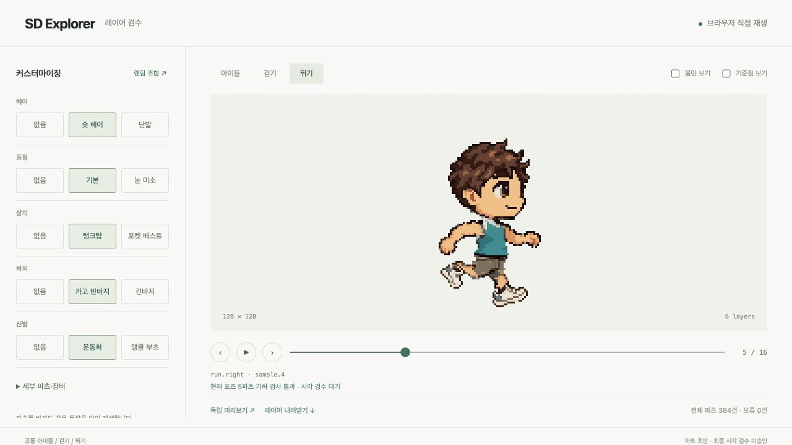

# SD Explorer 레이어 데모 개선

이 문서는 운동화·의상 경계 개선의 비교 기준이다. 현재 8766 실행본은
후속 [뛰기·헤어·신발 개선](sd-explorer-polish-20261005.md)으로 갱신했다.

이 단계에서 보존한 실행본은
`assets/sd-explorer-contribution-demo-20261005-v1/library/assembly.json`이다.
[뷰어](http://127.0.0.1:8766/?layers=basic)에서 새 운동화, 의상 경계 보정,
파츠별 검사 결과와 공통 모션 재생을 확인한다. 저장소에
[독립 HTML](assets/sd-explorer-layers-20261005.html)과
[PNG 레이어 묶음](assets/sd-explorer-layers-20261005.zip)도 보존했다.
아트 최종 승인과 출시 준비 상태는 계속 false다.



## 구현과 아트 변경

몸은 기존 Grok 영상에서 가져온 온전한 128px 레이어다. idle 4장,
walk 8장, run 16장과 기존 motion digest를 그대로 유지한다.
눈·헤어·상의·하의·신발을 독립 PNG 레이어로 덮고 같은 프레임에서
그림과 상대 좌표를 선택한다. 외형 조합마다 클립을 만들지 않는다.

운동화 A는 기존 6방향 그림과 몸의 스타일을 참조해 built-in imagegen으로
다시 제작했다. 각 방향을 native 규격에 한 번 맞춘 뒤 기존 48색 팔레트로
정리했다. 같은 방향의 그림 크기를 모든 포즈에서 유지하며, 선언된 발
좌표와 피복 영역에 맞춰 두 신발을 배치한다. 몸의 픽셀이나 모션 시간은
바꾸지 않았다. [선택한 생성 그림](assets/sd-explorer-sneakers-source-20261005.png)과
[생성 도구·prompt·참조 역할](assets/sd-explorer-sneakers-20261005.provenance.json)을
함께 보존한다. 기존 부츠 B는 이번 새 디자인 제작 범위에 포함되지 않는다.

하의 A/B의 실제 미피복 9개 포즈에서 총 37픽셀을 보정했다.
공개 `parts-repair-plan` 경로가 선언된 피복 영역의 누락 픽셀만 제안하고,
근처 기존 파츠 색을 사용한 후보를 원래 기준으로 다시 검사한다.
크기·허용 오차·몸·모션은 유지한다. 후보는 일반 `parts-import`로 등록했고,
수정 이력과 실패한 위치 이동 시도도 실행 폴더에 남는다.

상의의 나머지 두 실패는 옛 RGB/y 분류가 손 옆과 맨 어깨의 회색 몸 픽셀을
의상으로 분류한 문제였다. 이를 의상이 덮으면 안 되는 영역으로 직접
선언하고 두 상의의 실제 가림 마스크도 같은 기준으로 수정했다.
이 두 건은 의상 픽셀 재작업 건수에 포함하지 않는다.
[걷기 손 경계](assets/sd-explorer-walk6-interface-20261005.png)와
[뛰기 어깨 경계](assets/sd-explorer-run5-interface-20261005.png)에 원본 근거가 있다.
[보정 좌표와 사유](assets/sd-explorer-contribution-calibration-20261005.json)를
검토할 수 있으며, 원본 몸의 그림 품질은 여전히 미승인이다.

## 검사와 브라우저 동작

| 확인 대상 | 결과와 범위 |
|---|---|
| 전체 선택 가능 파츠의 보이는 piece/pose | 384건, 선언된 기하 검사 오류 0건 |
| 현재 기본 외형의 정식 QA | 140건, 기하 오류 0건, 시각 판단은 unverified |
| 기본 32조합과 공통 28포즈 | 896개 scene의 이미지·레이어 순서·좌표·시간이 Python과 브라우저 sampler에서 일치 |
| 몸과 모션 리비전 | 이전 native 기준과 동일 |
| 실제 브라우저 파츠 교체와 몸만 보기 | 정지한 같은 run 포즈와 몸 texture 유지 |
| 정식 회귀 | 전체 3443 passed, 2 skipped; 마지막 추가 뷰어·export·fit 회귀 32 passed |

이 횟수는 검사 대상 scene 수다. 런타임 출력은 공통 클립 3개와 독립 PNG
레이어이며 외형 클립 생성 수는 0이다.
[검증 결과](assets/sd-explorer-contribution-runtime-20261005.json)와
[출력 해시·검증 범위](assets/sd-explorer-contribution-20261005.provenance.json)를
함께 확인한다. 기본 외형 전체 승인이나 다른 체형의 아트 승인을 뜻하지 않는다.

`parts-fit-import`로 등록한 기준은 정식 `parts-inspect`와 review/build gate에
연결된다. 기준이 있는데 보이는 파츠의 sample 선언이 없거나 피팅이 실패하면
승인이 차단된다. 파츠/모션 리비전 변경 시 stale 기준을 분리하고, 기준 수정은
기존 리뷰를 무효화한다. 검사 결과가 아트 승인으로 자동 승격되지는 않는다.

뷰어는 레이어 묶음을 한 번 가져온 뒤 브라우저의 공통 시계로 재생한다.
파츠마다 canvas를 유지하며 그림을 늘이거나 몸을 분해하지 않는다.
이전/다음 프레임, 몸만 보기, 포즈별 실패 표시와 독립 미리보기·내려받기를
추가했다. 일반 슬롯 이름과 32px 장식 fixture로 SD 전용 분기 없이 검증했다.
구현의 지원 범위와 기여 절차는 [레이어 제작과 export](08-layer-export.md)에 있다.

앱의 `/standalone` 경로에서 내장 데이터로 동작하는 미리보기를 실행 확인했다.
저장한 HTML은 이미지·CSS·JS를 포함하며 단위 검사에서도 외부 의존 파일이
없음을 확인했다. 검수 브라우저는 `file:` URL을 차단하므로 로컬 파일을
더블클릭하는 실행 경로 자체는 검증하지 못했다.

## 재현과 남은 작업

기존 [native 기준 패키지](assets/sd-explorer-native-parts-20261005.tar.gz)를
새 폴더에 복원하고 선택한 신발 그림과 명시한 보정 기준을 넣는다.
추가 대형 실행 이력 archive 대신 새 PNG, calibration, HTML과 ZIP만 저장한다.
이 입력만으로 복원한 파츠·appearance·fitting digest가 현재 실행본과 같은
것을 확인했고, 복원본에서도 896개 scene의 런타임 비교를 통과했다.

```sh
mkdir -p assets/sd-explorer-replay
tar -xzf docs/parts/assets/sd-explorer-native-parts-20261005.tar.gz \
  -C assets/sd-explorer-replay --strip-components=1
cp docs/parts/assets/sd-explorer-sneakers-source-20261005.png \
  assets/sd-explorer-replay/raw-footwear-templates/footwear.a-revised.png
cp docs/parts/assets/sd-explorer-contribution-calibration-20261005.json \
  assets/sd-explorer-replay/pose-layer-calibration.json
.venv/bin/python scripts/dev/sd_explorer_contribution_demo.py \
  --base assets/sd-explorer-replay --apply-authored-masks --sneakers --repair
.venv/bin/python -m sprite_gen.cli parts-export \
  --assembly assets/sd-explorer-replay/library/assembly.json \
  --out assets/sd-explorer-replay/export --title 'SD Explorer'
.venv/bin/python -m sprite_gen.cli parts-play \
  --assembly assets/sd-explorer-replay/library/assembly.json \
  --interpolation frame --title 'SD Explorer' --port 8766
```

`--verify-runtime --baseline <복원한 이전 native 폴더>`는 Node.js와 Python으로
32조합의 전체 공통 포즈를 비교하고 몸·모션 불변을 확인한다.
이 recipe의 네트워크 생성 단계는 없으며 위에 보존한 이미지가 입력이다.

원본 영상에서 생긴 프레임별 몸 윤곽 흔들림, 헤어의 세부 색과 부츠 B의
표현 품질은 별도의 아트 검수가 필요하다. 다음 제작에서는 공통 몸의
정돈된 키 포즈를 먼저 확정하고 그 위에 native 파츠를 맞춰야 한다.
다른 체형은 자체 몸·포즈·피복/보호 영역과 binding을 제작해 같은 공개 경로로
검사한다. 이번 SD 좌표를 자동으로 다른 체형에 적용하는 retarget 모델은 아니다.
