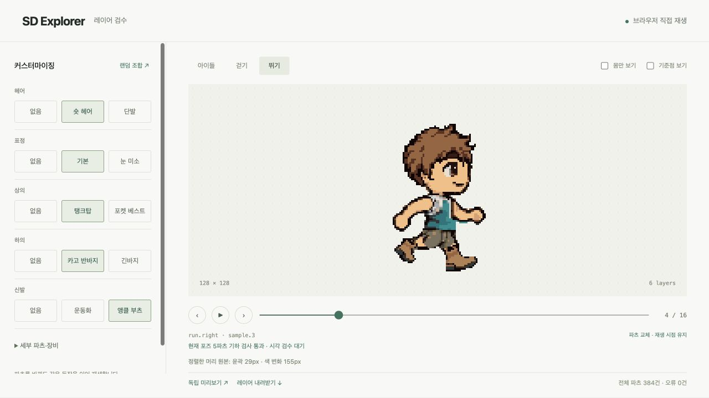
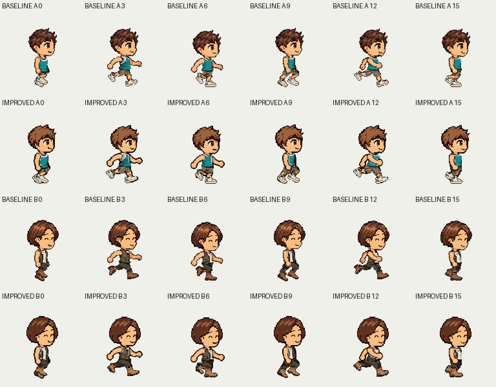

# SD Explorer: 뛰기 원본·헤어·신발 개선

현재 실행본은 `assets/sd-explorer-polish-20261005-v1/library/assembly.json`이다.
[실제 뷰어](http://127.0.0.1:8766/?layers=basic)에서 걷기·뛰기, 파츠 교체,
몸만 보기와 프레임별 검사 결과를 확인한다.
[독립 HTML](assets/sd-explorer-polish-20261005.html)과
[PNG 레이어 ZIP](assets/sd-explorer-polish-20261005.zip)도 보존했다.
이전 [운동화·의상 경계 개선본](sd-explorer-contribution-demo-20261005.md)은 비교 기준이다.
아트 최종 승인과 출시 준비 상태는 계속 false다.



## 실제 변경

헤어 A/B와 부츠 B를 기존 SD 몸·그림을 참조해 built-in imagegen으로 다시
제작했다. 헤어는 큰 색 면과 읽히는 윤곽으로 정리하고, 부츠는 발목·발끝·밑창을
구분했다. native 가져오기에서 헤어는 3색, 부츠는 5색으로 맞췄다. 그림의
재작업과 제한된 팔레트 가져오기는 별도 단계이며 색 수 감소만으로 아트를
승인하지 않는다. 단발 B는 동일한 그림을 모든 포즈에서 1픽셀 위로 배치해
걷기의 두 포즈에서 생기던 작은 외곽 빈틈을 없앴다.

신발 A/B는 각각 6방향의 고정된 그림을 재사용한다. 새 몸의 발과 맞도록
각 방향의 native 크기를 한 번 정하고, 두 발을 독립적으로 제한된 정수
좌표에 배치했다. 새 부츠의 뒤꿈치 들기 방향은 참조 그림에 맞게 한 번
반전했다. 포즈별 신발 크기 변경, 신발 픽셀 덧칠, 런타임 신발 마스크는 없다.
56개 신발 pair에서 선언된 발 피복 누락과 허용 영역 이탈이 모두 0이다.

뛰기 몸은 기존 Grok 영상의 16개 포즈를 참조해 윤곽과 색 면을 재작업했다.
이 PNG들은 새 비디오에서 추출한 프레임이 아니다. 새 영상 생성 없이 기존
두 걸음의 포즈 순서와 시간만 이어받는다. 몸은 매 프레임 하나의 온전한
PNG로 유지하고, 재생 중 몸 분해·관절 변형·텍스처 워핑을 하지 않는다.

몸 첫 후보는 native 면적이 약 1.6배로 커져 탈락했다. 걷기·아이들 재작업
후보도 포즈 크기와 격자 위치가 달라 적용하지 않았다. 걷기·아이들은 기존
불투명 실루엣을 유지하며 몸의 9색 native 팔레트로 정리했다. 오류가 있던
8등신 캐릭터는 이 실행본의 입력으로 사용하지 않는다.

새 몸의 회색 의상·피부 material과 기존에 저작한 영역을 바탕으로 의상
피복/보호 마스크를 다시 만들었다. 이 SD 전용 저작 보조는 recipe에만 있고
일반 QA나 런타임에 해부학 추론으로 들어가지 않는다. 의상은 기존 그림을
유지하면서 공개 `parts-repair-plan`으로 작은 빈틈과 위치를 보정했다.
미피복 허용 기준은 계속 0픽셀이고, 각 후보는 원래 기준으로 다시 검사했다.



## 원본 흔들림 검사와 검증 범위

새 `parts-stability-import`는 저작자가 지정한 안정 영역을 정수 부착 좌표로
맞춘 뒤 원본 PNG의 alpha와 RGB 변화를 센다. appearance 팔레트나 다른
파츠로 원본 문제를 가리지 않는다. 이번 SD 기준은 클립별 첫 포즈를 기준으로
머리의 40×28 영역을 검사한다. alpha 차이 48픽셀, RGB 채널 차이가 24를
넘는 픽셀 160개가 명시한 예산이다. 모든 몸에 적용할 보편 기준은 아니다.

| 확인 대상 | 결과와 한계 |
|---|---|
| 뛰기 머리의 평균 alpha 차이 | 27.31 → 11.56픽셀, 약 58% 감소 |
| 뛰기 머리의 최대 alpha 차이 | 50 → 29픽셀 |
| 뛰기 머리의 평균 RGB 차이 | 118.94 → 108.62픽셀 |
| 머리 안정 영역 검사 | 28포즈, 선언한 예산 초과 0건 |
| 선택 가능한 전체 파츠의 piece/pose | 384건, 선언한 기하 오류 0건 |
| 기본 32조합 × 공통 28포즈 | 896 scene의 그림 선택·순서·좌표·시계가 Python/브라우저 sampler에서 일치 |
| 공통 타이밍 | idle 4장·1fps, walk 8장·8fps, run 16장·24fps 유지 |
| 회귀 | 3454 passed, 2 skipped |

위 머리 수치는 원본 그림 재작업과 부착 좌표 정돈을 함께 반영한다.
움직이는 팔·다리의 정상적인 포즈 차이를 흔들림으로 계산하지 않는다.
걷기·아이들 실루엣 변화나 전체 몸의 모든 영역을 개선했다는 수치도 아니다.
[원본 전후 측정](assets/sd-explorer-polish-stability-20261005.json),
[공통 런타임 검증](assets/sd-explorer-polish-runtime-20261005.json),
[선택한 원본·prompt·출력 해시](assets/sd-explorer-polish-20261005.provenance.json)에
검증 범위를 보존한다. 원본 오류도 정식 QA/review/build gate를 차단하며,
기준이나 소스를 바꾸면 기존 검수 근거가 무효화된다.

뷰어에서 실제 걷기·뛰기를 재생하고 A/B 조합을 바꿨다. 정지한 같은 포즈에서
파츠를 숨겨도 몸 texture와 `(0,0)` 위치가 유지되는 것을 확인했다. 결과는
공통 클립 3개와 독립 PNG 레이어다. 896은 검사 횟수이며 조합별 외형 클립은 0개다.
`/standalone`에서도 내장 데이터 재생을 확인한다. 검수 브라우저의 `file:`
제한 때문에 저장한 HTML을 더블클릭하는 실행 경로는 직접 검증하지 않았다.

## 보존한 입력으로 재현

먼저 이전 개선 문서의 절차로 `assets/sd-explorer-contribution-demo-20261005-v1`
기준을 준비한다. 현재 로컬 작업 공간에는 이미 있다. 아래 입력은 새로
생성하지 않고 보존한 PNG와 저작 기준을 사용한다.

```sh
mkdir -p assets/sd-explorer-polish-replay/raw-art
cp docs/parts/assets/sd-explorer-polish-body-run-source-20261005.png \
  assets/sd-explorer-polish-replay/raw-art/body.run.candidate-2.png
cp docs/parts/assets/sd-explorer-polish-hair-a-source-20261005.png \
  assets/sd-explorer-polish-replay/raw-art/hair.a.png
cp docs/parts/assets/sd-explorer-polish-hair-b-source-20261005.png \
  assets/sd-explorer-polish-replay/raw-art/hair.b.png
cp docs/parts/assets/sd-explorer-polish-boots-source-20261005.png \
  assets/sd-explorer-polish-replay/raw-art/footwear.b.png
cp docs/parts/assets/sd-explorer-polish-calibration-20261005.json \
  assets/sd-explorer-polish-replay/pose-layer-calibration.json
for material in body hair boots; do
  mkdir -p "assets/sd-explorer-polish-replay/native-policy/$material"
  cp "docs/parts/assets/sd-explorer-polish-$material-palette-20261005.json" \
    "assets/sd-explorer-polish-replay/native-policy/$material/palette-policy.json"
done
.venv/bin/python scripts/dev/sd_explorer_polish.py \
  --base assets/sd-explorer-polish-replay \
  --baseline assets/sd-explorer-contribution-demo-20261005-v1
for step in body interfaces repair footwear stability; do
  .venv/bin/python scripts/dev/sd_explorer_polish.py \
    --base assets/sd-explorer-polish-replay \
    --baseline assets/sd-explorer-contribution-demo-20261005-v1 --"$step"
done
.venv/bin/python scripts/dev/sd_explorer_contribution_demo.py \
  --base assets/sd-explorer-polish-replay \
  --baseline assets/sd-explorer-contribution-demo-20261005-v1 \
  --verify-runtime --redrawn-body
.venv/bin/python -m sprite_gen.cli parts-play \
  --assembly assets/sd-explorer-polish-replay/library/assembly.json \
  --title 'SD Explorer' --interpolation frame --port 8766
```

별도의 새 폴더에서 위 입력만으로 재실행했고, motion·body/part·catalog·appearance·
fitting·stability 리비전이 현재 실행본과 모두 일치했다.
[재현 검증](assets/sd-explorer-polish-replay-20261005.json)에 결과를 보존한다.

몸·헤어·부츠의 원본 PNG, native 팔레트와
[저작 좌표·신발 규격](assets/sd-explorer-polish-calibration-20261005.json)이 입력이다.
다른 체형은 자체 몸·포즈·파츠와 피복/보호 영역을 저작해 같은 공개
[검사·레이어 export 경로](08-layer-export.md)를 사용한다. 이번 SD 좌표와
색 분류를 그대로 옮기는 자동 retargeting은 제공하지 않는다.

의상의 기존 세부 무늬와 나머지 장비는 유지했다. 기하 통과와 원본 영역
변화량은 그 그림의 스타일·표현·전체 외형 조합을 승인하지 않는다.
최종 아트 판단은 실제 공통 모션과 정확한 리비전을 함께 검수해야 한다.
