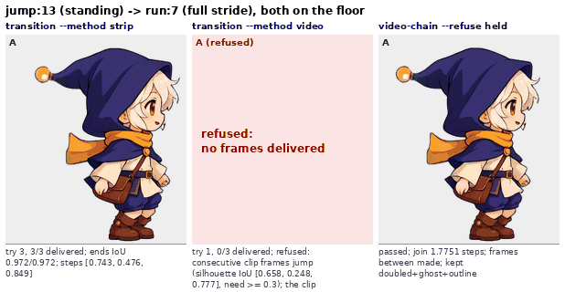

# Cross-state in-betweens: `sprite-gen transition`

> Owns: `sprite-gen transition`: frames between a frame of one state and a frame of another, drawn by a provider in one onion-skin keyframe strip or filmed as a first-last clip, judged as frames made between two are, where they stand (`--ground`), fixed frames, metadata, batches and sheets, the record and exit codes · Index: [docs/README.md](README.md)

`interpolate` ([frame interpolation](frame-interpolation.md)) makes one in-between inside one state's strip. Chained
states (`attack -> idle` recovery, `skill -> idle`, an `idle -> attack` wind-up, a jump landing into a run) need
frames between two frames of *different* states: often several, often across a large change of pose and height.
`sprite-gen transition` (`sprite_gen/effects/transition.py`, `transition_pipeline.py`; `scripts/transition_frames.py`) makes
those in-betweens between two states. It is not the curator's **Tween** button, which is `interpolate`'s one
in-between inside a row. (On the fork this verb was first written as `tween`; it was renamed so as not to be
confused with that button.)

## 1. `transition` and `video-chain`

Both put frames between the last frame of one piece and the first of the next. They answer different questions:

| | `transition` | `video-chain` ([video-pipeline](video-pipeline.md#9-pieces-of-clips-played-as-one-move-video-chain) section 9) |
|---|---|---|
| What it joins | two finished frames: two states of a run, two PNGs, two cells of a sheet | pieces of keyed clips on one canvas, key and rate |
| How a frame between is made | **redrawn** by a provider: one onion-skin keyframe strip (`--method strip`), or a first-last clip filmed on Grok and sampled (`--method video`) | **made from the two frames' pixels** by RIFE (`held_fill.at_times`) |
| Where it holds | any pose change a drawing can bridge: a crouch into a stand, a take-off into a stride | poses near each other, as a clip's neighbouring frames are: a cut, a bridge of a frame or two inside one move |
| The judge | `held_fill.judge`, unchanged; for `--method video` every fault refuses by default, `--refuse` as video-chain's | `held_fill.judge`, unchanged, `--refuse` |
| Time | `--n` frames evenly between, `--fps` or `--durations-ms` in the metadata | the chain's rate, `--out-fps` or `--places` |
| Where and when | the caller's: the ends where `--ground` puts them, the in-betweens where `--places` says, else on the straight line between the ends (section 5); no motion is decided | the caller's: `--places` on the chain; the frames between are where RIFE moves the pixels |
| Cost | one image call (strip) or one clip (video) per join, on a provider | none: RIFE runs here |

Across a pose change RIFE cross-fades: what it makes between a take-off and a stride is the two drawings at part
strength each, and the judge refuses it (`outline`, `ghost`). This is why `interpolate` retired flow-based
interpolation for appearance changes (its module docstring, the 3-way comparison of 2026-07-17) and why `transition` redraws.
`video-chain` stays the verb for joining clips whose poses meet, and its pose distance (`joins[].steps`) says how far
apart a join's frames are.

### Pip: one join, four ways

`scripts/dev/transition_chain_demo.py` runs both verbs through the CLI on one join between the repository's Pip clips:
`jump:13` (Pip standing, the landed hold of `tests/fixtures/rife-cuts/pip-jump`) into `run:7` (a full stride of
`pip-run`). Both ends are on the floor and the poses differ, so it is a cross-state join with nothing else in the way.
Two frames between. The provider draws anew on every call, so each transition row ran three times on grok
(`delivered` counts the tries); the chain rows run once (RIFE gives the same frames every run).

**The two clips are drawn at different scales.** Pip's run is drawn about 1.37 times as large as the jump (the square
root of the ratio of the clips' median opaque areas; their median figure heights are 689 and 542 px). Taken as they
are, the join's ends are 498 px (standing) and 696 px (striding) tall, and every frame between grows from one to the
other: `transition`'s strip delivered heights 498, 564, 630, 696, and RIFE's 498, 637, 688, 696, which reads as a
zoom that belongs to neither state. The demo scales the clip drawn larger down to the other's scale before
anything runs (`scale_by`, measured, not set: 0.726 on the run), so both verbs take the same normalized frames, on
one 412 x 784 canvas; the ends are then 498 and 511 px, the rest being the pose. Scaling also took `video-chain`'s
pose distance for the join from 3.15 steps to 1.78.

| Row | Delivered | Figure heights (A, between, between, B) | What the report says |
|---|---|---|---|
| `transition --method strip` (`--ground auto`: `shared` here, 8 and 24 px off the floor) | **3/3** | 498, 501, 503, 506 | ends IoU 0.962 to 0.972 / 0.972 to 0.975; lowest step IoU 0.415 to 0.476; judged for the record: `smear` once, `hole` once (with a pose-jump warning), nothing on try 3 |
| `transition --method video` | 0/3 | none delivered | refused: consecutive clip frames jump (IoU 0.248) once; the clip's last frame is not B (IoU 0.42, 0.46) twice |
| `video-chain --refuse held` | passed, 11.2 s | 498, 500, 504, 511 | the frames between kept `outline`, `ghost` (and `doubled` on the first) |
| `video-chain` (default) | failed, 100.8 s | | every frame between refused: `doubled`, `ghost`, `outline` |

<p align="center">
  <br />
  <sub>jump:13 (standing) into run:7 (a stride), the clips normalized to one scale: the strip's try 3 (the evenest
  delivered try with no fault kept), the clip (every try refused) and RIFE with <code>--refuse held</code>. The
  <a href="assets/transition-vs-chain.png">sheet</a> has every row's four frames; a refused row on red, as it was
  left in <code>keyed.refused/</code>.</sub>
</p>

What the run shows:

- **Across a pose change RIFE makes no frame the judge passes.** `video-chain`'s default refused both frames between.
  With `--refuse held` it passes in about 11 s, and what it hands over is the two drawings at part strength
  (`outline`, `ghost`): a standing Pip fading into a running one. The chain is the verb for joins whose poses meet.
- **The strip delivered every try** (3 of 3, about 30 s and one image call each), its ends at IoU 0.96 to 0.98
  against A and B and its in-betweens drawn poses: legs opening into the stride, not two figures at half strength.
  The judge's readings on a redrawn frame are kept on the record, not refused (section 4).
- **The clip is the least sure** (0 of 3 here): a first-last clip passes through poses in neither keyframe or ends
  off B, and the checks refuse it.

Where the frames stand and where the in-betweens go are the caller's, with `--ground` and `--places` (section 5),
which the examples there show in text and JSON.

## 2. Use

```bash
# run mode: endpoints from two states of a run (negative index = from the end)
sprite-gen transition <run> --from attack:-1 --to idle:0 --n 2 [--label attack_recover]
# file mode: endpoints from PNGs, or from cells of a sheet
sprite-gen transition --from-file a.png --to-file sheet.png:0 --cell 448x448 --n 3 --out-dir out/
# a take-off into a run: the take-off's height off the floor is kept (--ground auto, the default)
sprite-gen transition --from-file jump/keyed/frame-0029.png --to-file run/keyed/frame-0001.png --out-dir takeoff/
# a fall into the landing, the in-betweens where the caller's motion puts them (section 5)
sprite-gen transition --from-file jump/keyed/frame-0007.png --to-file jump/keyed/frame-0013.png --places places.json --out-dir landing/
```

| flag | meaning |
| --- | --- |
| `--n` | in-betweens, 1..6 (default 2), all in one call |
| `--method strip` (default) | one keyframe strip: slot 1 = A, last slot = B, grey onion-skin ghosts of both in the slots between; the provider fills every slot at once |
| `--method video` | films a first-last clip through `video --image --last-frame` (grok), samples N+2 frames evenly |
| `--provider codex\|grok` | the one provider that draws the strip (default `grok`, `transition.DEFAULT_PROVIDER`; the names are `gen.base`'s); no retry on another (No silent fallback). `--method video` films on grok and refuses another |
| `--refuse FAULT,FAULT` | `--method video`: the faults of the judge that refuse a frame (default: all); section 4 |
| `--places FILE` | where each in-between is placed, given by the caller (default: the straight line between the ends); section 5 |
| `--ground auto\|source\|shared` | where the delivered frames stand (default `auto`: an end's height off the floor kept where the two ends' differ); the provider draws on one floor either way; section 5 |
| `--anchor foot\|bottom-center` | horizontal anchor: mean x of the bottom 6 % of opaque rows, or the box centre |
| `--margin` | safe margin around each slot as a fraction of the figure size (default 0.12) |
| `--min-endpoint-iou` | the drawn endpoints' refusal bar (default 0.6) |
| `--ref` | extra identity reference for the strip method (repeatable) |
| `--description` | character text for the prompt (run mode reads `character.description`) |

## 3. What it checks

- **The ends.** The drawn slot 1 and last slot (the clip's first and last frames) are compared with A and B:
  silhouette IoU at the keyframes' height, foot anchors aligned, and the scale the provider drew the two ends at must
  agree (`scale_agree >= 0.85`). Under either bar the transition is refused with the numbers; `keyframe-strip.png`,
  `raw.png` (or `clip.mp4`, `clip-frames/`) and `transition.json` stay.
- **Scale and feet.** Every in-between is rescaled to the lerped keyframe height (A's to B's) and its foot anchor
  goes on the anchor column. How big the provider drew it, against the lerp of the two drawn endpoint heights, is
  `frame_scale.drawn_vs_endpoints`; outside 0.85..1.18 it is a warning for the strip and a refusal for video (a clip
  that zooms or shrinks the figure).
- **Slicing by component, with an ownership rule.** The drawn strip is cut by connected component, not by fixed
  columns. The largest component in each slot is that slot's figure; every other piece (a blade, a cape tip) goes to
  the figure it is horizontally closest to, so a prop reaching over a slot border stays with its owner. One warning is
  given for a figure spilling more than a quarter slot into its neighbour or a piece about equally close to two
  figures; a source cell whose content touches its own border is warned too (a mis-sliced sheet).
- **Pose jumps.** `step_iou` (consecutive silhouette IoU across A, the in-betweens, B) under 0.45 is warned;
  `drawn_step_iou` measures the same before rescaling, and for video under 0.3 is a refusal.
- **The judge and the final reading**: section 4.

A refusal ends with what to try for the method that was refused, never the method just run: for the strip, the other
provider or `--method video`; for video, a new clip or `--method strip`. Nothing is retried by itself.

## 4. The judge and the final reading

Each in-between is judged as a frame made between A and B at its own time, k/(n+1), the frame before it as the cell
before (`held_fill.judge`, unchanged; its faults are [loop repair](loop-repair.md) section 4's and 7's: `smear`,
`outline`, `ghost`, `torn`, `hole`, `doubled`, `contact`, `held`).

- **`--method video`.** By default every fault refuses a frame, as `video-chain`'s default. `--refuse FAULT,FAULT`
  names those that do (`video-chain --refuse`'s reading: a name that is no fault is a usage error; `held` is always
  among them). Which faults are a fault in a material and which are its own is the caller's to read off it. A fault
  found and not refused stays on the frame's row (`kept_faults`) and on a `warning:` line.
- **`--method strip`.** The in-betweens are redrawn, not made from A's and B's pixels; the judge's bars were measured
  on frames made from them (a redrawn line can read as `doubled` beside the end it redraws). So the strip is judged for
  the record, and only `held` refuses: an in-between that shows the picture of an end or of the frame before it is no
  frame between, however it was made. `--refuse` with the strip is a usage error, not an option that does nothing.
- **The final reading.** The frames as delivered, ends in, are read as `inspect-holds` reads a delivery
  (`qa.holds.inspect` on `alpha_figures`): a frame showing the picture of the frame before it, on no list, refuses the
  transition, whatever `--refuse` says. A transition has no hold meant.

`transition.json` records `refuse` (the faults that refused for this run), `judge` (each in-between's `frame`, `t`,
`faults`, `kept_faults`, `shows` and its `judged` values) and `read` (the final reading), as `chain.report.json` does.

## 5. Where the frames stand: `--ground`

The provider always draws on one ground row: the keyframe strip stands A, the ghosts and B on one floor, and the clip's
first and last frames stand A and B on it. It is never asked for a figure in the air, so it has no height to get
wrong, and the endpoint check compares the drawn ends with A and B as drawn. `--ground` says where the **delivered**
frames stand, once they are drawn:

| `--ground` | the delivered frames | when |
|---|---|---|
| `auto` (default) | `source` where the two ends' heights off the floor differ by 5 % of the taller end or more (`transition.AIRBORNE_FRACTION`), else `shared` | file mode on one canvas height; run mode and two canvas heights are `shared` |
| `source` | each end as high off the floor as on its source canvas, each in-between at the lerp of the two heights (or where `--places` says) | file mode, one canvas height (a usage error otherwise) |
| `shared` | every foot on one ground row: an end off the floor (a take-off, a fall) is delivered standing | anywhere |

For example, a take-off 130 px off the floor into a stride on it, two frames between: the two heights differ by more
than 5 %, so `auto` uses `source`, and the delivered frames stand 130, 87, 43 and 0 px up (the in-betweens on the
straight line, unless `--places` says otherwise). `--ground shared` delivers the same four poses at 0, 0, 0, 0.

A frame's height is the rows under its lowest opaque row on its source canvas (`Endpoint.lift`), whose bottom row is
the floor, as `video-set` films a set's states. Two ends within 5 % of each other (a stride and a stand, both on the
floor with a few rows of padding) are `shared` under `auto`, as before. The output canvas grows to hold the height;
a fixed `--frame-size` keeps the floor on the pivot row. `transition.json` records `ground` (`asked`, `used` and `why`) and
`lift_px` (A, the in-betweens, B).

### Where the in-betweens are placed: `--places`

transition decides no motion and no place: no fall curve, no easing, no velocity, no physics. As with `video-chain`, the
caller who knows the scene says where and when, and the engine makes the frames.

- **Without `--places`** (`placement: linear`) each in-between is on the **straight line** from A's place to B's, at
  k/(n+1): height and anchor column. That is the default when nothing says otherwise, not a claim about the motion.
  A fall that lands early is lower than the line, a jump's apex higher: the line knows neither.
- **`--places FILE`** (`placement: places`) puts each in-between where the caller says. The ends stay where `--ground`
  puts them (`auto`, `source` or `shared`, above); `--places` places only the in-betweens, never the ends, and never
  changes what the provider is shown (it draws on one floor either way).

The file is JSON: a list of one place per in-between, in order, or an object holding that list as `places` and,
optionally, `from` (text: what the places were read off; recorded):

```json
{"from": "pip-jump frames 8 and 10", "places": [{"dx": 7.7, "dy": -106}, {"dx": 6.8, "dy": -10}]}
```

Each place is the in-between's **foot anchor** (`--anchor`: the mean x of its bottom 6 % of opaque rows, and its
lowest opaque row):

- `dx`: px right of the anchor column the ends stand on (negative: left);
- `dy`: px down from the **floor** (negative: above it). The floor is the row a height of 0 stands on: the source
  canvas's bottom row where `--ground` uses `source`, the one ground row where it uses `shared`. So `dy` is minus
  the height off the floor, and `{"dx": 0, "dy": -106}` stands an in-between 106 px up, as a frame 106 px off its
  source canvas's floor is.

Read off a clip's own frames (a landing whose clip has the frames between): `dy` is minus each frame's rows
under its lowest opaque row; `dx` is its anchor's x minus the straight line between the two ends' anchors at that
frame's time, since transition stands both ends on one anchor column.

Refused as a usage error (exit 2) before anything is drawn or filmed: a file that is missing or not JSON; anything but
a non-empty list of `{"dx": number, "dy": number}` (no other keys, no booleans, no NaN); a count other than `--n`; a
place under the floor (`dy > 0`); a place whose in-between, at its lerped height, reaches past the top of the
reference canvas; `|dx|` of the canvas's width or more. The reference canvas is the ends' source canvas in file mode
(the larger of the two) and the raw strip's cell in run mode. The output canvas grows to hold every placed frame, as
it does for the heights, and no frame is clipped. `--places` works with both methods, in file mode, run mode (the take's
`transition.placement`) and a manifest (`"places"`: a file relative to the manifest, or the list itself; its values
are in the cache's input hash). `transition.json` records `placement`: `kind` (`linear` or `places`), `from` (the file, the
object's `from`, or `inline`; null for `linear`) and the `places` used, `{dx, dy}` per in-between (for `linear`, the
line's), beside `lift_px`.

The air of a cut played once is what `video-loop` reads (`root_motion`: [video-pipeline](video-pipeline.md) "Root
motion"); a caller can read the places off it.

## 6. Fixed frames, metadata, batches, sheets

File mode and `--manifest` mode add an engine-facing layer (`sprite_gen/effects/transition_pipeline.py`):

```bash
# one boundary, fixed 256x256 frames, feet on the bottom-centre pixel, a sheet for the packer
sprite-gen transition --from-file a.png --to-file b.png --n 2 --out-dir out/ \
  --frame-size 256x256 --pivot bottom-center --fps 12 --include-ends --export sheet
# many boundaries in one run; re-running skips what is already done
sprite-gen transition --manifest transitions.json --out-dir out/ [--only id ...] [--force]
```

| flag | meaning |
| --- | --- |
| `--frame-size WxH` | every frame (ends included) on one canvas size, foot anchor on `--pivot` |
| `--pivot bottom-center\|X,Y` | pixel the foot anchor lands on (default: `W/2, H`, the baseline on the bottom row) |
| `--fit error\|shrink` | a set that does not fit: refuse (default) or shrink the whole set uniformly about the anchor; never clipped |
| `--resample lanczos\|nearest` | filter for `--fit shrink` (`nearest` for hard-edged pixel art) |
| `--fps`, `--durations-ms a,b,…` | per-frame durations written to the metadata |
| `--include-ends` | metadata and sheet also list the `from` / `to` frames |
| `--export sheet` | also write `sheet.png` + `sheet.json`, one row per boundary |
| `--force` | redo a boundary even when its cached result is valid |

`transition.json` (`schema: sprite-gen-transition/2`) adds `id`, `input_hash`, `frame_size`, `pivot` (`x, y` px and normalised
`nx, ny`), `fit_scale`, `fps`, `loop` and `frames: [{index, file, role (from|between|to), w, h, pivot, duration_ms}]`.
`sheet.json` uses the `cell`, `animation.rows.<id>.{row, frames, durations_ms, loop}` and
`frame_layout.rows.<id>: [{x, y, w, h}]` shape of `compose`'s `manifest.json`, so a loader for compose output reads it.

Manifest (`--manifest`), paths relative to the manifest file:

```json
{
  "defaults": {"n": 2, "frame_size": "256x256", "fps": 12, "export": "sheet"},
  "boundaries": [
    {"id": "attack_to_idle", "from_file": "attack.png:-1", "to_file": "idle.png:0", "cell": "256x256"},
    {"id": "jump_to_run", "from_file": "jump.png", "to_file": "run.png", "ground": "source", "method": "video",
     "refuse": "smear,ghost,held"}
  ]
}
```

Every boundary option of file mode is accepted per entry (`n, method, provider, anchor, margin, min_endpoint_iou,
description, chroma, refs, cell, frame_size, pivot, fit, resample, fps, durations_ms, include_ends, loop, refuse,
ground, places`); an unknown key is a usage error. Each boundary lands in `<out>/<id>/`, one failure does not stop the rest,
and `<out>/batch.json` lists every id with `status` (`ok`, `cached`, `refused`, `error`, `usage`). A boundary is
skipped when its `transition.json` says `ok` for the same `input_hash` (endpoint and ref bytes plus every option that
changes the output) and its frame files exist; `transition.json` is written last and atomically, so an interrupted run
redoes that boundary.

## 7. Outputs, the record and exit codes

- **Run mode** writes one take strip on the destination state (`raw/<to>.takes/<label>.png`) with
  `takes[].transition = {from_state, from_index, to_state, to_index, n, method, provider, endpoint_match, placement}`;
  re-running a label overwrites it. Its working files are in `<run>/transition/<label>/`.
- **File mode** writes `from.png`, `between-<k>.png`, `to.png` (RGBA, one canvas) and `transition.json` in `--out-dir`.
- **The run contract** ([run-contract](run-contract.md)), as the frame verbs keep it: an input the run would write
  over or delete (`--from-file` as `<out>/from.png`, a `--ref` inside the outputs) is refused before anything is made
  (`runio.refuse_overlap`, a usage error). An earlier run's frames and sheet are removed before this run makes its own,
  so a refused run hands over none; a refused run leaves the frames it made in `<out>/refused/` (`refused_dir`), as a
  refused chain leaves `keyed.refused/`.
- **Status.** `transition.json` always carries `status`: `ok`, `refused` (with `error`), or `error` when the provider
  call itself failed (timeout, auth, crash). It carries `producer` (`evidence.engine_identity`, and `transition_sha256` of
  the transition modules, which that does not hash) and `source` (`evidence.source_identity` of the two endpoint files).
- **Exit codes**, as `video-chain`'s and `inspect-holds --gate`'s: `0` delivered (or cached), `1` refused (the ends
  drifted, the judge or the final reading refused, a set that does not fit), `2` an error (the provider, a usage
  error). A batch returns the most severe (2 over 1 over 0).

## 8. What it takes from sprite-gen

`transition` uses sprite-gen's existing rules where they answer a question the verb asks. A part that is its own says why.

| Part | Taken from | Owner of the rule |
|---|---|---|
| The provider names and the call | `gen.base.PROVIDER_CODEX`, `PROVIDER_GROK`; `gen.generate_image` | [gen.md](gen.md) |
| The clip of `--method video` | `gen.video.VideoRequest` (first-last), `generate_video` | [video.md](video.md) |
| Keying a flat background, components | `frames.extract.remove_chroma_background_ycbcr`, `connected_components`, `extract_component_images`, `tighten_components` | [chroma-alpha.md](chroma-alpha.md) |
| Run mode's endpoints and take | `spec.layout.raw_rel`, `take_raw_rel`; `spec.runio.load_request`, `publish_guard`, `write_request` | [run-contract.md](run-contract.md) |
| The judge | `held_fill.judge`, unchanged; its faults `held_fill.FAULTS`; the ghost screen `interpolation_quality.ghost_screen` | [loop-repair.md](loop-repair.md) sections 4 and 7 |
| Which faults refuse | `video-chain --refuse`'s reading (`held` always among them) | [video-pipeline.md](video-pipeline.md) section 9 |
| The final reading | `qa.holds.inspect`, `alpha_figures`, `NothingRead` | [asset-tools.md](asset-tools.md#frames-shown-again) |
| Overlapping inputs and outputs | `runio.refuse_overlap` | [run-contract.md](run-contract.md) |
| The record's identities | `evidence.engine_identity`, `evidence.source_identity` | |
| Exit codes 0 / 1 / 2 | `video-chain`, `inspect-holds --gate` | [video-pipeline.md](video-pipeline.md) section 9 |
| The sheet's shape | `compose`'s `manifest.json` (`animation.rows`, `frame_layout.rows`) | [atlas-workflow.md](atlas-workflow.md) |

| Part | Why it is new |
|---|---|
| The onion-skin keyframe strip (`plan_layout`, `keyframe_strip`, `transition_prompt`) and its aspect ratios (`STRIP_ASPECTS`) | `interpolate` sends two frames for one in-between; n in-betweens in one call need one image that holds all of them, padded to a ratio the providers accept. |
| Slicing by component with the ownership rule (`slice_slots`) | `extract_component_images` cuts a strip into a known count; a drawn strip's props reach over slot borders and belong to the nearest figure. |
| The endpoint check (`silhouette_iou`, `scale_agree`) | Nothing else compares a redrawn frame with the frame it was given. |
| The lerped height and the per-frame scale (`frame_scale`) | The ends of a cross-state join differ in height (a crouch into a stand); a frame made between two frames' pixels never changes size. |
| The step IoU (`step_iou`, `drawn_step_iou`) | `video-chain`'s pose distance (`gait_fallback.poses`) reads a clip's neighbouring frames; two frames from different states have no clip to read a step on. |
| Where a frame stands (`--ground`, `Endpoint.lift`) | No verb puts frames of two canvases' states on one floor. |
| Where an in-between is placed (`--places`, `read_places`) | `video-chain --places` places frames in time on a chain; nothing places a drawn frame in space. Same reading: the caller says, the verb refuses what is off before it makes anything. |
| The strip judged for the record only | `held_fill.judge`'s bars were measured on frames made from the ends' pixels; a redrawn frame differs from both by design. `held` and the final reading need no such bar. |
| Fixed frames, the metadata, batches and the cache (`transition_pipeline`) | Transition frames are delivered as engine assets (one canvas, one pivot) and many boundaries are made at once; nothing else delivers frames that way. |

## Related

- [frame interpolation](frame-interpolation.md): one in-between inside one state's strip
- [video-pipeline](video-pipeline.md) section 9: `video-chain`
- [docs/README.md](README.md): documentation index
