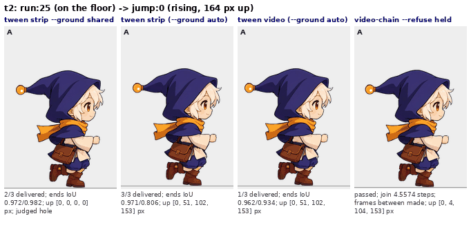
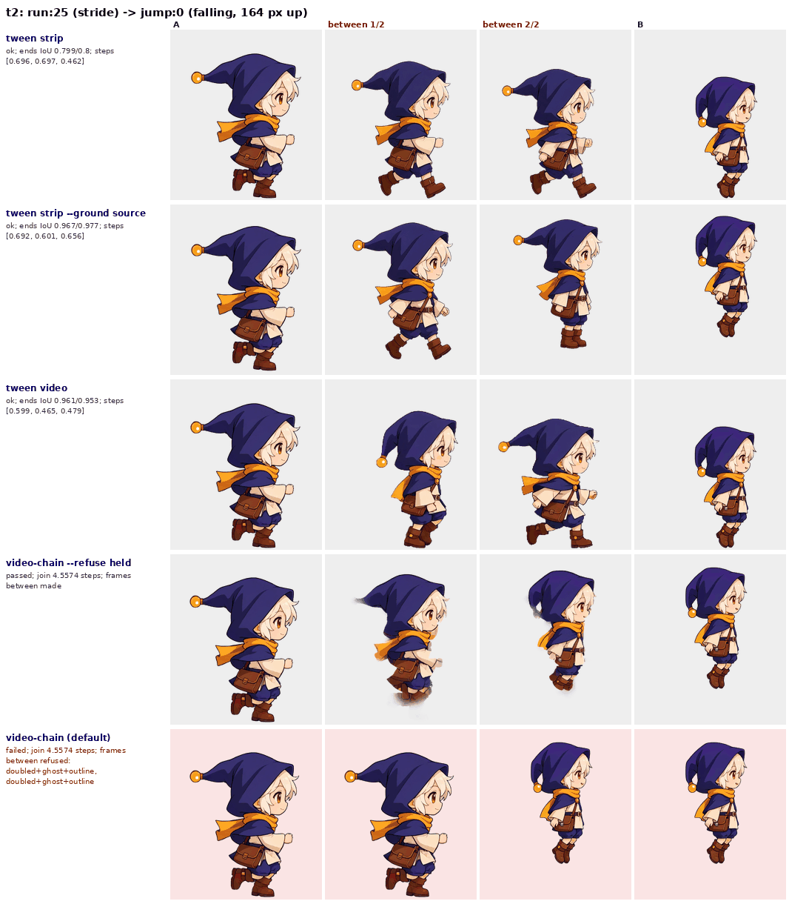

# Cross-state in-betweens: `sprite-gen tween`

> Owns: `sprite-gen tween`: frames between a frame of one state and a frame of another, drawn by a provider in one onion-skin keyframe strip or filmed as a first-last clip, judged as frames made between two are, where they stand (`--ground`), fixed frames, metadata, batches and sheets, the record and exit codes · Index: [docs/README.md](README.md)

`interpolate` ([frame interpolation](frame-interpolation.md)) makes one in-between inside one state's strip. Chained
states (`attack -> idle` recovery, `skill -> idle`, an `idle -> attack` wind-up, a jump landing into a run) need
frames between two frames of *different* states: often several, often across a large change of pose and height.
`sprite-gen tween` (`sprite_gen/effects/tween.py`, `tween_pipeline.py`; `scripts/tween_frames.py`) draws them.

## 1. `tween` and `video-chain`

Both put frames between the last frame of one piece and the first of the next. They answer different questions:

| | `tween` | `video-chain` ([video-pipeline](video-pipeline.md#9-pieces-of-clips-played-as-one-move-video-chain) section 9) |
|---|---|---|
| What it joins | two finished frames: two states of a run, two PNGs, two cells of a sheet | pieces of keyed clips on one canvas, key and rate |
| How a frame between is made | **redrawn** by a provider: one onion-skin keyframe strip (`--method strip`), or a first-last clip filmed on Grok and sampled (`--method video`) | **made from the two frames' pixels** by RIFE (`held_fill.at_times`) |
| Where it holds | any pose change a drawing can bridge: a crouch into a stand, a take-off into a stride | poses near each other, as a clip's neighbouring frames are: a cut, a bridge of a frame or two inside one move |
| The judge | `held_fill.judge`, unchanged; for `--method video` every fault refuses by default, `--refuse` as video-chain's | `held_fill.judge`, unchanged, `--refuse` |
| Time | `--n` frames evenly between, `--fps` or `--durations-ms` in the metadata | the chain's rate, `--out-fps` or `--places` |
| Cost | one image call (strip) or one clip (video) per join, on a provider | none: RIFE runs here |

Across a pose change RIFE cross-fades: what it makes between a take-off and a stride is the two drawings at part
strength each, and the judge refuses it (`outline`, `ghost`). This is why `interpolate` retired flow-based
interpolation for appearance changes (its module docstring, the 3-way comparison of 2026-07-17) and why `tween` redraws.
`video-chain` stays the verb for joining clips whose poses meet, and its pose distance (`joins[].steps`) says how far
apart a join's frames are.

### Pip: three joins, five ways

`scripts/dev/tween_chain_demo.py` runs both verbs through the CLI on the repository's Pip clips
(`tests/fixtures/rife-cuts/pip-jump`, `pip-run`, put on one 560 x 784 canvas), two frames between, at three pose
distances. One run on grok (the tween rows draw anew on every run; the numbers are that run's, and the two extra
tries of t1's `--ground source` are named):

| Join (pose distance on `video-chain`'s reading) | `tween` strip | `tween` strip `--ground source` | `tween` video | `video-chain --refuse held` | `video-chain` (default) |
|---|---|---|---|---|---|
| `t1` jump:28 (take-off, 130 px up) into run:0 (2.19 steps) | ok, 29.6 s; ends IoU 0.976 / 0.975; steps 0.571, 0.744, 0.652 | refused (exit 1): B redrawn, ends IoU 0.82 / 0.62, scales agree 0.82; of two more tries one ok (0.974 / 0.973, lift 130 → 13 px), one refused (IoU to B 0.19) | refused (exit 1), 50.7 s: the judge, in-between 2 `smear`, `outline` (the clip draws a second figure) | passed, 16.4 s; both frames kept `outline`, `ghost` | failed (exit 1), 108.6 s: every try refused (`ghost`, `outline`), the frame beside it shown again |
| `t3` jump:13 (standing) into run:7 (3.15 steps) | ok, 29.7 s; 0.967 / 0.966; steps 0.336, 0.592, 0.669 (pose jump warned) | ok, 33.0 s; 0.970 / 0.965; lift 8 → 33 px; steps 0.528, 0.259, 0.652 (warned) | refused (exit 1), 50.5 s: the clip's last frame is not B (IoU 0.57) | passed, 16.6 s; kept `outline`, `ghost`, `doubled` / `hole` | failed (exit 1), 147.3 s: `doubled`, `ghost`, `outline` / `hole` |
| `t2` run:25 into jump:0 (falling, 164 px up) (4.56 steps) | ok, 35.0 s; 0.799 / 0.800; steps 0.696, 0.697, 0.462; B's air drawn standing | ok, 34.3 s; 0.967 / 0.977; lift 11 → 62 → 113 → 164 px | ok, 43.9 s; 0.961 / 0.953; drawn 1.07x and 1.10x the ends' size, rescaled | passed, 15.6 s; kept `outline`, `ghost` | failed (exit 1), 129.6 s: `doubled`, `ghost`, `outline`; the fill of the frame shown again, `contact` |

<p align="center">
  <br />
  <sub>t2, run:25 into jump:0 (falling). Columns: tween strip, tween strip <code>--ground source</code>, tween video, video-chain <code>--refuse held</code>.</sub>
</p>

<p align="center">
  <br />
  <sub>t2, every row's frames; a refused row on red, as it was left in <code>refused/</code> or <code>keyed.refused/</code>. The same for
  <a href="assets/tween-vs-chain-t1.png">t1</a> (<a href="assets/tween-vs-chain-t1.gif">GIF</a>) and
  <a href="assets/tween-vs-chain-t3.png">t3</a> (<a href="assets/tween-vs-chain-t3.gif">GIF</a>).</sub>
</p>

What the run shows:

- **Across a pose change RIFE makes no frame the judge passes.** At every distance, from the nearest join (2.19
  steps) on, `video-chain`'s default refused every frame it made between the two poses and the chain failed on a
  frame shown again; with `--refuse held` it passes in about 16 s, and what it hands over is the two drawings at part
  strength (the GIFs' last row). That is the chain doing its job: it is for joins whose poses meet.
- **The strip passed every join** (three of three, about 30 s and one image call each), its ends' IoU 0.80 to 0.98, and the judge found no fault on its six in-betweens (on an earlier run of these joins, three of six read
  `doubled`, a redrawn line beside the end it redraws: section 4). Its identity drifts a little (the hood's shade, the
  face) where a provider redraws.
- **`--ground shared` stands an airborne end on the floor** (t2's B, t1's A); `--ground source` keeps the air and
  places the in-betweens on the line between. With the ends at two heights the provider redrew B more often on t1 (one
  of three tries passed; the other two were refused on the ends, as they should be): re-run, or take the shared ground
  and give the height back in the engine.
- **The clip is the least sure** (one of three): a first-last clip passes through poses in neither keyframe, and the
  judge and the endpoint check refuse it; when it passes, its frames are drawn bigger than the ends and rescaled.

## 2. Use

```bash
# run mode: endpoints from two states of a run (negative index = from the end)
sprite-gen tween <run> --from attack:-1 --to idle:0 --n 2 [--label attack_recover]
# file mode: endpoints from PNGs, or from cells of a sheet
sprite-gen tween --from-file a.png --to-file sheet.png:0 --cell 448x448 --n 3 --out-dir out/
# a jump into a run, each end as high off the floor as on its canvas
sprite-gen tween --from-file jump/keyed/frame-0029.png --to-file run/keyed/frame-0001.png --ground source --out-dir t1/
```

| flag | meaning |
| --- | --- |
| `--n` | in-betweens, 1..6 (default 2), all in one call |
| `--method strip` (default) | one keyframe strip: slot 1 = A, last slot = B, grey onion-skin ghosts of both in the slots between; the provider fills every slot at once |
| `--method video` | films a first-last clip through `video --image --last-frame` (grok), samples N+2 frames evenly |
| `--provider codex\|grok` | the one provider that draws the strip (default `grok`, `tween.DEFAULT_PROVIDER`; the names are `gen.base`'s); no retry on another (No silent fallback). `--method video` films on grok and refuses another |
| `--refuse FAULT,FAULT` | `--method video`: the faults of the judge that refuse a frame (default: all); section 4 |
| `--ground shared\|source` | where each frame stands (default `shared`); section 5 |
| `--anchor foot\|bottom-center` | horizontal anchor: mean x of the bottom 6 % of opaque rows, or the box centre |
| `--margin` | safe margin around each slot as a fraction of the figure size (default 0.12) |
| `--min-endpoint-iou` | the drawn endpoints' refusal bar (default 0.6) |
| `--ref` | extra identity reference for the strip method (repeatable) |
| `--description` | character text for the prompt (run mode reads `character.description`) |

## 3. What it checks

- **The ends.** The drawn slot 1 and last slot (the clip's first and last frames) are compared with A and B:
  silhouette IoU at the keyframes' height, foot anchors aligned, and the scale the provider drew the two ends at must
  agree (`scale_agree >= 0.85`). Under either bar the tween is refused with the numbers; `keyframe-strip.png`,
  `raw.png` (or `clip.mp4`, `clip-frames/`) and `tween.json` stay.
- **Scale and feet.** Every in-between is rescaled to the lerped keyframe height (A's to B's) and its foot anchor
  goes on the anchor column. How big the provider drew it, against the lerp of the two drawn endpoint heights, is
  `frame_scale.drawn_vs_endpoints`; outside 0.85..1.18 it is a warning for the strip and a refusal for video (a clip
  that zooms or shrinks the figure).
- **Slicing by component, with an ownership rule.** The drawn strip is cut by connected component, not by fixed
  columns. The largest component in each slot is that slot's figure; every other piece (a blade, a cape tip) goes to
  the figure it is horizontally closest to, so a prop reaching over a slot border stays with its owner. One warning is
  given for a figure spilling more than a quarter slot into its neighbour or a piece about equally close to two
  figures; a source cell whose content touches its own border is warned too (a mis-sliced sheet).
- **Pose jumps.** `step_iou` (consecutive silhouette IoU across A, the in-betweens, B) under 0.45 is warned;
  `drawn_step_iou` measures the same before rescaling, and for video under 0.3 is a refusal.
- **The judge and the final reading**: section 4.

A refusal ends with what to try for the method that was refused, never the method just run: for the strip, the other
provider or `--method video`; for video, a new clip or `--method strip`. Nothing is retried by itself.

## 4. The judge and the final reading

Each in-between is judged as a frame made between A and B at its own time, k/(n+1), the frame before it as the cell
before (`held_fill.judge`, unchanged; its faults are [loop repair](loop-repair.md) section 4's and 7's: `smear`,
`outline`, `ghost`, `torn`, `hole`, `doubled`, `contact`, `held`).

- **`--method video`.** By default every fault refuses a frame, as `video-chain`'s default. `--refuse FAULT,FAULT`
  names those that do (`video-chain --refuse`'s reading: a name that is no fault is a usage error; `held` is always
  among them). Which faults are a fault in a material and which are its own is the caller's to read off it. A fault
  found and not refused stays on the frame's row (`kept_faults`) and on a `warning:` line.
- **`--method strip`.** The in-betweens are redrawn, not made from A's and B's pixels; the judge's bars were measured
  on frames made from them (a redrawn line can read as `doubled` beside the end it redraws). So the strip is judged for
  the record, and only `held` refuses: an in-between that shows the picture of an end or of the frame before it is no
  frame between, however it was made. `--refuse` with the strip is a usage error, not an option that does nothing.
- **The final reading.** The frames as delivered, ends in, are read as `inspect-holds` reads a delivery
  (`qa.holds.inspect` on `alpha_figures`): a frame showing the picture of the frame before it, on no list, refuses the
  tween, whatever `--refuse` says. A tween has no hold meant.

`tween.json` records `refuse` (the faults that refused for this run), `judge` (each in-between's `frame`, `t`,
`faults`, `kept_faults`, `shows` and its `judged` values) and `read` (the final reading), as `chain.report.json` does.

## 5. Where the frames stand: `--ground`

`--ground shared` (the default) puts every foot of the strip and of the delivered frames on one ground row. A frame
off the floor (a take-off, a fall) is then drawn standing, and so are the in-betweens beside it: in the Pip
comparison, `t1` and `t2` land the jump's 130 px and 164 px of air on the floor, and an engine has to give the
height back.

`--ground source` (file mode) keeps it: each end's height above its canvas floor is read off its source canvas (the
rows under its lowest opaque row, `Endpoint.lift`), the ends stand that high in the keyframe strip and in the clip's
first and last frames, the ghosts and the in-betweens at the lerp of the two heights, and the prompt asks for each pose
as high as its ghosts. The output canvas grows to hold them; a fixed `--frame-size` keeps the floor on the pivot row.
`tween.json` records `ground` and `lift_px` (A, the in-betweens, B). The two ends must be on one canvas height (their
floor is its bottom row, as `video-set` films a set's states); run mode reads no canvas and refuses `source`. The
height between is a straight line, not a jump's parabola (that is the air `video-loop` reads off a cut played
once, `root_motion`: [video-pipeline](video-pipeline.md) "Root motion"), and the horizontal place is the anchor column
on both.

## 6. Fixed frames, metadata, batches, sheets

File mode and `--manifest` mode add an engine-facing layer (`sprite_gen/effects/tween_pipeline.py`):

```bash
# one boundary, fixed 256x256 frames, feet on the bottom-centre pixel, a sheet for the packer
sprite-gen tween --from-file a.png --to-file b.png --n 2 --out-dir out/ \
  --frame-size 256x256 --pivot bottom-center --fps 12 --include-ends --export sheet
# many boundaries in one run; re-running skips what is already done
sprite-gen tween --manifest tweens.json --out-dir out/ [--only id ...] [--force]
```

| flag | meaning |
| --- | --- |
| `--frame-size WxH` | every frame (ends included) on one canvas size, foot anchor on `--pivot` |
| `--pivot bottom-center\|X,Y` | pixel the foot anchor lands on (default: `W/2, H`, the baseline on the bottom row) |
| `--fit error\|shrink` | a set that does not fit: refuse (default) or shrink the whole set uniformly about the anchor; never clipped |
| `--resample lanczos\|nearest` | filter for `--fit shrink` (`nearest` for hard-edged pixel art) |
| `--fps`, `--durations-ms a,b,…` | per-frame durations written to the metadata |
| `--include-ends` | metadata and sheet also list the `from` / `to` frames |
| `--export sheet` | also write `sheet.png` + `sheet.json`, one row per boundary |
| `--force` | redo a boundary even when its cached result is valid |

`tween.json` (`schema: sprite-gen-tween/2`) adds `id`, `input_hash`, `frame_size`, `pivot` (`x, y` px and normalised
`nx, ny`), `fit_scale`, `fps`, `loop` and `frames: [{index, file, role (from|tween|to), w, h, pivot, duration_ms}]`.
`sheet.json` uses the `cell`, `animation.rows.<id>.{row, frames, durations_ms, loop}` and
`frame_layout.rows.<id>: [{x, y, w, h}]` shape of `compose`'s `manifest.json`, so a loader for compose output reads it.

Manifest (`--manifest`), paths relative to the manifest file:

```json
{
  "defaults": {"n": 2, "frame_size": "256x256", "fps": 12, "export": "sheet"},
  "boundaries": [
    {"id": "attack_to_idle", "from_file": "attack.png:-1", "to_file": "idle.png:0", "cell": "256x256"},
    {"id": "jump_to_run", "from_file": "jump.png", "to_file": "run.png", "ground": "source", "method": "video",
     "refuse": "smear,ghost,held"}
  ]
}
```

Every boundary option of file mode is accepted per entry (`n, method, provider, anchor, margin, min_endpoint_iou,
description, chroma, refs, cell, frame_size, pivot, fit, resample, fps, durations_ms, include_ends, loop, refuse,
ground`); an unknown key is a usage error. Each boundary lands in `<out>/<id>/`, one failure does not stop the rest,
and `<out>/batch.json` lists every id with `status` (`ok`, `cached`, `refused`, `error`, `usage`). A boundary is
skipped when its `tween.json` says `ok` for the same `input_hash` (endpoint and ref bytes plus every option that
changes the output) and its frame files exist; `tween.json` is written last and atomically, so an interrupted run
redoes that boundary.

## 7. Outputs, the record and exit codes

- **Run mode** writes one take strip on the destination state (`raw/<to>.takes/<label>.png`) with
  `takes[].transition = {from_state, from_index, to_state, to_index, n, method, provider, endpoint_match}`;
  re-running a label overwrites it. Its working files are in `<run>/tween/<label>/`.
- **File mode** writes `from.png`, `tween-<k>.png`, `to.png` (RGBA, one canvas) and `tween.json` in `--out-dir`.
- **The run contract** ([run-contract](run-contract.md)), as the frame verbs keep it: an input the run would write
  over or delete (`--from-file` as `<out>/from.png`, a `--ref` inside the outputs) is refused before anything is made
  (`runio.refuse_overlap`, a usage error). An earlier run's frames and sheet are removed before this run makes its own,
  so a refused run hands over none; a refused run leaves the frames it made in `<out>/refused/` (`refused_dir`), as a
  refused chain leaves `keyed.refused/`.
- **Status.** `tween.json` always carries `status`: `ok`, `refused` (with `error`), or `error` when the provider
  call itself failed (timeout, auth, crash). It carries `producer` (`evidence.engine_identity`, and `tween_sha256` of
  the tween modules, which that does not hash) and `source` (`evidence.source_identity` of the two endpoint files).
- **Exit codes**, as `video-chain`'s and `inspect-holds --gate`'s: `0` delivered (or cached), `1` refused (the ends
  drifted, the judge or the final reading refused, a set that does not fit), `2` an error (the provider, a usage
  error). A batch returns the most severe (2 over 1 over 0).

## 8. What it takes from sprite-gen

`tween` uses sprite-gen's existing rules where they answer a question the verb asks. A part that is its own says why.

| Part | Taken from | Owner of the rule |
|---|---|---|
| The provider names and the call | `gen.base.PROVIDER_CODEX`, `PROVIDER_GROK`; `gen.generate_image` | [gen.md](gen.md) |
| The clip of `--method video` | `gen.video.VideoRequest` (first-last), `generate_video` | [video.md](video.md) |
| Keying a flat background, components | `frames.extract.remove_chroma_background_ycbcr`, `connected_components`, `extract_component_images`, `tighten_components` | [chroma-alpha.md](chroma-alpha.md) |
| Run mode's endpoints and take | `spec.layout.raw_rel`, `take_raw_rel`; `spec.runio.load_request`, `publish_guard`, `write_request` | [run-contract.md](run-contract.md) |
| The judge | `held_fill.judge`, unchanged; its faults `held_fill.FAULTS`; the ghost screen `interpolation_quality.ghost_screen` | [loop-repair.md](loop-repair.md) sections 4 and 7 |
| Which faults refuse | `video-chain --refuse`'s reading (`held` always among them) | [video-pipeline.md](video-pipeline.md) section 9 |
| The final reading | `qa.holds.inspect`, `alpha_figures`, `NothingRead` | [asset-tools.md](asset-tools.md#frames-shown-again) |
| Overlapping inputs and outputs | `runio.refuse_overlap` | [run-contract.md](run-contract.md) |
| The record's identities | `evidence.engine_identity`, `evidence.source_identity` | |
| Exit codes 0 / 1 / 2 | `video-chain`, `inspect-holds --gate` | [video-pipeline.md](video-pipeline.md) section 9 |
| The sheet's shape | `compose`'s `manifest.json` (`animation.rows`, `frame_layout.rows`) | [atlas-workflow.md](atlas-workflow.md) |

| Part | Why it is new |
|---|---|
| The onion-skin keyframe strip (`plan_layout`, `keyframe_strip`, `tween_prompt`) and its aspect ratios (`STRIP_ASPECTS`) | `interpolate` sends two frames for one in-between; n in-betweens in one call need one image that holds all of them, padded to a ratio the providers accept. |
| Slicing by component with the ownership rule (`slice_slots`) | `extract_component_images` cuts a strip into a known count; a drawn strip's props reach over slot borders and belong to the nearest figure. |
| The endpoint check (`silhouette_iou`, `scale_agree`) | Nothing else compares a redrawn frame with the frame it was given. |
| The lerped height and the per-frame scale (`frame_scale`) | The ends of a cross-state join differ in height (a crouch into a stand); a frame made between two frames' pixels never changes size. |
| The step IoU (`step_iou`, `drawn_step_iou`) | `video-chain`'s pose distance (`gait_fallback.poses`) reads a clip's neighbouring frames; two frames from different states have no clip to read a step on. |
| Where a frame stands (`--ground`, `Endpoint.lift`) | No verb puts frames of two canvases' states on one floor. |
| The strip judged for the record only | `held_fill.judge`'s bars were measured on frames made from the ends' pixels; a redrawn frame differs from both by design. `held` and the final reading need no such bar. |
| Fixed frames, the metadata, batches and the cache (`tween_pipeline`) | Transition frames are delivered as engine assets (one canvas, one pivot) and many boundaries are made at once; nothing else delivers frames that way. |

## Related

- [frame interpolation](frame-interpolation.md): one in-between inside one state's strip
- [video-pipeline](video-pipeline.md) section 9: `video-chain`
- [docs/README.md](README.md): documentation index
